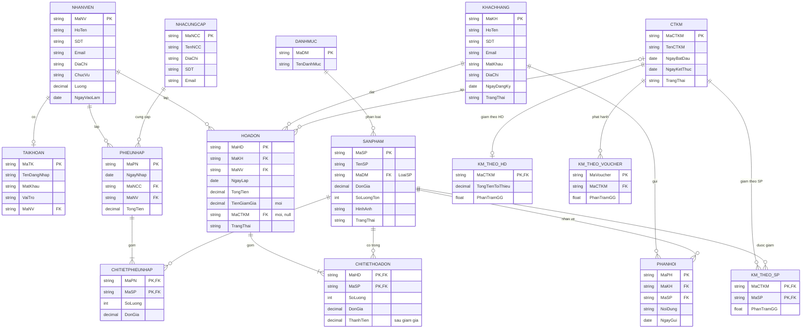

Đồ án · Hệ thống bán đồ cầu lông

# ERD vẽ lại + phần Khuyến mãi

Giữ nguyên các entity, thuộc tính và quan hệ trong bản vẽ tay. Phần mới là CTKM và 3 bảng con, nối vào SANPHAM và HOADON.

**||--o{** 1 – nhiều (0..n) **||--|{** 1 – nhiều (1..n) **||--o|** 1 – 0..1 **|o--o{** 0..1 – nhiều

## Phần khuyến mãi nối vào như thế nào

- **CTKM** là bảng cha (tên, ngày bắt đầu, ngày kết thúc). 3 bảng con đều có `MaCTKM` trỏ về nó, đúng như mũi tên đỏ bạn vẽ.
- **KM_THEO_SP** nối với **SANPHAM** qua `MaSP`. Khi bán, giá trong CHITIETHOADON được trừ % này, nên mình thêm `ThanhTien` (đúng chỗ bạn ghi "thành tiền gg").
- **KM_THEO_HD**: chỗ bạn khoanh `MaHD` và ghi "Tổng", mình hiểu là điều kiện hóa đơn đạt tổng tiền tối thiểu, nên đổi thành `TongTienToiThieu`.
- **HOADON** thêm `MaCTKM` (cho phép null) để biết hóa đơn dùng CTKM theo HĐ hoặc voucher nào, và `TienGiamGia` (chỗ bạn ghi "gg").
- Ghi chú đỏ "Loại SP" ở SANPHAM: mình giữ `MaDM`, chỉ ghi chú là loại SP. Cột "Chi tiết ĐG" mình đọc là `DonGia`.