Đồ án · Hệ thống bán đồ cầu lông

# ERD – bản chốt (khớp `database/01_CreateDatabase.sql`)

> **Chốt ngày 15/10/2026.** Từ giờ lược đồ **chỉ được THÊM bảng/cột**, **không đổi tên, không xóa cột**.
> Muốn thêm → báo SV1 (nhóm trưởng) để sửa `01_CreateDatabase.sql` + Model tương ứng trong cùng 1 PR.
> Nguồn sự thật là script SQL; file này phải luôn khớp script.

**||--o{** 1 – nhiều (0..n) · **||--|{** 1 – nhiều (1..n) · **||--o|** 1 – 0..1 · **|o--o{** 0..1 – nhiều (FK cho phép NULL)

```mermaid
erDiagram
    TAIKHOAN {
        int MaTK PK "identity"
        varchar TenDangNhap UK
        varchar MatKhau "bam BCrypt"
        varchar VaiTro "ADMIN / QUANLY / NHANVIEN"
        int MaNV FK,UK "1 NV toi da 1 TK"
        bit TrangThai "0 = bi khoa"
    }
    NHANVIEN {
        int MaNV PK "identity"
        nvarchar HoTen
        varchar SDT
        varchar Email
        nvarchar DiaChi
        nvarchar ChucVu
        decimal Luong ">= 0"
        date NgayVaoLam
    }
    NHACUNGCAP {
        int MaNCC PK "identity"
        nvarchar TenNCC
        nvarchar DiaChi
        varchar SDT
        varchar Email
    }
    DANHMUC {
        int MaDM PK "identity"
        nvarchar TenDanhMuc UK
        nvarchar MoTa
    }
    KHACHHANG {
        int MaKH PK "identity"
        nvarchar HoTen
        varchar SDT
        varchar Email UK "dung de dang nhap web"
        varchar MatKhau "bam BCrypt"
        nvarchar DiaChi
        datetime NgayDangKy
        bit TrangThai "0 = bi khoa"
    }
    SANPHAM {
        int MaSP PK "identity"
        nvarchar TenSP
        int MaDM FK "Loai SP"
        nvarchar ThuongHieu
        decimal DonGiaBan ">= 0"
        int SoLuongTon ">= 0, trigger cap nhat"
        nvarchar DonViTinh
        nvarchar HinhAnh
        nvarchar MoTa
        nvarchar TrangThai "Dang ban / ..."
    }
    PHIEUNHAP {
        int MaPN PK "identity"
        datetime NgayNhap
        int MaNCC FK
        int MaNV FK
        decimal TongTien "trigger tu tinh"
    }
    CHITIETPHIEUNHAP {
        int MaPN PK,FK
        int MaSP PK,FK
        int SoLuong "> 0"
        decimal DonGia ">= 0"
        decimal ThanhTien "cot tinh = SoLuong * DonGia"
    }
    HOADON {
        int MaHD PK "identity"
        int MaKH FK "NULL = khach vang lai mua tai quay (POS); don web chua dang nhap -> KhachHang tao theo SDT"
        int MaNV FK "NULL = khach tu dat web"
        datetime NgayLap
        nvarchar LoaiBan "Online / Tai quay"
        nvarchar HinhThucTT "COD / Online / Tien mat"
        nvarchar DiaChiGiao
        int MaCTKM FK "NULL, KM theo HD / voucher"
        decimal TienGiamGia "giam cap hoa don"
        decimal TongTien "trigger = tong ThanhTien - TienGiamGia"
        nvarchar TrangThai "5 trang thai"
    }
    CHITIETHOADON {
        int MaHD PK,FK
        int MaSP PK,FK
        int SoLuong "> 0"
        decimal DonGia ">= 0"
        decimal GiamGia "% giam theo SP"
        decimal ThanhTien "cot tinh, sau giam gia"
    }
    PHANHOI {
        int MaPH PK "identity"
        int MaKH FK
        int MaSP FK
        tinyint SoSao "1..5"
        nvarchar NoiDung
        datetime NgayGui
        nvarchar TrangThai "Hien thi / An"
    }
    CTKM {
        int MaCTKM PK "identity"
        nvarchar TenCTKM
        date NgayBatDau
        date NgayKetThuc ">= NgayBatDau"
        varchar LoaiKM "SANPHAM / HOADON / VOUCHER"
        bit TrangThai
    }
    KM_THEOSP {
        int MaCTKM PK,FK
        int MaSP PK,FK
        decimal PhanTramGG "0..100"
    }
    KM_THEOHD {
        int MaCTKM PK,FK
        decimal TongTienToiThieu PK "nhieu bac / 1 CTKM"
        decimal PhanTramGG "0..100"
    }
    KM_THEOVOUCHER {
        varchar MaVoucher PK
        int MaCTKM FK
        decimal PhanTramGG "0..100"
        int SoLuong ">= 0"
        int DaDung "0..SoLuong"
    }

    NHANVIEN   ||--o| TAIKHOAN : "co"
    NHANVIEN   ||--o{ PHIEUNHAP : "lap"
    NHACUNGCAP ||--o{ PHIEUNHAP : "cung cap"
    NHANVIEN   |o--o{ HOADON : "lap"
    KHACHHANG  |o--o{ HOADON : "dat"
    DANHMUC    ||--o{ SANPHAM : "phan loai"
    KHACHHANG  ||--o{ PHANHOI : "gui"
    SANPHAM    ||--o{ PHANHOI : "nhan ve"
    PHIEUNHAP  ||--|{ CHITIETPHIEUNHAP : "gom"
    SANPHAM    ||--o{ CHITIETPHIEUNHAP : "co trong"
    HOADON     ||--|{ CHITIETHOADON : "gom"
    SANPHAM    ||--o{ CHITIETHOADON : "co trong"

    CTKM       ||--o{ KM_THEOSP : "giam theo SP"
    SANPHAM    ||--o{ KM_THEOSP : "duoc giam"
    CTKM       ||--o{ KM_THEOHD : "cac bac muc tien"
    CTKM       ||--o{ KM_THEOVOUCHER : "phat hanh"
    CTKM       |o--o{ HOADON : "ap dung"
```

## Những điểm đã chốt so với ERD vẽ tay

| Chỗ khác | ERD vẽ tay | Bản chốt (script) | Lý do |
|---|---|---|---|
| Khóa chính | `string` | `INT IDENTITY` | đơn giản, tự tăng, join nhanh |
| KM_TheoHD – tên cột | `TongTienToiThieu` | `TongTienToiThieu` | giữ tên ERD (script đã đổi từ `MucTienHD`) |
| KM_TheoHD – số bậc | 1 CTKM – 0..1 dòng | 1 CTKM – nhiều bậc, PK `(MaCTKM, TongTienToiThieu)` | vd ≥1tr giảm 5%, ≥3tr giảm 10% |
| CTKM | không có loại | thêm `LoaiKM` (SANPHAM / HOADON / VOUCHER) | SV3 lọc theo loại |
| KM_TheoVoucher | chỉ `PhanTramGG` | thêm `SoLuong`, `DaDung` | giới hạn lượt dùng voucher |
| SanPham | `DonGia` | `DonGiaBan` + `ThuongHieu`, `MoTa`, `DonViTinh` | SV2 lọc thương hiệu, trang chi tiết |
| DanhMuc | `TenDanhMuc` | thêm `MoTa` | hiển thị trên web |
| HoaDon | `TienGiamGia`, `MaCTKM` | giữ + thêm `LoaiBan`, `HinhThucTT`, `DiaChiGiao`; `MaKH`, `MaNV` cho phép NULL | bán tại quầy (SV4) và đặt online (SV3) chung 1 bảng |
| HoaDon – trạng thái | tự do | CHECK 5 giá trị: `Chờ xác nhận → Đã xác nhận → Đang giao → Hoàn thành / Đã hủy` | trigger hủy đơn trả kho dựa vào đây |
| CTHD | `ThanhTien` | thêm `GiamGia` (%), `ThanhTien` là **cột tính** | không lệch số liệu |
| CTPN | không có | thêm `ThanhTien` là **cột tính** | |
| PhanHoi | không có sao | thêm `SoSao` (1–5), `TrangThai` | SV2 đánh giá sao, SV4 duyệt bình luận |
| TaiKhoan | không có trạng thái | thêm `TrangThai` (khóa TK), `MaNV` UNIQUE | khóa tài khoản, 1 NV – 1 TK |
| KhachHang | `TrangThai` string | `TrangThai` BIT, `Email` UNIQUE | đăng nhập web bằng email |

## Ràng buộc nghiệp vụ do trigger đảm bảo (`02_Triggers.sql`)

- Thêm `ChiTietPhieuNhap` → tăng `SanPham.SoLuongTon` và tính lại `PhieuNhap.TongTien` (chỉ AFTER INSERT – phiếu nhập đã lưu thì không sửa chi tiết).
- Thêm `ChiTietHoaDon` → trừ tồn; **không đủ tồn thì báo lỗi và rollback** (bắt `SqlException` để hiện thông báo).
- Hóa đơn chuyển sang `Đã hủy` → trả hàng về kho; đơn đã hủy **không được mở lại**.
- `HoaDon.TongTien` = tổng `ThanhTien` − `TienGiamGia`.

## Bổ sung lược đồ hiện tại — 05/11/2026

Sơ đồ nền phía trên là bản 15 bảng. Cài đủ script hiện tại có **16 bảng**: script 07 bổ sung `DanhGiaSanPham(MaDG PK, MaSP FK, MaKH FK, SoSao, NoiDung, NgayDanhGia, TrangThai)`. Quan hệ: SanPham 1–N DanhGiaSanPham và KhachHang 1–N DanhGiaSanPham. Web/Desktop dùng bảng này để gửi/duyệt đánh giá; `PhanHoi` vẫn tồn tại để giữ schema cũ.

Script 04/06 bổ sung HoaDon: LyDoHuy, MaYeuCauPOS, TienKhachDua, DauVanTayPOS và unique filtered index token khác NULL. Chi tiết kiểu/ràng buộc xem [mô tả CSDL](bao-cao/mo-ta-csdl.md). Hình ERD PNG/Word nền chưa được xuất lại trong lượt review này; cần đồng bộ trước khi ghép báo cáo cuối.
