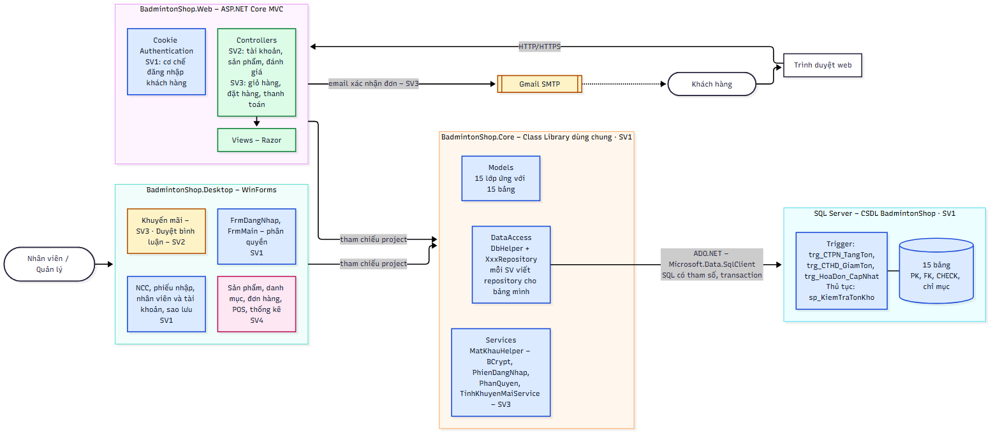
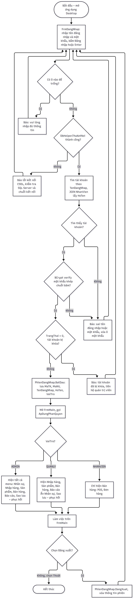
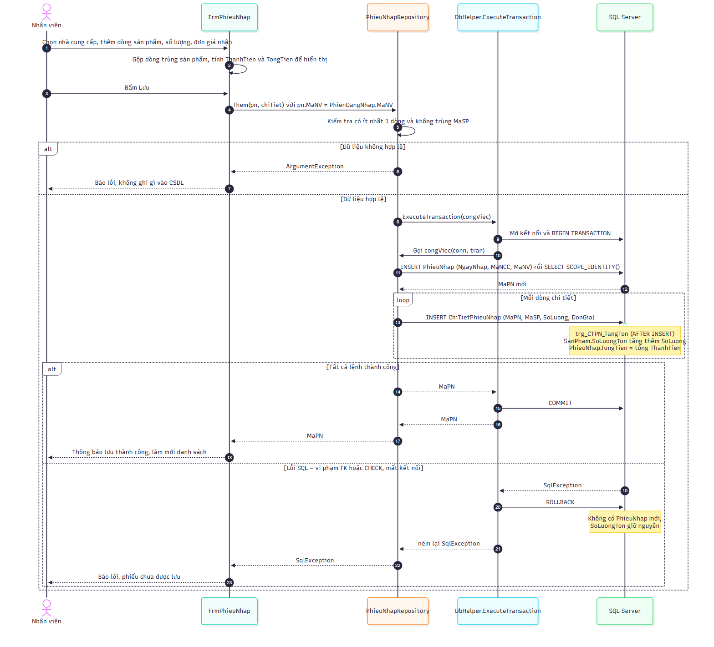
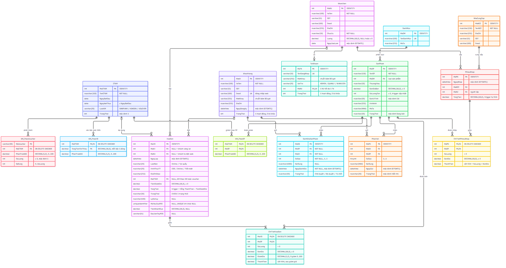
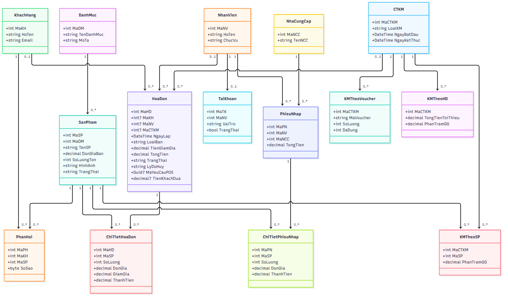
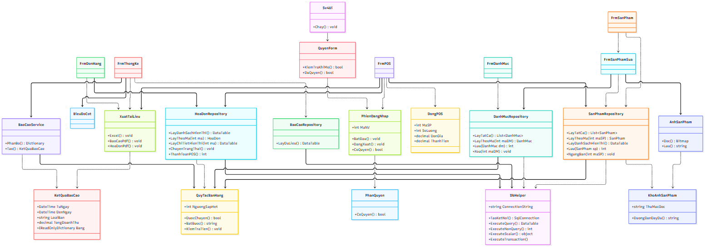
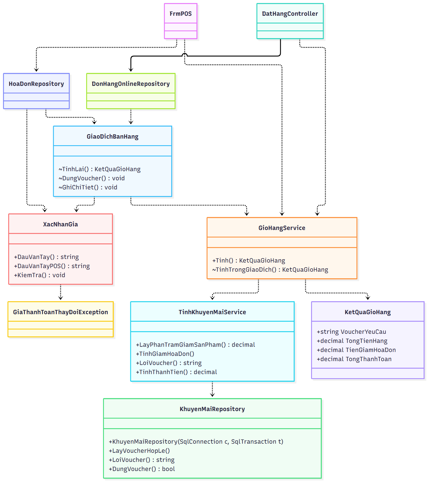

# BÁO CÁO TỔNG HỢP ĐỒ ÁN BADMINTONSHOP

<!-- Sinh tự động bởi tools/XuatBaoCao/ghep-bao-cao.js – sửa file nguồn rồi chạy lại -->

**Mục lục chương**

1. Giới thiệu

2. SRS và use case tổng quát — SV2

3. Kiến trúc hệ thống — SV1

4. Cơ sở dữ liệu — SV1

5. Thiết kế

6. Cài đặt

7. Kiểm thử

8. Hướng dẫn sử dụng

9. Tổng kết

10. Bảng tự đánh giá

11. Phụ lục đặc tả

## 1. Giới thiệu

BadmintonShop gồm Web ASP.NET Core MVC, Desktop WinForms, thư viện Core và SQL Server, sử dụng .NET 8.

TODO(SV1): Điền thông tin nhóm, giảng viên, phạm vi và mục tiêu nghiệm thu.

## 2. SRS và use case tổng quát — SV2

TODO(SV2): Cung cấp SRS và use case khách hàng đã duyệt.

## 3. Kiến trúc hệ thống — SV1

### 3.1. Tổng quan kiến trúc

Hệ thống bán đồ thể thao cầu lông BadmintonShop gồm hai ứng dụng phục vụ hai nhóm người dùng khác nhau:

- **Ứng dụng web BadmintonShop.Web** (ASP.NET Core MVC, .NET 8) dành cho khách hàng: xem và tìm kiếm sản phẩm, đăng ký và đăng nhập, giỏ hàng, đặt hàng, thanh toán, đánh giá sản phẩm.
- **Ứng dụng desktop BadmintonShop.Desktop** (Windows Forms, .NET 8) dành cho nhân viên và quản lý cửa hàng: quản lý sản phẩm, nhập hàng, xử lý đơn hàng, bán tại quầy (POS), khuyến mãi, nhân sự, thống kê và sao lưu dữ liệu.

Hai ứng dụng không truy cập cơ sở dữ liệu trực tiếp mà cùng tham chiếu một **thư viện lớp dùng chung BadmintonShop.Core**. Thư viện này chứa các lớp thực thể, lớp truy xuất dữ liệu và các dịch vụ nghiệp vụ, và là nơi duy nhất làm việc với **một cơ sở dữ liệu SQL Server**. Nhờ vậy, một đơn hàng đặt trên web sẽ hiện ngay trên màn hình quản lý đơn của desktop, và tồn kho luôn là một con số thống nhất cho cả hai phía.



### 3.2. Các thành phần của hệ thống

Bảng 3.1

| Thành phần | Công nghệ | Trách nhiệm chính | Phụ trách |
|---|---|---|---|
| BadmintonShop.Web | ASP.NET Core MVC, Razor, Cookie Authentication | Giao diện cho khách hàng; nhận yêu cầu HTTP, gọi Core, trả về trang HTML | SV2, SV3 (cơ chế đăng nhập: SV1) |
| BadmintonShop.Desktop | Windows Forms | Giao diện cho nhân viên; đăng nhập và phân quyền theo vai trò | SV1, SV4 (khuyến mãi: SV3; duyệt bình luận: SV2) |
| BadmintonShop.Core | Class Library .NET 8, ADO.NET (Microsoft.Data.SqlClient), BCrypt.Net-Next | Models, DataAccess (DbHelper và các Repository), Services (mật khẩu, phiên đăng nhập, phân quyền, khuyến mãi) | SV1 (mỗi thành viên viết Repository cho bảng mình) |
| CSDL BadmintonShop | SQL Server 2022 (máy phát triển có thể dùng LocalDB) | 15 bảng với khóa chính, khóa ngoại, CHECK, chỉ mục; trigger cập nhật tồn kho và tổng tiền | SV1 |
| Dịch vụ email | Gmail SMTP | Gửi email xác nhận đơn hàng cho khách | SV3 |

#### 3.2.1. Thư viện dùng chung BadmintonShop.Core

Thư viện được chia thành ba thư mục, ứng với ba trách nhiệm:

- **Models**: 15 lớp thực thể, mỗi lớp ứng với một bảng, tên thuộc tính trùng tên cột (ví dụ `SanPham`, `HoaDon`, `PhieuNhap`). Các lớp này chỉ chứa dữ liệu, không chứa logic.
- **DataAccess**: lớp tĩnh `DbHelper` gói việc mở kết nối, chạy câu lệnh có tham số (`ExecuteQuery`, `ExecuteNonQuery`, `ExecuteScalar`) và chạy nhiều câu lệnh trong một giao tác (`ExecuteTransaction`). Mỗi bảng có một lớp `XxxRepository` (ví dụ `NhaCungCapRepository`, `PhieuNhapRepository`) cung cấp các hàm đọc/ghi như `LayTatCa`, `LayTheoMa`, `Them`, `Sua`, `Xoa`.
- **Services**: các xử lý nghiệp vụ không gắn với một bảng cụ thể, gồm `MatKhauHelper` (băm và kiểm tra mật khẩu bằng BCrypt), `PhienDangNhap` (lưu người đang đăng nhập trên desktop), `PhanQuyen` (bảng quyền theo vai trò), `KiemTraDuLieu` (kiểm tra số điện thoại, email) và `TinhKhuyenMaiService` (tính giảm giá).

Chuỗi kết nối không viết cứng trong mã: ứng dụng đọc biến môi trường `ConnectionStrings__BadmintonShop` nếu có, nếu không thì đọc từ `appsettings.json` (web) hoặc `App.config` (desktop), rồi gán cho `DbHelper.ConnectionString` một lần khi khởi động. Mỗi máy tự đặt chuỗi kết nối của mình mà không phải sửa file trong kho mã.

### 3.3. Mô hình phân lớp

Mỗi ứng dụng được tổ chức theo mô hình nhiều lớp. Lớp trên chỉ gọi lớp ngay dưới nó:

Bảng 3.2

| Lớp | Web | Desktop | Nhiệm vụ |
|---|---|---|---|
| Giao diện | Views (Razor) + Controllers | Các Form (`FrmPhieuNhap`, `FrmNhanVien`…) | Hiển thị, nhận dữ liệu nhập, kiểm tra định dạng, báo lỗi cho người dùng |
| Nghiệp vụ | Core/Services | Core/Services | Quy tắc nghiệp vụ dùng chung: mật khẩu, phân quyền, khuyến mãi |
| Truy xuất dữ liệu | Core/DataAccess | Core/DataAccess | Câu lệnh SQL có tham số, giao tác, chuyển dòng dữ liệu thành đối tượng Model |
| Dữ liệu | SQL Server | SQL Server | Lưu trữ; ràng buộc toàn vẹn; trigger cập nhật tồn kho và tổng tiền |

Quy ước bắt buộc của nhóm: **không viết câu lệnh SQL trong Controller hay Form**. Mọi truy cập dữ liệu đi qua Repository trong Core. Khi duyệt Pull Request, nhóm trưởng kiểm tra quy ước này trước khi gộp mã.

### 3.4. Lý do tách thư viện dùng chung

- **Viết một lần, hai ứng dụng cùng dùng.** Ví dụ `SanPhamRepository.LayTheoMa` được cả trang chi tiết sản phẩm trên web lẫn màn hình POS trên desktop gọi. Sửa câu truy vấn ở một chỗ thì cả hai ứng dụng cùng được sửa.
- **Tránh lệch logic giữa hai ứng dụng.** Việc băm mật khẩu, tính khuyến mãi, lưu hóa đơn trong giao tác chỉ có một bản cài đặt. Không xảy ra tình trạng web tính giảm giá một kiểu còn desktop tính một kiểu.
- **Dễ phân công và làm song song.** Mỗi thành viên viết Repository cho các bảng mình phụ trách. Giao diện web và desktop được phát triển độc lập trên cùng một nền đã chốt từ tuần đầu.
- **Dễ kiểm thử.** Thư viện Core không phụ thuộc giao diện nên có thể kiểm thử bằng một chương trình console nhỏ chạy trên CSDL thật, không cần mở form hay trình duyệt.
- **Ràng buộc quan trọng đặt ở CSDL.** Khóa ngoại, CHECK và trigger tồn kho nằm trong SQL Server, nên dù dữ liệu đến từ ứng dụng nào cũng không thể bán quá tồn kho hay làm sai tổng tiền.

### 3.5. Một số luồng xử lý tiêu biểu

#### 3.5.1. Đăng nhập và phân quyền trên desktop

Khi mở ứng dụng desktop, `FrmDangNhap` kiểm tra kết nối CSDL trước (`DbHelper.ThuKetNoi`) để báo lỗi rõ ràng nếu máy chủ chưa chạy. Sau đó `TaiKhoanRepository.DangNhap` tìm tài khoản theo tên đăng nhập, so mật khẩu bằng BCrypt và chặn tài khoản đã bị khóa. Đăng nhập thành công thì thông tin người dùng được lưu vào `PhienDangNhap`. `FrmMain` dựa vào vai trò để ẩn hoặc hiện từng nhóm menu theo bảng dưới đây. Khi người dùng đăng xuất, phiên bị xóa và ứng dụng quay về màn hình đăng nhập.

Bảng 3.3

| Chức năng | ADMIN | QUANLY | NHANVIEN |
|---|:-:|:-:|:-:|
| Nhân viên và tài khoản | ✔ | | |
| Nhà cung cấp, phiếu nhập | ✔ | ✔ | |
| Sản phẩm, danh mục, khuyến mãi | ✔ | ✔ | |
| Đơn hàng, bán tại quầy (POS) | ✔ | ✔ | ✔ |
| Thống kê – báo cáo, duyệt bình luận | ✔ | ✔ | |
| Sao lưu – phục hồi CSDL | ✔ | | |



Trên web, khách hàng đăng nhập bằng email và mật khẩu. Hệ thống dùng **Cookie Authentication** của ASP.NET Core: sau khi đăng nhập, cookie chứa các claim `MaKH`, họ tên và email, có hạn 7 ngày và tự gia hạn khi khách còn hoạt động. Các trang cần đăng nhập (giỏ hàng, đặt hàng, hồ sơ) được đánh dấu `[Authorize]`. Ở mỗi yêu cầu, hệ thống kiểm tra lại trạng thái tài khoản, nên khách bị khóa giữa chừng sẽ bị đăng xuất ngay ở yêu cầu kế tiếp.

#### 3.5.2. Lập phiếu nhập và cập nhật tồn kho

Nhân viên chọn nhà cung cấp và thêm các dòng sản phẩm trên `FrmPhieuNhap`; thành tiền và tổng tiền được tính ngay trên form. Khi lưu, `PhieuNhapRepository.Them` ghi phiếu nhập rồi ghi từng dòng chi tiết **trong cùng một giao tác**. Mỗi lần thêm chi tiết, trigger `trg_CTPN_TangTon` tự cộng số lượng vào tồn kho của sản phẩm và tính lại tổng tiền của phiếu. Nếu bất kỳ dòng nào lỗi, toàn bộ giao tác bị hoàn tác: không có phiếu "lưu một nửa" và tồn kho giữ nguyên.



Luồng bán hàng làm theo cách tương tự nhưng theo chiều ngược lại. Trigger `trg_CTHD_GiamTon` trừ tồn kho khi thêm chi tiết hóa đơn và báo lỗi nếu không đủ hàng. Trigger `trg_HoaDon_CapNhat` trả hàng về kho khi đơn chuyển sang trạng thái "Đã hủy". Thủ tục `sp_KiemTraTonKho` cho phép kiểm tra tồn trước khi đặt hàng.

### 3.6. Bảo mật và toàn vẹn dữ liệu

- **Mật khẩu không lưu dạng thô.** Mật khẩu nhân viên và khách hàng được băm bằng BCrypt (work factor 11) trước khi lưu. Hệ thống yêu cầu mật khẩu mạnh: tối thiểu 8 ký tự, có chữ hoa, chữ thường và chữ số. Khi quản trị viên đặt lại mật khẩu, hệ thống sinh ngẫu nhiên một mật khẩu mới và chỉ hiển thị một lần.
- **Chống SQL Injection.** Mọi câu lệnh đều dùng tham số (`SqlParameter`), không ghép chuỗi dữ liệu người dùng vào câu SQL.
- **Phân quyền theo vai trò.** Có 3 vai trò ADMIN, QUANLY, NHANVIEN. Quản trị viên không thể tự khóa hoặc tự hạ quyền của chính mình, để hệ thống luôn còn người quản trị.
- **Giao tác.** Các nghiệp vụ ghi nhiều bảng (phiếu nhập và chi tiết, hóa đơn và chi tiết) chạy trong một giao tác.
- **Ràng buộc ở CSDL.** Khóa ngoại chặn xóa dữ liệu đang được tham chiếu, ví dụ không xóa được nhà cung cấp đã có phiếu nhập. CHECK chặn số lượng âm và trạng thái đơn không hợp lệ. Cột thành tiền là cột tính toán nên không thể ghi sai.
- **Sao lưu – phục hồi.** Quản trị viên sao lưu CSDL ra file `.bak` và phục hồi khi cần ngay từ ứng dụng desktop.

### 3.7. Thiết kế cơ sở dữ liệu

#### 3.7.1. Sơ đồ thực thể – liên kết (ERD)

Lược đồ nền gồm 15 bảng, chia thành 5 nhóm: nhân sự và tài khoản; danh mục, sản phẩm, nhà cung cấp, khách hàng; nhập hàng; khuyến mãi; bán hàng và phản hồi. Khóa chính đơn đều là số nguyên tự tăng (`INT IDENTITY`). Hai bảng chi tiết dùng khóa chính ghép gồm mã phiếu (hoặc mã hóa đơn) và mã sản phẩm, nên một sản phẩm chỉ xuất hiện một lần trong mỗi phiếu.



#### 3.7.2. Lược đồ quan hệ

Quy ước: khóa chính <ins>gạch chân</ins>, khóa ngoại _in nghiêng_; cột vừa là khóa chính vừa là khóa ngoại thì <ins>_gạch chân và in nghiêng_</ins>.

1. NhanVien(<ins>MaNV</ins>, HoTen, SDT, Email, DiaChi, ChucVu, Luong, NgayVaoLam)
2. TaiKhoan(<ins>MaTK</ins>, TenDangNhap, MatKhau, VaiTro, _MaNV_, TrangThai)
3. DanhMuc(<ins>MaDM</ins>, TenDanhMuc, MoTa)
4. NhaCungCap(<ins>MaNCC</ins>, TenNCC, DiaChi, SDT, Email)
5. SanPham(<ins>MaSP</ins>, TenSP, _MaDM_, ThuongHieu, DonGiaBan, SoLuongTon, DonViTinh, HinhAnh, MoTa, TrangThai)
6. KhachHang(<ins>MaKH</ins>, HoTen, SDT, Email, MatKhau, DiaChi, NgayDangKy, TrangThai)
7. PhieuNhap(<ins>MaPN</ins>, NgayNhap, _MaNCC_, _MaNV_, TongTien)
8. ChiTietPhieuNhap(<ins>_MaPN_</ins>, <ins>_MaSP_</ins>, SoLuong, DonGia, ThanhTien)
9. CTKM(<ins>MaCTKM</ins>, TenCTKM, NgayBatDau, NgayKetThuc, LoaiKM, TrangThai)
10. KM_TheoSP(<ins>_MaCTKM_</ins>, <ins>_MaSP_</ins>, PhanTramGG)
11. KM_TheoHD(<ins>_MaCTKM_</ins>, <ins>TongTienToiThieu</ins>, PhanTramGG)
12. KM_TheoVoucher(<ins>MaVoucher</ins>, _MaCTKM_, PhanTramGG, SoLuong, DaDung)
13. HoaDon(<ins>MaHD</ins>, _MaKH_, _MaNV_, NgayLap, LoaiBan, HinhThucTT, DiaChiGiao, _MaCTKM_, TienGiamGia, TongTien, TrangThai)
14. ChiTietHoaDon(<ins>_MaHD_</ins>, <ins>_MaSP_</ins>, SoLuong, DonGia, GiamGia, ThanhTien)
15. PhanHoi(<ins>MaPH</ins>, _MaKH_, _MaSP_, SoSao, NoiDung, NgayGui, TrangThai)

#### 3.7.3. Các ràng buộc khóa ngoại

Bảng 3.4

| Bảng con | Khóa ngoại | Tham chiếu | Cho phép NULL | Khi xóa bản ghi cha |
|---|---|---|:-:|---|
| TaiKhoan | MaNV (duy nhất) | NhanVien | Không | Chặn |
| SanPham | MaDM | DanhMuc | Không | Chặn |
| PhieuNhap | MaNCC | NhaCungCap | Không | Chặn |
| PhieuNhap | MaNV | NhanVien | Không | Chặn |
| ChiTietPhieuNhap | MaPN | PhieuNhap | Không | Xóa theo |
| ChiTietPhieuNhap | MaSP | SanPham | Không | Chặn |
| KM_TheoSP | MaCTKM | CTKM | Không | Xóa theo |
| KM_TheoSP | MaSP | SanPham | Không | Chặn |
| KM_TheoHD | MaCTKM | CTKM | Không | Xóa theo |
| KM_TheoVoucher | MaCTKM | CTKM | Không | Xóa theo |
| HoaDon | MaKH | KhachHang | Có (khách vãng lai tại quầy) | Chặn |
| HoaDon | MaNV | NhanVien | Có (khách tự đặt trên web) | Chặn |
| HoaDon | MaCTKM | CTKM | Có (không áp khuyến mãi hóa đơn) | Chặn |
| ChiTietHoaDon | MaHD | HoaDon | Không | Xóa theo |
| ChiTietHoaDon | MaSP | SanPham | Không | Chặn |
| PhanHoi | MaKH | KhachHang | Không | Chặn |
| PhanHoi | MaSP | SanPham | Không | Chặn |

Bảng mô tả chi tiết từng cột (kiểu dữ liệu, ràng buộc, ý nghĩa) của các bảng được trình bày ở phần Mô tả cơ sở dữ liệu.

#### 3.7.4. Bảng và cột bổ sung

Script tổng `database/BadmintonShop.sql` tạo 16 bảng: 15 bảng nền ở trên và bảng `DanhGiaSanPham` (script 07). Chức năng đánh giá trên Web và duyệt đánh giá trên Desktop dùng bảng này; bảng `PhanHoi` nền vẫn được giữ để không đổi lược đồ đã chốt.

16. DanhGiaSanPham(<ins>MaDG</ins>, _MaSP_, _MaKH_, SoSao, NoiDung, NgayDanhGia, TrangThai)

Bảng 3.5

| Bảng con | Khóa ngoại | Tham chiếu | Cho phép NULL | Khi xóa bản ghi cha |
|---|---|---|:-:|---|
| DanhGiaSanPham | MaSP | SanPham | Không | Chặn |
| DanhGiaSanPham | MaKH | KhachHang | Không | Chặn |

Bảng `HoaDon` được bổ sung bốn cột phục vụ hủy đơn và bán tại quầy (script 04, 06): `LyDoHuy`, `MaYeuCauPOS` (chỉ mục duy nhất khi khác NULL, chống ghi trùng hóa đơn), `TienKhachDua`, `DauVanTayPOS`.

## 4. Cơ sở dữ liệu — SV1

### 4.1. Quy ước

CSDL **BadmintonShop** chạy trên SQL Server. Lược đồ nền 01 có 15 bảng; cài đủ script hiện tại có 16 bảng, gồm bảng bổ sung `DanhGiaSanPham` ở 07. Các ký hiệu dùng trong cột "Ràng buộc":

- **PK**: khóa chính; **FK → Bảng**: khóa ngoại tham chiếu tới bảng đó; **UNIQUE**: giá trị không được trùng.
- **IDENTITY**: số tự tăng bắt đầu từ 1, do SQL Server tự cấp khi thêm dòng.
- **NOT NULL** / **NULL**: bắt buộc có giá trị / được bỏ trống.
- **DEFAULT**: giá trị mặc định khi không truyền vào; **CHECK**: điều kiện giá trị phải thỏa.
- **Cột tính**: giá trị do SQL Server tự tính từ các cột khác, lưu sẵn (PERSISTED), không ghi trực tiếp được.

Kiểu tiền tệ dùng `DECIMAL(18,0)` (đơn vị đồng, không có phần lẻ). Phần trăm giảm giá dùng `DECIMAL(5,2)` trong khoảng 0–100. Chuỗi tiếng Việt dùng `NVARCHAR`; chuỗi chỉ có ký tự không dấu (email, số điện thoại, tên đăng nhập, mã voucher) dùng `VARCHAR`.

### 4.2. Nhân sự và tài khoản

#### 4.2.1. Bảng NhanVien – Nhân viên

Bảng 4.1

| STT | Tên cột | Kiểu dữ liệu | Ràng buộc | Ý nghĩa |
|:-:|---|---|---|---|
| 1 | MaNV | INT | PK, IDENTITY | Mã nhân viên |
| 2 | HoTen | NVARCHAR(100) | NOT NULL | Họ tên nhân viên |
| 3 | SDT | VARCHAR(15) | NULL | Số điện thoại (ứng dụng kiểm tra 10–11 chữ số) |
| 4 | Email | VARCHAR(100) | NULL | Email liên hệ |
| 5 | DiaChi | NVARCHAR(255) | NULL | Địa chỉ |
| 6 | ChucVu | NVARCHAR(50) | NOT NULL | Chức vụ: Quản lý, Nhân viên bán hàng, Kho… |
| 7 | Luong | DECIMAL(18,0) | NULL, CHECK ≥ 0 | Lương tháng (đồng) |
| 8 | NgayVaoLam | DATE | NOT NULL, DEFAULT ngày hiện tại | Ngày bắt đầu làm việc |

#### 4.2.2. Bảng TaiKhoan – Tài khoản đăng nhập ứng dụng desktop

Bảng 4.2

| STT | Tên cột | Kiểu dữ liệu | Ràng buộc | Ý nghĩa |
|:-:|---|---|---|---|
| 1 | MaTK | INT | PK, IDENTITY | Mã tài khoản |
| 2 | TenDangNhap | VARCHAR(50) | NOT NULL, UNIQUE | Tên đăng nhập |
| 3 | MatKhau | VARCHAR(255) | NOT NULL | Chuỗi băm BCrypt của mật khẩu (không lưu mật khẩu thô) |
| 4 | VaiTro | VARCHAR(20) | NOT NULL, CHECK ∈ {ADMIN, QUANLY, NHANVIEN} | Vai trò, quyết định menu được dùng |
| 5 | MaNV | INT | FK → NhanVien, NOT NULL, UNIQUE | Nhân viên sở hữu tài khoản; mỗi nhân viên có tối đa 1 tài khoản |
| 6 | TrangThai | BIT | NOT NULL, DEFAULT 1 | 1 = đang hoạt động, 0 = bị khóa |

### 4.3. Danh mục, sản phẩm, nhà cung cấp, khách hàng

#### 4.3.1. Bảng DanhMuc – Danh mục (loại) sản phẩm

Bảng 4.3

| STT | Tên cột | Kiểu dữ liệu | Ràng buộc | Ý nghĩa |
|:-:|---|---|---|---|
| 1 | MaDM | INT | PK, IDENTITY | Mã danh mục |
| 2 | TenDanhMuc | NVARCHAR(100) | NOT NULL, UNIQUE | Tên danh mục: Vợt, Cầu, Giày, Quần áo, Phụ kiện |
| 3 | MoTa | NVARCHAR(255) | NULL | Mô tả danh mục |

#### 4.3.2. Bảng NhaCungCap – Nhà cung cấp

Bảng 4.4

| STT | Tên cột | Kiểu dữ liệu | Ràng buộc | Ý nghĩa |
|:-:|---|---|---|---|
| 1 | MaNCC | INT | PK, IDENTITY | Mã nhà cung cấp |
| 2 | TenNCC | NVARCHAR(150) | NOT NULL | Tên nhà cung cấp |
| 3 | DiaChi | NVARCHAR(255) | NULL | Địa chỉ |
| 4 | SDT | VARCHAR(15) | NULL | Số điện thoại |
| 5 | Email | VARCHAR(100) | NULL | Email liên hệ |

#### 4.3.3. Bảng SanPham – Sản phẩm

Bảng 4.5

| STT | Tên cột | Kiểu dữ liệu | Ràng buộc | Ý nghĩa |
|:-:|---|---|---|---|
| 1 | MaSP | INT | PK, IDENTITY | Mã sản phẩm |
| 2 | TenSP | NVARCHAR(150) | NOT NULL | Tên sản phẩm |
| 3 | MaDM | INT | FK → DanhMuc, NOT NULL | Danh mục của sản phẩm |
| 4 | ThuongHieu | NVARCHAR(50) | NULL | Thương hiệu: Yonex, Victor, Li-Ning… (dùng để lọc trên web) |
| 5 | DonGiaBan | DECIMAL(18,0) | NOT NULL, CHECK ≥ 0 | Giá bán hiện tại (đồng) |
| 6 | SoLuongTon | INT | NOT NULL, DEFAULT 0, CHECK ≥ 0 | Số lượng tồn kho; trigger tự tăng khi nhập, tự giảm khi bán |
| 7 | DonViTinh | NVARCHAR(20) | NOT NULL, DEFAULT 'Cái' | Đơn vị tính: Cái, Đôi, Hộp, Ống… |
| 8 | HinhAnh | NVARCHAR(255) | NULL | Đường dẫn ảnh sản phẩm |
| 9 | MoTa | NVARCHAR(MAX) | NULL | Mô tả, thông số (trọng lượng vợt 3U/4U, độ cứng, size giày…) |
| 10 | TrangThai | NVARCHAR(20) | NOT NULL, DEFAULT 'Đang bán' | Trạng thái kinh doanh: Đang bán / Ngừng bán |

#### 4.3.4. Bảng KhachHang – Khách hàng (tài khoản đăng nhập web)

Bảng 4.6

| STT | Tên cột | Kiểu dữ liệu | Ràng buộc | Ý nghĩa |
|:-:|---|---|---|---|
| 1 | MaKH | INT | PK, IDENTITY | Mã khách hàng |
| 2 | HoTen | NVARCHAR(100) | NOT NULL | Họ tên khách hàng |
| 3 | SDT | VARCHAR(15) | NULL | Số điện thoại |
| 4 | Email | VARCHAR(100) | NOT NULL, UNIQUE | Email, dùng làm tên đăng nhập web |
| 5 | MatKhau | VARCHAR(255) | NOT NULL | Chuỗi băm BCrypt của mật khẩu |
| 6 | DiaChi | NVARCHAR(255) | NULL | Địa chỉ nhận hàng mặc định |
| 7 | NgayDangKy | DATETIME | NOT NULL, DEFAULT thời điểm hiện tại | Thời điểm đăng ký tài khoản |
| 8 | TrangThai | BIT | NOT NULL, DEFAULT 1 | 1 = hoạt động, 0 = bị khóa (không đăng nhập được) |

### 4.4. Nhập hàng

#### 4.4.1. Bảng PhieuNhap – Phiếu nhập hàng

Bảng 4.7

| STT | Tên cột | Kiểu dữ liệu | Ràng buộc | Ý nghĩa |
|:-:|---|---|---|---|
| 1 | MaPN | INT | PK, IDENTITY | Số phiếu nhập |
| 2 | NgayNhap | DATETIME | NOT NULL, DEFAULT thời điểm hiện tại | Ngày giờ nhập hàng |
| 3 | MaNCC | INT | FK → NhaCungCap, NOT NULL | Nhà cung cấp hàng |
| 4 | MaNV | INT | FK → NhanVien, NOT NULL | Nhân viên lập phiếu |
| 5 | TongTien | DECIMAL(18,0) | NOT NULL, DEFAULT 0 | Tổng tiền phiếu; trigger tự tính bằng tổng thành tiền các dòng chi tiết |

#### 4.4.2. Bảng ChiTietPhieuNhap – Chi tiết phiếu nhập

Bảng 4.8

| STT | Tên cột | Kiểu dữ liệu | Ràng buộc | Ý nghĩa |
|:-:|---|---|---|---|
| 1 | MaPN | INT | PK, FK → PhieuNhap (xóa phiếu thì xóa theo) | Phiếu nhập chứa dòng này |
| 2 | MaSP | INT | PK, FK → SanPham | Sản phẩm được nhập (mỗi sản phẩm 1 dòng trong 1 phiếu) |
| 3 | SoLuong | INT | NOT NULL, CHECK > 0 | Số lượng nhập |
| 4 | DonGia | DECIMAL(18,0) | NOT NULL, CHECK ≥ 0 | Đơn giá nhập (đồng) |
| 5 | ThanhTien | DECIMAL(29,0) | Cột tính = SoLuong × DonGia | Thành tiền của dòng |

### 4.5. Khuyến mãi

#### 4.5.1. Bảng CTKM – Chương trình khuyến mãi

Bảng 4.9

| STT | Tên cột | Kiểu dữ liệu | Ràng buộc | Ý nghĩa |
|:-:|---|---|---|---|
| 1 | MaCTKM | INT | PK, IDENTITY | Mã chương trình khuyến mãi |
| 2 | TenCTKM | NVARCHAR(150) | NOT NULL | Tên chương trình |
| 3 | NgayBatDau | DATE | NOT NULL | Ngày bắt đầu áp dụng |
| 4 | NgayKetThuc | DATE | NOT NULL, CHECK ≥ NgayBatDau | Ngày kết thúc áp dụng |
| 5 | LoaiKM | VARCHAR(20) | NOT NULL, CHECK ∈ {SANPHAM, HOADON, VOUCHER} | Kiểu khuyến mãi, cho biết chi tiết nằm ở bảng KM_TheoSP, KM_TheoHD hay KM_TheoVoucher |
| 6 | TrangThai | BIT | NOT NULL, DEFAULT 1 | 1 = đang bật, 0 = tạm tắt |

#### 4.5.2. Bảng KM_TheoSP – Khuyến mãi theo sản phẩm

Bảng 4.10

| STT | Tên cột | Kiểu dữ liệu | Ràng buộc | Ý nghĩa |
|:-:|---|---|---|---|
| 1 | MaCTKM | INT | PK, FK → CTKM (xóa CTKM thì xóa theo) | Chương trình khuyến mãi |
| 2 | MaSP | INT | PK, FK → SanPham | Sản phẩm được giảm giá |
| 3 | PhanTramGG | DECIMAL(5,2) | NOT NULL, CHECK 0–100 | Phần trăm giảm cho sản phẩm |

#### 4.5.3. Bảng KM_TheoHD – Khuyến mãi theo giá trị hóa đơn

Bảng 4.11

| STT | Tên cột | Kiểu dữ liệu | Ràng buộc | Ý nghĩa |
|:-:|---|---|---|---|
| 1 | MaCTKM | INT | PK, FK → CTKM (xóa CTKM thì xóa theo) | Chương trình khuyến mãi |
| 2 | TongTienToiThieu | DECIMAL(18,0) | PK, CHECK ≥ 0 | Mức tổng tiền hóa đơn tối thiểu để được giảm; một chương trình có thể có nhiều bậc |
| 3 | PhanTramGG | DECIMAL(5,2) | NOT NULL, CHECK 0–100 | Phần trăm giảm khi đạt mức tiền |

#### 4.5.4. Bảng KM_TheoVoucher – Khuyến mãi theo mã voucher

Bảng 4.12

| STT | Tên cột | Kiểu dữ liệu | Ràng buộc | Ý nghĩa |
|:-:|---|---|---|---|
| 1 | MaVoucher | VARCHAR(30) | PK | Mã voucher khách nhập khi đặt hàng |
| 2 | MaCTKM | INT | FK → CTKM (xóa CTKM thì xóa theo), NOT NULL | Chương trình phát hành voucher |
| 3 | PhanTramGG | DECIMAL(5,2) | NOT NULL, CHECK 0–100 | Phần trăm giảm trên hóa đơn |
| 4 | SoLuong | INT | NOT NULL, DEFAULT 1, CHECK ≥ 0 | Tổng số lượt được dùng |
| 5 | DaDung | INT | NOT NULL, DEFAULT 0, CHECK 0 ≤ DaDung ≤ SoLuong | Số lượt đã dùng |

### 4.6. Bán hàng và phản hồi

#### 4.6.1. Bảng HoaDon – Hóa đơn (đơn hàng web và hóa đơn bán tại quầy)

Bảng 4.13

| STT | Tên cột | Kiểu dữ liệu | Ràng buộc | Ý nghĩa |
|:-:|---|---|---|---|
| 1 | MaHD | INT | PK, IDENTITY | Mã hóa đơn |
| 2 | MaKH | INT | FK → KhachHang, NULL | Khách mua; NULL khi bán tại quầy cho khách vãng lai |
| 3 | MaNV | INT | FK → NhanVien, NULL | Nhân viên lập/xử lý; NULL khi khách tự đặt trên web |
| 4 | NgayLap | DATETIME | NOT NULL, DEFAULT thời điểm hiện tại | Thời điểm lập hóa đơn |
| 5 | LoaiBan | NVARCHAR(20) | NOT NULL, DEFAULT 'Online' | Kênh bán: Online / Tại quầy |
| 6 | HinhThucTT | NVARCHAR(20) | NOT NULL, DEFAULT 'COD' | Hình thức thanh toán: COD / Online / Tiền mặt |
| 7 | DiaChiGiao | NVARCHAR(255) | NULL | Địa chỉ giao hàng (đơn web) |
| 8 | MaCTKM | INT | FK → CTKM, NULL | Khuyến mãi cấp hóa đơn (theo hóa đơn hoặc voucher) đã áp dụng |
| 9 | TienGiamGia | DECIMAL(18,0) | NOT NULL, DEFAULT 0, CHECK ≥ 0 | Số tiền giảm ở cấp hóa đơn |
| 10 | TongTien | DECIMAL(18,0) | NOT NULL, DEFAULT 0 | Tổng phải trả; trigger tự tính = tổng thành tiền chi tiết − TienGiamGia |
| 11 | TrangThai | NVARCHAR(30) | NOT NULL, DEFAULT 'Chờ xác nhận', CHECK ∈ {Chờ xác nhận, Đã xác nhận, Đang giao, Hoàn thành, Đã hủy} | Trạng thái đơn; chuyển sang "Đã hủy" thì trigger trả hàng về kho |

#### 4.6.2. Bảng ChiTietHoaDon – Chi tiết hóa đơn

Bảng 4.14

| STT | Tên cột | Kiểu dữ liệu | Ràng buộc | Ý nghĩa |
|:-:|---|---|---|---|
| 1 | MaHD | INT | PK, FK → HoaDon (xóa hóa đơn thì xóa theo) | Hóa đơn chứa dòng này |
| 2 | MaSP | INT | PK, FK → SanPham | Sản phẩm bán |
| 3 | SoLuong | INT | NOT NULL, CHECK > 0 | Số lượng mua; trigger chặn nếu vượt tồn kho |
| 4 | DonGia | DECIMAL(18,0) | NOT NULL, CHECK ≥ 0 | Đơn giá bán tại thời điểm mua |
| 5 | GiamGia | DECIMAL(5,2) | NOT NULL, DEFAULT 0, CHECK 0–100 | Phần trăm giảm theo sản phẩm (từ KM_TheoSP) |
| 6 | ThanhTien | DECIMAL(18,0) | Cột tính = SoLuong × DonGia × (1 − GiamGia/100) | Thành tiền của dòng sau giảm |

#### 4.6.3. Bảng PhanHoi – Đánh giá, bình luận sản phẩm

Bảng 4.15

| STT | Tên cột | Kiểu dữ liệu | Ràng buộc | Ý nghĩa |
|:-:|---|---|---|---|
| 1 | MaPH | INT | PK, IDENTITY | Mã phản hồi |
| 2 | MaKH | INT | FK → KhachHang, NOT NULL | Khách viết đánh giá |
| 3 | MaSP | INT | FK → SanPham, NOT NULL | Sản phẩm được đánh giá |
| 4 | SoSao | TINYINT | NOT NULL, CHECK 1–5 | Số sao |
| 5 | NoiDung | NVARCHAR(MAX) | NULL | Nội dung bình luận |
| 6 | NgayGui | DATETIME | NOT NULL, DEFAULT thời điểm hiện tại | Thời điểm gửi |
| 7 | TrangThai | NVARCHAR(20) | NOT NULL, DEFAULT 'Hiển thị' | Trạng thái duyệt: Hiển thị / Ẩn (nhân viên duyệt trên desktop) |

### 4.7. Chỉ mục, trigger và thủ tục

Ngoài chỉ mục tự tạo cho khóa chính và UNIQUE, CSDL có thêm các chỉ mục phục vụ truy vấn thường dùng:

Bảng 4.16

| Chỉ mục | Bảng (cột) | Phục vụ |
|---|---|---|
| IX_SanPham_DanhMuc | SanPham(MaDM) | Lọc sản phẩm theo danh mục |
| IX_HoaDon_NgayLap | HoaDon(NgayLap) | Thống kê doanh thu theo ngày/tháng |
| IX_HoaDon_KH | HoaDon(MaKH) | Lịch sử mua hàng của khách |
| IX_PhieuNhap_Ngay | PhieuNhap(NgayNhap) | Lọc phiếu nhập theo khoảng ngày |
| IX_PhanHoi_SP | PhanHoi(MaSP) | Hiện đánh giá trên trang chi tiết sản phẩm |

Bảng 4.17

| Đối tượng | Loại | Chức năng |
|---|---|---|
| trg_CTPN_TangTon | Trigger trên ChiTietPhieuNhap | Thêm chi tiết phiếu nhập thì cộng tồn kho sản phẩm và tính lại TongTien của phiếu |
| trg_CTHD_GiamTon | Trigger trên ChiTietHoaDon | Thêm chi tiết hóa đơn thì trừ tồn kho; không đủ hàng thì báo lỗi và hủy giao tác; tính lại TongTien hóa đơn |
| trg_HoaDon_CapNhat | Trigger trên HoaDon | Hóa đơn chuyển sang "Đã hủy" thì trả hàng về kho; không cho mở lại đơn đã hủy; đổi TienGiamGia thì tính lại TongTien |
| sp_KiemTraTonKho | Thủ tục | Kiểm tra một sản phẩm còn đủ số lượng để bán hay không (dùng trước khi đặt hàng) |

### 4.8. Bảng và cột bổ sung

Ngoài 15 bảng nền ở trên, script tổng có thêm bảng `DanhGiaSanPham` (tổng cộng 16 bảng). Chức năng đánh giá dùng bảng này; bảng `PhanHoi` nền vẫn được giữ.

#### 4.8.1. Bảng DanhGiaSanPham – Đánh giá sản phẩm (script 07)

Bảng 4.18

| Cột | Kiểu | Ràng buộc / ý nghĩa |
|---|---|---|
| MaDG | INT | PK, IDENTITY |
| MaSP | INT | NOT NULL, FK → SanPham |
| MaKH | INT | NOT NULL, FK → KhachHang |
| SoSao | INT | NOT NULL, CHECK 1–5 |
| NoiDung | NVARCHAR(1000) | NULL |
| NgayDanhGia | DATETIME | NOT NULL, DEFAULT GETDATE() |
| TrangThai | NVARCHAR(20) | NOT NULL, mặc định Chờ duyệt; CHECK Chờ duyệt / Đã duyệt / Từ chối |

Chỉ mục `IX_DanhGiaSanPham_SP(MaSP, TrangThai)` hỗ trợ đọc đánh giá theo sản phẩm và trạng thái.

#### 4.8.2. Cột bổ sung của bảng HoaDon (script 04, 06)

Bảng 4.19

| Cột | Kiểu | Ý nghĩa |
|---|---|---|
| LyDoHuy | NVARCHAR(500) NULL | Lý do nhân viên hủy đơn |
| MaYeuCauPOS | UNIQUEIDENTIFIER NULL | Token chống ghi trùng POS |
| TienKhachDua | DECIMAL(18,0) NULL | Số tiền nhận tại quầy |
| DauVanTayPOS | VARCHAR(64) NULL | SHA-256 yêu cầu POS đã xác nhận |

Unique filtered index `UX_HoaDon_MaYeuCauPOS` áp dụng khi MaYeuCauPOS khác NULL. Các cột bổ sung không thay đổi lược đồ nền.

### 4.9. Kiểm chứng dữ liệu mẫu

Chạy `database/BadmintonShop.sql` trên CSDL trống ngày 12/11/2026: 16 bảng, 3 trigger, 1 thủ tục, 40 sản phẩm, 23 khách hàng, 5 nhân viên, 11 phiếu nhập, 28 hóa đơn Online, 4 CTKM, 34 đánh giá, không sản phẩm nào tồn kho âm. Hóa đơn trải 5 tháng 06–10/2026.

TODO(SV3): Phối hợp SV4 bổ sung hóa đơn trải 6–12 tháng.

TODO(SV4): Bổ sung hóa đơn tại quầy vào dữ liệu nộp.

## 5. Thiết kế

### 5.1. Sequence và activity đặt hàng — SV3

TODO(SV3): Cung cấp sequence đặt hàng/thanh toán và activity xử lý đơn.

### 5.2. Class diagram — SV4

#### 5.2.1. Các thực thể Core



Các model là POCO 1–1 với bảng, **không có navigation property/ORM**; các mũi tên trên là FK nghiệp vụ. ChiTietHoaDon.ThanhTien và ChiTietPhieuNhap.ThanhTien chỉ đọc về từ cột tính; HoaDon.TongTien và PhieuNhap.TongTien do trigger tính. CSDL cho phép hóa đơn chưa có chi tiết ở cấp lược đồ; thao tác ghi phải bảo đảm không để header rỗng sau lỗi.

#### 5.2.2. Repository, dịch vụ và giao diện



Tất cả form SV4 gọi QuyenForm ở OnLoad và dùng Sv4Ui khi thực hiện thao tác CSDL; lược bỏ các cạnh lặp để dễ đọc. Các lớp NhaCungCapRepository, NhanVienRepository, TaiKhoanRepository, KhachHangRepository, PhieuNhapRepository, SaoLuuRepository (SV1) cũng truy cập DbHelper và model tương ứng; không bị thay thế bởi SV4.

Dịch vụ Core hiện có khác: MatKhauHelper, KiemTraDuLieu, LoiCsdl, VaiTro, ChucNang, KetQuaDangNhap. `TinhKhuyenMaiService` và `GioHangService` đã tính khuyến mãi thật dùng chung Web/POS; không còn service khung. Cột SQL `HoaDon.DauVanTayPOS` do repository ghi/đọc trực tiếp, chưa thêm property vào POCO HoaDon. `XuatTaiLieu`, `AnhSanPham`, `QuyenForm`, `BieuDoCot` nằm ở Desktop do phụ thuộc WinForms/GDI, không đưa vào Core đa nền tảng.

#### 5.2.3. Luồng thanh toán cuối cùng



GiaoDichBanHang internal chia sẻ điều kiện ghi, không thay ranh giới quyền: POS dùng MaNV/QuyenForm; web dùng Authorize/MaKH chủ đơn. KhuyenMaiRepository gắn connection/transaction để không đọc giá qua kết nối khác khi thanh toán. Trigger SV1 là nơi duy nhất sửa tồn và TongTien; không biểu diễn trigger như class C#.

### 5.3. Sequence lập phiếu nhập — SV1

Nhân viên lập phiếu nhập trên `FrmPhieuNhap`; form tự tính thành tiền/tổng tiền để xem trước, rồi gọi `PhieuNhapRepository.Them`.
Repository ghi `PhieuNhap` và từng dòng `ChiTietPhieuNhap` trong **một transaction** thông qua `DbHelper.ExecuteTransaction`.
Code **không tự cộng tồn kho**: mỗi lần INSERT chi tiết, trigger `trg_CTPN_TangTon` tăng `SanPham.SoLuongTon` và tính lại `PhieuNhap.TongTien`.
Có lỗi ở bất kỳ bước nào thì toàn bộ bị rollback – không có phiếu "nửa vời", tồn kho giữ nguyên.


### 5.4. Activity đăng nhập Desktop — SV1

Nhân viên nhập tên đăng nhập và mật khẩu trên `FrmDangNhap`. Form kiểm tra ô trống, thử kết nối CSDL (`DbHelper.ThuKetNoi`), rồi gọi `TaiKhoanRepository.DangNhap`.
Mật khẩu được so bằng **BCrypt** với chuỗi băm trong CSDL; mật khẩu được kiểm **trước** trạng thái khóa để người nhập sai không dò được tài khoản nào đang bị khóa.
Đăng nhập thành công thì thông tin được lưu vào `PhienDangNhap`, mở `FrmMain` và `ApDungPhanQuyen()` ẩn/hiện menu theo vai trò (bảng quyền nằm trong `PhanQuyen.cs`).


**Bảng phân quyền áp dụng** (`Core/Services/PhanQuyen.cs`)

Bảng 5.1

| Nhóm chức năng (menu) | ADMIN | QUANLY | NHANVIEN |
|---|:-:|:-:|:-:|
| Nhân viên & tài khoản | ✔ | | |
| Nhà cung cấp, phiếu nhập | ✔ | ✔ | |
| Sản phẩm, danh mục, khuyến mãi | ✔ | ✔ | |
| Đơn hàng, POS | ✔ | ✔ | ✔ |
| Thống kê – báo cáo, duyệt bình luận | ✔ | ✔ | |
| Sao lưu – phục hồi CSDL | ✔ | | |

## 6. Cài đặt

Tài liệu dành cho: thành viên nhóm cài môi trường lập trình, giảng viên chạy thử chương trình, và làm phần "Hướng dẫn cài đặt" của báo cáo.

### 6.1. Yêu cầu hệ thống

Bảng 6.1

| Thành phần | Yêu cầu | Ghi chú |
|---|---|---|
| Hệ điều hành | Windows 10/11 64-bit | Ứng dụng desktop (WinForms) chỉ chạy trên Windows |
| Phần cứng | CPU 4 nhân, RAM ≥ 8 GB, ổ đĩa trống ≥ 15 GB | SQL Server và Visual Studio khá nặng |
| .NET | .NET 8 SDK (hoặc SDK mới hơn) và .NET 8 Runtime | Có sẵn khi cài Visual Studio 2022; SDK 9/10 vẫn build được project .NET 8 |
| IDE | Visual Studio 2022 (17.8 trở lên), bản Community | Workload ASP.NET and web development + .NET desktop development |
| CSDL | SQL Server Express/Developer + SSMS | Máy đóng gói dùng `.\SQLEXPRESS`, phiên bản 17.x. Cài từ SQL tổng cho máy SQL Server cũ hơn; restore .bak cần phiên bản tương thích |
| Git | 2.40 trở lên | Chỉ cần cho thành viên nhóm |
| Node.js | 18 trở lên (không bắt buộc) | Chỉ cần khi xuất lại tài liệu Word trong `docs/bao-cao` |
| Trình duyệt | Chrome hoặc Edge bản mới | Để dùng ứng dụng web |

### 6.2. Cài đặt phần mềm nền

#### 6.2.1. Visual Studio 2022

- Tải Visual Studio 2022 Community tại visualstudio.microsoft.com.
- Trong Visual Studio Installer, chọn 2 workload **ASP.NET and web development** và **.NET desktop development**.
- Cài xong, mở Command Prompt, gõ `dotnet --list-sdks` và `dotnet --list-runtimes`. Phải có một SDK bản 8 trở lên và runtime `Microsoft.NETCore.App 8.x`, `Microsoft.WindowsDesktop.App 8.x`, `Microsoft.AspNetCore.App 8.x`.

#### 6.2.2. SQL Server

Chọn một trong hai cách:

- **Cách 1 – SQL Server Express/Developer** (máy đóng gói dùng `.\SQLEXPRESS`): tải tại microsoft.com/sql-server/sql-server-downloads. Ở bước Database Engine Configuration, chọn Mixed Mode và Add Current User. Ghi lại **tên server**: thường là `localhost` (Developer, kiểu Basic) hoặc `.\SQLEXPRESS` (Express). Sau đó cài thêm SQL Server Management Studio (SSMS).
- **Cách 2 – LocalDB** (nhẹ, có sẵn khi cài Visual Studio): tên server là `(localdb)\MSSQLLocalDB`. Kiểm tra bằng lệnh `sqllocaldb info`, nếu thấy `MSSQLLocalDB` là dùng được.

Sai tên server là lỗi kết nối hay gặp nhất khi chạy trên máy khác.

#### 6.2.3. Git

Cài Git tại git-scm.com (giữ mặc định), rồi khai báo tên và email:

```
git config --global user.name "Ho Ten"
git config --global user.email "email@gmail.com"
```

### 6.3. Lấy mã nguồn

**Thành viên nhóm:**

```
cd D:\
git clone https://github.com/kutin2005gl/BadmintonShop.git
cd BadmintonShop
git checkout develop
```

**Giảng viên / máy chấm:** giải nén file nộp bài vào `D:\BadmintonShop`, mở `BadmintonShop.sln` bằng Visual Studio 2022.

Cấu trúc thư mục:

```
BadmintonShop\
├── BadmintonShop.sln
├── BadmintonShop.Core\       Thư viện dùng chung (SV1)
│   ├── Models\               Models cho lược đồ nền và bảng đánh giá bổ sung
│   ├── DataAccess\           DbHelper + các XxxRepository
│   └── Services\             MatKhauHelper, PhienDangNhap, PhanQuyen...
├── BadmintonShop.Web\        Web khách hàng – ASP.NET Core MVC (SV2, SV3)
│   └── appsettings.json      cấu hình web, máy dùng biến môi trường User
├── BadmintonShop.Desktop\    Desktop quản lý – WinForms (SV1, SV4)
│   └── App.config            cấu hình desktop, máy dùng biến môi trường User
├── database\
│   ├── BadmintonShop.sql     file tổng = 01 + 02 + 03 + 04 + 06 + 07 + 08
│   ├── 01_CreateDatabase.sql tạo CSDL, 15 bảng, khóa, ràng buộc, chỉ mục
│   ├── 02_Triggers.sql       trigger tồn kho, tổng tiền + thủ tục
│   ├── 03_SampleData.sql     dữ liệu mẫu + tài khoản test
│   └── 08_SV1_KhachHangHaNoi.sql 08: 3 khách hàng Hà Nội + 4 hóa đơn để demo tìm kiếm nâng cao (chứa ... OR ...)
├── tools\
│   ├── HashTool\             tạo chuỗi băm BCrypt cho mật khẩu mẫu
│   └── XuatBaoCao\           xuất tài liệu Markdown sang Word
└── docs\                     ERD, sơ đồ, chương báo cáo
```

### 6.4. Tạo cơ sở dữ liệu

Cách nhanh nhất: chạy **một file duy nhất** `database\BadmintonShop.sql` – bản nối sẵn của 01 → 02 → 03 → 04 → 06 → 07 → 08, dùng trên máy chưa có CSDL. Muốn chạy từng phần thì chạy đủ bảy script này **theo đúng thứ tự**. File 05 chỉ dành cho DB test/demo riêng, không thuộc chuỗi cài đặt thông thường.

Chú ý, file tổng và file 01 **xóa và tạo lại** CSDL `BadmintonShop` nếu đã có. Chạy các lệnh cài mới dưới đây trên máy chưa có CSDL cùng tên. Trên máy đang sử dụng, tạo bản script đổi tên CSDL theo mục 4.4 để kiểm tra trong CSDL riêng, rồi áp dụng migration sau khi đã rà soát.

#### 6.4.1. Cách 1 – bằng SSMS

Mở SSMS, kết nối tới `.\SQLEXPRESS` hoặc instance của máy cài mới, mở file `database\BadmintonShop.sql` (File → Open → File…) và bấm Execute (F5). Nếu chạy từng phần thì mở và Execute lần lượt 01, 02, 03, 04, 06, 07, 08.

#### 6.4.2. Cách 2 – bằng dòng lệnh sqlcmd

Mở Command Prompt tại thư mục `BadmintonShop`. Các lệnh dưới đây dùng instance `.\SQLEXPRESS`, thay tên instance theo máy cài đặt khi cần.

```
sqlcmd -S ".\SQLEXPRESS" -E -I -b -f 65001 -i database\BadmintonShop.sql
```

Hoặc chạy từng phần:

```
sqlcmd -S ".\SQLEXPRESS" -E -I -b -f 65001 -i database\01_CreateDatabase.sql
sqlcmd -S ".\SQLEXPRESS" -E -I -b -f 65001 -i database\02_Triggers.sql
sqlcmd -S ".\SQLEXPRESS" -E -I -b -f 65001 -i database\03_SampleData.sql
sqlcmd -S ".\SQLEXPRESS" -E -I -b -f 65001 -i database\04_SV4_Migration.sql
sqlcmd -S ".\SQLEXPRESS" -E -I -b -f 65001 -i database\06_SV4_POS_Request.sql
sqlcmd -S ".\SQLEXPRESS" -E -I -b -f 65001 -i database\07_SV2_DanhGiaSanPham.sql
sqlcmd -S ".\SQLEXPRESS" -E -I -b -f 65001 -i database\08_SV1_KhachHangHaNoi.sql
```

Ý nghĩa các tham số: `-E` đăng nhập bằng tài khoản Windows; `-I` **bắt buộc** (bật QUOTED_IDENTIFIER, nếu thiếu sẽ lỗi khi tạo chỉ mục/cột tính); `-b` dừng ngay khi có lỗi; `-f 65001` đọc file UTF-8 để tiếng Việt không bị lỗi font.

#### 6.4.3. Kiểm tra

Chạy câu lệnh sau, trên CSDL mới cài đủ script của repo phải có 16 bảng người dùng (15 bảng nền + DanhGiaSanPham). Tồn kho phải không âm; số sản phẩm còn hàng không bắt buộc bằng toàn bộ sản phẩm sau khi đã sử dụng hệ thống:

```
USE BadmintonShop;
SELECT COUNT(*) FROM sys.tables WHERE is_ms_shipped = 0; -- 16 trên DB mới
SELECT COUNT(*) FROM SanPham WHERE SoLuongTon < 0;    -- phải = 0
SELECT COUNT(*) FROM PhieuNhap WHERE TongTien > 0;    -- = số phiếu nhập
```

Mật khẩu trong dữ liệu mẫu đã được băm BCrypt sẵn. Khi cần tạo chuỗi băm cho mật khẩu mới (ví dụ thêm tài khoản mẫu), chạy `dotnet run --project tools/HashTool -- MatKhau@123` rồi chép chuỗi in ra vào script.

#### 6.4.4. Kiểm tra script trên CSDL tạm

Trong PowerShell tại gốc repo, tạo bản script chỉ đổi tên CSDL, giữ nguyên dữ liệu mẫu.

```powershell
$sqlDemo = Get-Content -Encoding UTF8 database/BadmintonShop.sql -Raw
$sqlDemo = [regex]::Replace($sqlDemo, '\bBadmintonShop\b', 'BadmintonShop_GptTmp')
[IO.File]::WriteAllText("$env:TEMP\BadmintonShop_GptTmp.sql", $sqlDemo)
sqlcmd -S ".\SQLEXPRESS" -E -I -b -f 65001 -i "$env:TEMP\BadmintonShop_GptTmp.sql"
```

Trước khi chạy, kiểm tra tên `BadmintonShop_GptTmp` chưa được ai sử dụng vì bản script cũng có DROP/CREATE cho tên đã thay. Kiểm chứng ngày 12/11/2026 trên CSDL tạm cho kết quả 16 bảng, 3 trigger, 1 thủ tục, 40 sản phẩm, 23 khách hàng, 5 nhân viên, 11 phiếu nhập, 28 hóa đơn Online, 4 CTKM, 34 đánh giá trong `DanhGiaSanPham`, 0 sản phẩm tồn kho âm. `kh01@gmail.com` hoạt động, `kh20@gmail.com` bị khóa. Hóa đơn từ 22/06 đến 20/10/2026, gồm 5 tháng có dữ liệu.

TODO(SV3): Phối hợp SV4 bổ sung hóa đơn trải 6–12 tháng theo tiêu chí dữ liệu nộp.

TODO(SV4): Bổ sung hóa đơn tại quầy vào dữ liệu nộp và kiểm tra lại phân bố tháng.

### 6.5. Cấu hình chuỗi kết nối

Hai ứng dụng đọc chuỗi kết nối tên **BadmintonShop** theo thứ tự ưu tiên:

1. Biến môi trường `ConnectionStrings__BadmintonShop` (nếu có).
2. File cấu hình: `BadmintonShop.Web\appsettings.json` cho web và `BadmintonShop.Desktop\App.config` cho desktop.

Mặc định 2 file cấu hình trỏ tới `Server=localhost`. Nếu máy dùng tên server khác, nên dùng **biến môi trường**: đặt một lần cho cả hai ứng dụng và không phải sửa file trong kho mã. Nhờ vậy các thành viên không ghi đè cấu hình của nhau khi commit.

#### 6.5.1. Đặt biến môi trường User

Mở **Edit environment variables for your account** trong Windows. Tại **User variables**, tạo biến `ConnectionStrings__BadmintonShop` với giá trị kết nối của máy. Các thành phần cho Windows Authentication được điền theo bảng sau, giá trị hoàn chỉnh được lưu tại máy cài đặt.

Bảng 6.2

| Thành phần | Giá trị trên máy dùng SQLEXPRESS |
|---|---|
| Server | .\SQLEXPRESS |
| Database | BadmintonShop hoặc tên CSDL demo riêng |
| Trusted_Connection | True |
| TrustServerCertificate | True |

Đóng và mở lại Visual Studio hoặc terminal sau khi đặt biến.

#### 6.5.2. Cấu hình riêng cho máy đóng gói

Máy hiện tại lấy cấu hình từ biến môi trường **User** `ConnectionStrings__BadmintonShop`. Để terminal đang mở nhận giá trị đã lưu, dùng PowerShell.

```powershell
$env:ConnectionStrings__BadmintonShop = [Environment]::GetEnvironmentVariable(
    'ConnectionStrings__BadmintonShop', 'User')
```

Giá trị thực và thông tin đăng nhập CSDL được quản lý ngoài kho mã. Với bản publish, đặt biến môi trường cho tài khoản Windows chạy ứng dụng, rồi mở lại tiến trình. Giữ file `BadmintonShop.Desktop.dll.config` cạnh DLL của desktop.

Hai ứng dụng có thể dùng `BadmintonShop__MediaRoot` trỏ đến thư mục ảnh dùng chung. Khi cài bản publish trên máy khác, chép thư mục ảnh và đặt cùng thư mục gốc cho Web, Desktop để các khóa `products/...` tìm đúng file.

### 6.6. Build và chạy chương trình

#### 6.6.1. Bằng Visual Studio

- Mở `BadmintonShop.sln`, chờ Visual Studio tự khôi phục các gói NuGet.
- Build → Build Solution (Ctrl + Shift + B): các project phải build thành công, gồm bộ kiểm tra SV4 đang có trong solution.
- Chạy web: chuột phải `BadmintonShop.Web` → Set as Startup Project → F5. Chọn profile `http` để mở http://localhost:5255 hoặc profile `https` để mở https://localhost:7150.
- Chạy desktop: chuột phải `BadmintonShop.Desktop` → Set as Startup Project → F5. Màn hình đăng nhập hiện ra.
- Chạy cả hai cùng lúc (demo đặt hàng trên web rồi xử lý trên desktop): chuột phải Solution → Properties → Startup Project → Multiple startup projects → đặt Web và Desktop là Start.

#### 6.6.2. Bằng dòng lệnh

```
dotnet build BadmintonShop.sln
dotnet run --project BadmintonShop.Web --launch-profile http
:: mở cửa sổ khác
dotnet run --project BadmintonShop.Desktop
```

#### 6.6.3. Tài khoản test

Bảng 6.3

| Ứng dụng | Tài khoản | Mật khẩu | Dùng để demo |
|---|---|---|---|
| Desktop | admin | Admin@123 | Toàn quyền: nhân viên và tài khoản, sao lưu, mọi chức năng |
| Desktop | quanly | Quanly@123 | Sản phẩm, nhà cung cấp, phiếu nhập, đơn hàng, báo cáo |
| Desktop | kho | Quanly@123 | Vai trò Quản lý (nhân viên kho) |
| Desktop | nhanvien | Nhanvien@123 | Chỉ bán tại quầy (POS) và xử lý đơn hàng |
| Desktop | nhanvien2 | Nhanvien@123 | Tài khoản bị khóa – demo chặn đăng nhập |
| Web | kh01@gmail.com | Khach@123 | Khách hàng mua hàng, theo dõi đơn, đánh giá (đã có trong script 03 hiện tại) |
| Web | kh20@gmail.com | Khach@123 | Khách hàng bị khóa – demo chặn đăng nhập (đã có trong script 03 hiện tại) |

### 6.7. Sao lưu và phục hồi cơ sở dữ liệu

#### 6.7.1. Trong ứng dụng desktop (tài khoản ADMIN)

- Đăng nhập `admin`, trong nhóm **HỆ THỐNG** ở thanh điều hướng trái chọn **Sao lưu, phục hồi**.
- **Sao lưu:** chọn thư mục, bấm "Sao lưu ngay". File được đặt tên `BadmintonShop_yyyyMMdd_HHmmss.bak`.
- **Phục hồi:** chọn file `.bak`, bấm "Phục hồi" và xác nhận. Ứng dụng tự kiểm tra file, ngắt các kết nối khác, phục hồi và yêu cầu đăng nhập lại. Bản sao lưu cần tương thích phiên bản SQL Server đích.

Đường dẫn thư mục là đường dẫn trên **máy chạy SQL Server**. Với SQL Server cài dạng dịch vụ, tài khoản dịch vụ phải có quyền ghi vào thư mục; đơn giản nhất là dùng thư mục Backup mặc định mà form tự gợi ý. LocalDB chạy bằng tài khoản Windows của người dùng nên ghi được vào thư mục bất kỳ của người đó.

#### 6.7.2. File sao lưu demo và kiểm chứng

Ngày 12/11/2026 đã tạo `BadmintonShop_demo.bak` từ CSDL tạm cài bằng script tổng, dùng `BACKUP DATABASE [BadmintonShop_GptTmp] ... WITH COPY_ONLY, CHECKSUM`. `RESTORE VERIFYONLY ... WITH CHECKSUM` trả về “The backup set on file 1 is valid.”.

File được lưu ở thư mục **Backup mặc định của instance SQL Server**. SV1 lấy đường dẫn thực và dung lượng từ báo cáo đóng gói để chép vào gói nộp. Bản .bak mang tên CSDL nguồn `BadmintonShop_GptTmp`. Khi phục hồi sang máy demo, chọn tên CSDL đích và ánh xạ file dữ liệu bằng `WITH MOVE`.

```sql
-- Chạy bằng sqlcmd -S ".\SQLEXPRESS" -E -I -b -f 65001 -i <file>
-- Thay <thu-muc-Backup> bằng thư mục Backup mặc định của instance.
RESTORE VERIFYONLY FROM DISK = N'<thu-muc-Backup>\BadmintonShop_demo.bak'
WITH CHECKSUM;
RESTORE FILELISTONLY FROM DISK = N'<thu-muc-Backup>\BadmintonShop_demo.bak';
-- Dùng LogicalName vừa đọc và đường dẫn dữ liệu của máy đích.
RESTORE DATABASE [BadmintonShop_Demo]
FROM DISK = N'<thu-muc-Backup>\BadmintonShop_demo.bak'
WITH MOVE N'BadmintonShop_GptTmp' TO N'<thu-muc-du-lieu>\BadmintonShop_Demo.mdf',
     MOVE N'BadmintonShop_GptTmp_log' TO N'<thu-muc-du-lieu>\BadmintonShop_Demo_log.ldf';
```

Dùng tên đích `BadmintonShop_Demo` chưa tồn tại, rồi cấu hình biến môi trường trỏ tới CSDL đó để thử trên máy demo. SQL Server nguồn là 17.x, cần kiểm tra tương thích trước khi restore lên máy khác. Dữ liệu trong bản sao lưu hiện có hóa đơn trải 5 tháng, cần SV3/SV4 hoàn thiện theo mục 4.4.

### 6.8. Đóng gói để nộp bài và demo

Các lệnh đã dùng thành công ngày 12/11/2026 từ gốc repo.

```powershell
dotnet publish BadmintonShop.Web/BadmintonShop.Web.csproj -c Release -o publish_web --nologo
dotnet publish BadmintonShop.Desktop/BadmintonShop.Desktop.csproj -c Release -o publish_desktop --nologo
```

- **Web**, mở terminal tại `publish_web`, chạy `dotnet BadmintonShop.Web.dll --urls http://localhost:5255`. Đặt cấu hình kết nối qua biến môi trường User.
- **Desktop**, chạy `publish_desktop\BadmintonShop.Desktop.exe`, giữ `BadmintonShop.Desktop.dll.config` cạnh DLL. Bản publish framework-dependent cần .NET 8 Desktop Runtime. Web cần ASP.NET Core Runtime 8.
- **File nộp**, mã nguồn, `database/BadmintonShop.sql`, bản sao lưu demo, báo cáo Word/PDF đã duyệt và `readme.txt`. Nếu đính kèm script rời, dùng 01/02/03/04/06/07/08 theo đúng thứ tự. Lọc `bin/`, `obj/`, `node_modules/` và `database/05_SV4_Demo.sql` khi tạo bản sao đóng gói.
- **Ảnh sản phẩm**, mang theo thư mục ảnh dùng chung và thiết lập `BadmintonShop__MediaRoot` theo mục 5.2.
- **Thông tin nhóm**, điền TODO trong `readme.txt`, biên bản và bảng tự đánh giá trước khi nộp.

TODO(SV1): Chốt dữ liệu, ghép báo cáo cuối, tạo gói nộp và chạy thử trên máy sạch.

### 6.9. Lỗi thường gặp

Bảng 6.4

| Hiện tượng / thông báo lỗi | Nguyên nhân | Cách xử lý |
|---|---|---|
| Màn hình đăng nhập báo "Không kết nối được cơ sở dữ liệu"; A network-related or instance-specific error (error 26/40/50) | Sai tên server, hoặc dịch vụ SQL Server / LocalDB chưa chạy | Kiểm tra tên server trong chuỗi kết nối (mục 5); mở services.msc khởi động SQL Server; với LocalDB chạy `sqllocaldb start MSSQLLocalDB` |
| The certificate chain was issued by an authority that is not trusted | Thiếu TrustServerCertificate | Thêm `TrustServerCertificate=True;` vào chuỗi kết nối |
| Đã đặt biến môi trường nhưng ứng dụng vẫn dùng chuỗi cũ | Visual Studio mở trước khi đặt biến | Đóng hẳn Visual Studio (và cửa sổ lệnh) rồi mở lại |
| Login failed for user… | Sai mật khẩu sa, hoặc SQL Server chỉ bật Windows Authentication | Bật Mixed Mode trong Server Properties → Security, khởi động lại dịch vụ |
| Cannot open database "BadmintonShop" requested by the login | Chưa tạo CSDL | Cài đủ script theo mục 4 trên DB mới; với DB có dữ liệu chỉ bổ sung migration phù hợp |
| CREATE INDEX failed because … SET options have incorrect settings: 'QUOTED_IDENTIFIER' | Chạy sqlcmd thiếu tham số `-I` | Chạy lại với `-I` (mục 4.2) |
| Chữ tiếng Việt thành ký tự lạ (?? hoặc á…) | sqlcmd đọc file sai bảng mã, hoặc chèn chuỗi thiếu tiền tố N | Thêm `-f 65001` khi chạy sqlcmd; chuỗi tiếng Việt viết dạng `N'Vợt'` |
| San pham khong du ton kho | Trigger chặn bán quá tồn kho – đúng như thiết kế | Nhập thêm hàng hoặc giảm số lượng |
| The INSERT statement conflicted with the FOREIGN KEY constraint | Thêm dữ liệu sai thứ tự bảng | Thêm bảng cha trước: DanhMuc → SanPham, NhanVien → TaiKhoan, HoaDon → ChiTietHoaDon |
| Sao lưu báo Operating system error 5 (Access is denied) | Tài khoản dịch vụ SQL Server không có quyền ghi thư mục | Dùng thư mục Backup mặc định của SQL Server, hoặc cấp quyền ghi cho thư mục |
| NU1101: Unable to find package … | Chưa khôi phục NuGet hoặc máy không có mạng | Chạy `dotnet restore` khi có mạng |
| Đăng nhập đúng mật khẩu mẫu vẫn báo sai | Script 03 còn chuỗi `<HASH_...>` chưa thay | Đối chiếu script tổng và mật khẩu mẫu; với DB đang dùng, thực hiện đổi/reset mật khẩu qua ứng dụng |

### 6.10. Nâng cấp CSDL đã có và cấu hình email

Với CSDL có dữ liệu cần giữ: sao lưu, kiểm tra schema rồi áp dụng riêng 04 → 06 → 07 khi còn thiếu; không chạy lại 01 hoặc file tổng vì có DROP/CREATE DATABASE. Bảng đánh giá được Web/Desktop sử dụng là `DanhGiaSanPham`; bảng `PhanHoi` nền vẫn được giữ.

TODO(SV3): Hoàn thiện hướng dẫn cấu hình email qua biến môi trường hoặc user-secrets, ghi các khóa cần dùng và bằng chứng gửi email xác nhận đơn thực tế. Xác nhận luồng OTP tài khoản riêng theo môi trường chạy.

### 6.11. Cấu hình bộ nhớ đệm tìm kiếm

Dữ liệu tìm kiếm được giữ trong bộ nhớ đệm, mặc định 10 phút. Biến môi trường `BadmintonShop__CacheMinutes` nhận giá trị từ 1 đến 60. Các tiến trình cùng tài khoản Windows chia sẻ tín hiệu thay đổi trong thư mục CacheSignals dưới LocalApplicationData/BadmintonShop. Với các tiến trình khác tài khoản hoặc khác máy, đặt `BadmintonShop__CacheSignalRoot` tới thư mục chung có quyền đọc/ghi và dùng cùng tên server/catalog.

## 7. Kiểm thử

### 7.1. Kế hoạch kiểm thử SV4

#### 7.1.1. Bộ kiểm tra hiện tại

Bảng 7.1

| Nhóm | Phạm vi | Bằng chứng |
| --- | --- | --- |
| U/I | Quy tắc, quyền, CRUD, tồn/trigger, token, hủy cạnh tranh, migration, demo, xuất file | results.txt mới |
| P01–P19 | Không ưu đãi, SP/HĐ/voucher, cộng dồn/chọn ưu đãi, làm tròn, stale giá/CTKM, voucher cuối, tồn cuối, retry/đổi payload, rollback header/dòng hai | results.txt mới |
| H01 | Kestrel/MVC thật, cookie fixture + anti-forgery, checkout, chủ đơn, stale quote, web phản ánh desktop | HTTP fixture, chưa browser E2E |
| N01–N05 | Lý do voucher gồm chưa mở, tiền sau giảm, thiếu index chặn POS, 12 bộ lọc đối chiếu SQL/bảng/XLSX/PDF, demo chạy lại | results.txt và filtered-expected.tsv |
| J01–J02 | Cài mới từ SQL tổng trên DB riêng, 04/06/05 lặp; demo từ chối master trước mọi ghi | install-results.txt |
| GUI | Form thật, voucher Apply/Bỏ, giữ giỏ/bản nháp, sidebar ADMIN/QUANLY/NHANVIEN, 1366×768/1556×884 và scale mô phỏng; 1920×1080 chưa xác minh | Ảnh DrawToBitmap, chưa DPI Windows |
| Schema | Chỉ SELECT metadata cấu hình hiện tại, chỉ rõ thiếu trường/index/trigger | schema-readonly.txt; không migration CSDL người dùng |

Chưa kiểm: browser login/catalog SV2, SMTP, fault injection mạng đúng sau commit, mọi hộp thoại, Designer, DPI Windows thực, máy in. Checklist SV2 chưa điền. Các lệnh chạy và CSDL test trong HDSD.

#### 7.1.2. Phạm vi và môi trường

- Windows, SDK .NET 10.0.203 build target .NET 8; có runtime .NET/WindowsDesktop 8.
- SQL Server LocalDB 17.0.1000.7, Windows integrated authentication, **CSDL test riêng sinh tên mới**. Không chạy migration/demo trên CSDL BadmintonShop có sẵn.
- Bộ kiểm tra console `tests/BadmintonShop.SV4.Checks`, STA cho WinForms; kết thúc mã 0 khi mọi kiểm tra đạt, mã 1 nếu có lỗi.
- Unit: ma trận trạng thái/phân quyền, kiểm dữ liệu/đường dẫn, phân bổ giảm giá (1.000 bộ ngẫu nhiên + giá trị lớn), báo cáo rỗng.
- Integration: schema/trigger thật, migration hai lần, giao dịch thành công/lỗi, yêu cầu đồng thời, dữ liệu demo 12 tháng, đối chiếu số liệu SQL.
- GUI smoke: thực sự Show và OnLoad các form, dùng DrawToBitmap lưu ảnh của điều khiển thật. Có kiểm nút Mới của danh mục và thêm/bỏ giỏ POS. Không phải kiểm thử đầy đủ thao tác người dùng/Designer.
- File: mở lại bằng ClosedXML/PDFsharp, xác thực OpenXML, kiểm độc lập bằng openpyxl/pypdf, render PDF bằng Poppler và xem ảnh.

Lệnh chạy và lưu trữ bằng chứng: xem hướng dẫn SV4. File kết quả nằm ở thư mục Temp in tại cuối lần chạy. Mỗi lần integration tạo CSDL test mới và để lại để review. Không tự xóa CSDL.

#### 7.1.3. Tiêu chí bàn giao và kiểm thử chéo

Build solution không lỗi, unit/integration pass trên CSDL riêng, không sửa CSDL người dùng; file có số liệu và cấu trúc đọc được; ghi chính xác tầng đã kiểm (SQL/repository/HTTP fixture), không đánh đồng browser E2E. SV2 cần kiểm thử chéo phần SV4 theo phân công, đặc biệt nhập liệu tương tác, hộp thoại, DPI và Designer. SV1/SV3 review quy tắc hủy và transaction dùng chung trước PR.

Kiểm độc lập: pypdf đọc Unicode tiếng Việt/PDF nhiều trang, Poppler render xem bố cục; openpyxl đọc đủ 6 sheet, tổng danh mục bằng tổng CSDL. Không kiểm bằng cách đổi đuôi tệp. Kết quả theo lần chạy được lưu trong biên bản kiểm thử.

### 7.2. Bảng test case chung SV1 và SV4

Kết quả giữ theo mốc của từng nguồn, gồm hồ sơ SV1 ngày 15/10 và kế hoạch SV4 ngày 18/10. Các lần kiểm sau được trình bày ở mục kết quả.

Bảng 7.2

| ID chung | Phụ trách | ID nguồn | Use case | Tình huống | Bước/dữ liệu thử | Kết quả mong đợi | Kết quả / bằng chứng |
|---|---|---|---|---|---|---|---|
| TC001 | SV1 | TC01 | UC01 | Đăng nhập đúng tài khoản ADMIN | admin / Admin@123 | Vào form chính, thấy đủ menu: Nhân sự, Nhập hàng, Sản phẩm, Bán hàng, Báo cáo, Sao lưu | Đạt (test tự động) |
| TC002 | SV1 | TC02 | UC01 | Đăng nhập vai trò QUANLY | quanly / Quanly@123 | Không thấy menu Nhân sự và Sao lưu; thấy các menu còn lại | Đạt (test tự động) |
| TC003 | SV1 | TC03 | UC01 | Đăng nhập vai trò NHANVIEN | nhanvien / Nhanvien@123 | Chỉ thấy menu Bán hàng (đơn hàng, POS) và Hệ thống | Đạt (test tự động) |
| TC004 | SV1 | TC04 | UC01 | Sai mật khẩu | admin / sai123 | Báo sai tên đăng nhập hoặc mật khẩu, vẫn ở màn hình đăng nhập | Đạt (test tự động) |
| TC005 | SV1 | TC05 | UC01 | Tên đăng nhập không tồn tại | khongco / Admin@123 | Báo giống TC04 | Đạt (test tự động) |
| TC006 | SV1 | TC06 | UC01 | Tài khoản bị khóa | nhanvien2 / Nhanvien@123 | Báo tài khoản đã bị khóa | Đạt (test tự động) |
| TC007 | SV1 | TC07 | UC01 | Mất kết nối CSDL | Tắt SQL Server, mở app, bấm Đăng nhập | Báo không kết nối được cơ sở dữ liệu, không bị văng app | – |
| TC008 | SV1 | TC08 | UC01 | Đổi mật khẩu hợp lệ | MK cũ đúng, MK mới Abcd1234 | Báo thành công; đăng nhập lại bằng MK mới được, MK cũ không được | Đạt (test tự động) |
| TC009 | SV1 | TC09 | UC01 | Đổi mật khẩu – mật khẩu mới yếu | MK mới abc | Báo chưa đủ mạnh | – |
| TC010 | SV1 | TC10 | UC01 | Đăng xuất | Hệ thống → Đăng xuất → Yes | Quay về màn hình đăng nhập | – |
| TC011 | SV1 | TC11 | UC03 | Thêm NCC hợp lệ | Tên "NCC A", SĐT 0901234567, email a@b.com | Thêm thành công, NCC hiện trên lưới | – |
| TC012 | SV1 | TC12 | UC03 | Thêm NCC bỏ trống tên | Tên rỗng | Báo nhập tên, không lưu | – |
| TC013 | SV1 | TC13 | UC03 | SĐT sai định dạng | SĐT 09abc hoặc 123 | Báo SĐT 10–11 chữ số | Đạt (test hàm kiểm tra) |
| TC014 | SV1 | TC14 | UC03 | Email sai định dạng | a@b, "x y@b.com" | Báo email không hợp lệ | Đạt (test hàm kiểm tra) |
| TC015 | SV1 | TC15 | UC03 | Xóa NCC đã có phiếu nhập | NCC số 1 | Không xóa, báo đã có phiếu nhập | Đạt (test tự động) |
| TC016 | SV1 | TC16 | UC03 | Xóa NCC chưa có phiếu nhập | NCC số 4 | Hỏi xác nhận, xóa thành công | Đạt (test tự động, phần kiểm tra) |
| TC017 | SV1 | TC17 | UC03 | Tìm kiếm theo tên / SĐT | Từ khóa "Yonex" hoặc một phần SĐT | Lưới chỉ còn các NCC khớp | – |
| TC018 | SV1 | TC18 | UC04 | Thêm nhân viên hợp lệ | Họ tên, chức vụ Kho, lương 5000000 | Thêm thành công, xuất hiện trong danh sách cấp tài khoản | Đạt (test tự động) |
| TC019 | SV1 | TC19 | UC04 | Lương âm / không phải số | -1 hoặc "abc" | Báo lương phải là số không âm | – |
| TC020 | SV1 | TC20 | UC04 | Xóa nhân viên đã có tài khoản | Nhân viên số 1 | Không xóa, gợi ý khóa tài khoản | Đạt (test tự động) |
| TC021 | SV1 | TC21 | UC04 | Cấp tài khoản hợp lệ | NV mới, test_tv1 / Abcd1234, NHANVIEN | Cấp thành công; đăng nhập được bằng tài khoản mới | Đạt (test tự động) |
| TC022 | SV1 | TC22 | UC04 | Cấp tài khoản trùng tên đăng nhập | Tên "admin" | Báo tên đăng nhập đã được dùng | – |
| TC023 | SV1 | TC23 | UC04 | Khóa rồi mở khóa tài khoản | Tài khoản test_tv1 | Sau khóa: không đăng nhập được; sau mở: đăng nhập được | Đạt (test tự động) |
| TC024 | SV1 | TC24 | UC04 | Đổi vai trò | test_tv1: NHANVIEN → QUANLY | Đăng nhập lại thấy menu của Quản lý | Đạt (test tự động) |
| TC025 | SV1 | TC25 | UC04 | Đặt lại mật khẩu | Tài khoản test_tv1 | Hiện mật khẩu mới 10 ký tự đủ mạnh; MK cũ hết hiệu lực | Đạt (test tự động) |
| TC026 | SV1 | TC26 | UC04 | ADMIN tự khóa / tự đổi vai trò mình | Đăng nhập admin, chọn dòng admin | Hệ thống chặn, báo không thể tự khóa / tự đổi vai trò | – |
| TC027 | SV1 | TC27 | UC05 | Lập phiếu nhập hợp lệ | NCC 1; SP1 ×3 giá 120.000; SP2 ×3 giá 50.000 | Lưu thành công; TongTien = 510.000; tồn SP1 +3, SP2 +3 | Đạt (test tự động trên CSDL) |
| TC028 | SV1 | TC28 | UC05 | Thêm trùng sản phẩm trong phiếu | SP1 ×2 giá 100.000, rồi SP1 ×1 giá 120.000 | Còn 1 dòng SP1: SL 3, giá 120.000, thành tiền 360.000 | Đạt (test tự động trên form) |
| TC029 | SV1 | TC29 | UC05 | Lưu khi chưa chọn NCC / chưa có dòng | – | Báo lỗi, không lưu | – |
| TC030 | SV1 | TC30 | UC05 | Lỗi giữa chừng khi lưu | Dòng 2 có mã sản phẩm không tồn tại | Không lưu phiếu nào, tồn kho dòng 1 không đổi | Đạt (test tự động trên CSDL) |
| TC031 | SV1 | TC31 | UC05 | Gợi ý đơn giá nhập gần nhất | Chọn SP đã từng nhập | Ô đơn giá điền sẵn giá lần nhập gần nhất | Đạt (test tự động) |
| TC032 | SV1 | TC32 | UC05 | Lọc danh sách phiếu nhập | Khoảng ngày + NCC | Chỉ hiện phiếu khớp, tổng giá trị nhập đúng | – |
| TC033 | SV1 | TC33 | UC06 | Sao lưu | Thư mục hợp lệ | Tạo file .bak, báo đường dẫn | Đạt (test tự động trên LocalDB) |
| TC034 | SV1 | TC34 | UC06 | Phục hồi khi đang có kết nối khác | File .bak vừa tạo; thêm 1 NCC trước khi phục hồi | Phục hồi thành công, NCC vừa thêm biến mất, yêu cầu đăng nhập lại | Đạt (test tự động, phần dữ liệu) |
| TC035 | SV1 | TC35 | UC06 | Phục hồi file không tồn tại / file hỏng | File rác .bak | Báo lỗi, CSDL vẫn dùng được bình thường | Đạt (test tự động) |
| TC036 | SV1 | TC36 | UC06 | Tài khoản QUANLY mở sao lưu | Đăng nhập quanly | Không thấy menu Sao lưu - phục hồi | Đạt (test tự động phân quyền) |
| TC037 | SV4 | TC01 |  |  | Tên `  Vợt  `, rỗng, 101 ký tự | Trim; từ chối rỗng/quá 100 | Đạt — U01 |
| TC038 | SV4 | TC02 |  |  | Giá -1, 0.5, 10^18, 0 | Chặn âm/lẻ/vượt precision; nhận 0 | Đạt — U02 |
| TC039 | SV4 | TC03 |  |  | Thử tất cả 25 cặp trạng thái | Chỉ 3 bước tiến và 2 trường hợp hủy trước giao | Đạt — U03 |
| TC040 | SV4 | TC04 |  |  | ADMIN/NHANVIEN, vai trò lạ, không đăng nhập | ADMIN đủ quyền; NV chỉ đơn/POS; còn lại chặn | Đạt — U04, tầng quyền |
| TC041 | SV4 | TC05 |  |  | Kho ảnh: products/test.jpg; ổ đĩa, URL, ../, backslash | Nhận khóa tương đối đúng vùng; chặn đường dẫn sai | Đạt — U05 |
| TC042 | SV4 | TC06 |  |  | Net 101, hai danh mục trọng số 100/100 | Phân bổ 51/50, tổng 101 | Đạt — U06 |
| TC043 | SV4 | TC07 |  |  | Phân bổ 0 và trọng số 0 | Không chia cho 0, mọi phân bổ 0 | Đạt — U06 |
| TC044 | SV4 | TC08 |  |  | 1.000 bộ trọng số ngẫu nhiên và net 18 chữ số | Không âm/tràn, tổng chính xác | Đạt — U07 |
| TC045 | SV4 | TC09 |  |  | Hóa đơn hoàn thành và hủy trong fixture | Chỉ hoàn thành có doanh thu/lượng bán | Đạt — U08 |
| TC046 | SV4 | TC10 |  |  | Báo cáo theo ngày/tháng/năm/danh mục | Các tổng bằng tổng hóa đơn hoàn thành | Đạt — U08, I12 |
| TC047 | SV4 | TC11 |  |  | Không có dòng nguồn | Doanh thu 0; bảng doanh thu trống; 5 trạng thái bằng 0 | Đạt — U09 |
| TC048 | SV4 | TC12 |  |  | Tạo và Dispose 6 form, chưa có DB/phiên | Constructor không gọi DB, không lỗi | Đạt — U10 |
| TC049 | SV4 | TC13 |  |  | Xuất báo cáo fixture thành .xlsx | 6 sheet, ô tiền numeric, tổng 161; OpenXML hợp lệ | Đạt — U11 |
| TC050 | SV4 | TC14 |  |  | Xuất PDF fixture, hóa đơn 180 dòng, báo cáo trống | PDF đọc lại được; hóa đơn nhiều trang; báo cáo rỗng không lỗi | Đạt — U12 |
| TC051 | SV4 | TC15 |  |  | Ảnh PNG hợp lệ → JPEG trong kho test | Kích thước/khóa tương đối đúng, mở lại được | Đạt — U13 |
| TC052 | SV4 | TC16 |  |  | Ảnh giả, file thiếu, >10 MB | Từ chối, không ghi ảnh giả | Đạt — U13 |
| TC053 | SV4 | TC17 |  |  | Migration 04 chạy hai lần trên schema thật | Không lỗi, cột/index giữ nguyên | Đạt — I01/setup |
| TC054 | SV4 | TC18 |  |  | Thêm SP truyền SoLuongTon=999 | CSDL vẫn tồn 0 | Đạt — I01 |
| TC055 | SV4 | TC19 |  |  | Danh mục thêm/sửa/xóa không dùng | Đúng ID, trim tên; xóa xong không còn | Đạt — I02 |
| TC056 | SV4 | TC20 |  |  | Thêm tên danh mục trùng | Từ chối và giữ dữ liệu trước | Đạt — I02 |
| TC057 | SV4 | TC21 |  |  | Xóa danh mục đang có SP | Từ chối rõ ràng, SP còn nguyên | Đạt — I02 |
| TC058 | SV4 | TC22 |  |  | SP tên rỗng/giá âm | Từ chối trước SQL | Đạt — I03 |
| TC059 | SV4 | TC23 |  |  | Nhập 100 hàng qua phiếu nhập; sửa SP truyền tồn 100.000 | Trigger tăng 100; sửa SP không đổi tồn | Đạt — I03 |
| TC060 | SV4 | TC24 |  |  | POS 2 SP cùng mã đã gộp, giá 100, khách đưa 250 | HĐ Hoàn thành/Tại quầy/Tiền mặt, MaKH NULL, MaNV đúng; tổng 200; tồn giảm 2 | Đạt — I04 |
| TC061 | SV4 | TC25 |  |  | Gọi POS hai lần cùng token/giỏ/tiền | Cùng MaHD, không giảm tồn lần hai | Đạt — I04 |
| TC062 | SV4 | TC26 |  |  | Dùng lại token nhưng đổi giỏ | Từ chối, không tạo HĐ khác | Đạt — I04 |
| TC063 | SV4 | TC27 |  |  | POS thiếu tồn hoặc tiền 99 cho đơn 100 | Chặn, số HĐ/tồn không đổi | Đạt — I05 |
| TC064 | SV4 | TC28 |  |  | POS giá cũ 99 trong khi DB 100; SP đã ngừng bán | Chặn, yêu cầu nạp lại | Đạt — I05 |
| TC065 | SV4 | TC29 |  |  | POS truyền hai dòng trùng mã | Chặn trước ghi | Đạt — I05 |
| TC066 | SV4 | TC30 |  |  | Tạo header + dòng hợp lệ rồi dòng thứ hai thiếu tồn | Trigger rollback toàn bộ header/chi tiết/tồn | Đạt — I06 |
| TC067 | SV4 | TC31 |  |  | Hủy Chờ xác nhận với lý do trắng | Chặn và không hoàn kho | Đạt — I07 |
| TC068 | SV4 | TC32 |  |  | Hủy hợp lệ rồi hủy lặp/mở lại | Lưu lý do, hoàn đúng 1 lần; không mở lại | Đạt — I07, gồm trigger trực tiếp |
| TC069 | SV4 | TC33 |  |  | Đơn đã xác nhận nhưng yêu cầu mang trạng thái Chờ cũ | Từ chối cập nhật stale | Đạt — I08 |
| TC070 | SV4 | TC34 |  |  | Đi đủ luồng; thử hủy Đang giao | Đúng luồng hoàn thành, chặn hủy muộn | Đạt — I08 |
| TC071 | SV4 | TC35 |  |  | 2 task POS đồng thời cùng token | Cùng một hóa đơn, tồn giảm 1 lần | Đạt — I09 |
| TC072 | SV4 | TC36 |  |  | 2 task mua sản phẩm chỉ còn 1 | Chỉ 1 thành công, tồn 0 | Đạt — I10 |
| TC073 | SV4 | TC37 |  |  | Lọc mã đơn/ngày/trạng thái/loại, ngày ngược | Kết quả đúng bộ lọc; chặn khoảng sai | Đạt — I11 |
| TC074 | SV4 | TC38 |  |  | Demo 05 chạy hai lần | Không trùng, nhập trước bán, đủ 12 tháng | Đạt — I12 |
| TC075 | SV4 | TC39 |  |  | Tổng SQL vs bảng/sheet danh mục; Online + Tại quầy | Khớp toàn bộ; không tính hủy | Đạt — I12 |
| TC076 | SV4 | TC40 |  |  | 2 task hủy cùng trạng thái kỳ vọng | Chỉ 1 thành công; hoàn tồn đúng 1 | Đạt — I13 |
| TC077 | SV4 | TC41 |  |  | Đơn 31/01 lúc 23:59:59.997 | Có trong 31/01; không trong 01/02 | Đạt — I14 |
| TC078 | SV4 | TC42 |  |  | API đọc sản phẩm cũ, tìm tên + danh mục | Vẫn trả model và kết quả như trước; JOIN có tên danh mục | Đạt — I14 |
| TC079 | SV4 | TC43 |  |  | Khách test riêng; tìm tên/SĐT/email | Đúng đơn của khách; không cần dữ liệu SV2 | Đạt — I15 |
| TC080 | SV4 | TC44 |  |  | Xuất lại HĐ POS đã lưu | PDF tạo từ giá/tiền CSDL, tổng chi tiết khớp header | Đạt — I15 |
| TC081 | SV4 | TC45 |  |  | Dòng 2×100 giảm 7,5% + 1×50; giảm HĐ 30 | Tiền hàng 235, net 205, danh mục tổng 205; PDF giữ 7,5% | Đạt — I16 |
| TC082 | SV4 | TC46 |  |  | Mở 6 form trên CSDL test | OnLoad nạp được, render có dữ liệu | Đạt — GUI smoke |
| TC083 | SV4 | TC47 |  |  | Danh mục chọn dòng rồi Mới | Mã về mới, ô nhập rỗng; không ghi đè dòng cũ | Đạt — GUI FrmDanhMuc |
| TC084 | SV4 | TC48 |  |  | POS thêm sản phẩm rồi bỏ dòng giỏ | Giỏ có 1 rồi 0 dòng trước lưu | Đạt — GUI FrmPOS |
| TC085 | SV4 | TC49 |  |  | Đăng nhập NV rồi mở trực tiếp form sản phẩm/báo cáo ngoài menu | Thông báo thiếu quyền, form đóng; kiểm cả nút sau đăng xuất | Chờ kiểm thủ công (ma trận quyền đã đạt TC04) |
| TC086 | SV4 | TC50 |  |  | Form sản phẩm lọc thương hiệu/tồn/trạng thái và sắp xếp; scale 125/150% | Lưới đúng tập lọc, không che nút | Chờ thao tác thủ công, đã smoke ở scale mặc định |
| TC087 | SV4 | TC51 |  |  | VS mở Designer 6 form | Không truy cập DB khi thiết kế; mở và thay bố cục được | Chờ Visual Studio; constructor đạt TC12 |
| TC088 | SV4 | TC52 |  |  | Web đăng ký/đăng nhập, tài khoản khóa | Xác thực đúng, không lộ mật khẩu | Chờ SV2 tích hợp UI và kiểm E2E |
| TC089 | SV4 | TC53 |  |  | Web catalog thấy SP desktop thêm/sửa/ngừng bán | Giá/ảnh/danh mục đồng nhất, ẩn SP ngừng bán | Chờ SV2 tích hợp |
| TC090 | SV4 | TC54 |  |  | Web ảnh NULL/404/sai khóa | Ảnh fallback; không lộ đường dẫn vật lý | Chờ mount kho ảnh với SV2 |
| TC091 | SV4 | TC55 |  |  | Web giỏ hàng đổi số lượng/thiếu tồn | Không bán quá tồn, giữ giỏ để sửa | Chờ SV3 |
| TC092 | SV4 | TC56 |  |  | Web COD/online giả lập → desktop xác nhận/giao/hoàn thành | Cùng hóa đơn/trạng thái và tồn, không ghi trùng | Chờ SV3 E2E; luồng repository đã đạt |
| TC093 | SV4 | TC57 |  |  | Khách web hủy đơn của mình còn Chờ | Lưu lý do, hoàn đúng 1; không hủy đơn người khác/đã xác nhận | Chờ SV3 endpoint kiểm chủ đơn |
| TC094 | SV4 | TC58 |  |  | Voucher hết hạn/hết lượt/SP + HĐ giảm chồng nhau | Từ chối voucher sai, không trừ hai lần, lượt dùng atomic | Lịch sử 18/10: chờ SV3; hiện đã kiểm P/N, xem biên bản 26/10 |
| TC095 | SV4 | TC59 |  |  | Gửi email xác nhận web | Nội dung đúng đơn, không gửi trùng sau retry | Chờ SV3 cấu hình/test SMTP |
| TC096 | SV4 | TC60 |  |  | Khách chưa mua/đã mua gửi đánh giá, desktop duyệt | Chặn đánh giá trái quyền; ẩn/hiện đúng | Chờ SV2 |
| TC097 | SV4 | TC61 |  |  | Mất mạng ngay sau commit POS trước nhận kết quả | Retry cùng token trả đơn cũ; thao tác người dùng không tạo đơn mới | Chờ fault injection mạng; retry bền vững đã đạt I04/I09 |

### 7.3. Kết quả kiểm thử SV4

#### 7.3.1. Nghiệp vụ đã kiểm chứng

CRUD danh mục, tên trùng, dữ liệu không hợp lệ, chặn xóa khi có sản phẩm; thêm sản phẩm tồn 0, phiếu nhập tăng tồn bằng trigger, sửa sản phẩm không ghi tồn. Ảnh thật đọc/mã hóa lại được, chặn file giả/quá dung lượng và kiểm đường dẫn tương đối.

POS lưu đầy đủ header/chi tiết, đúng loại/trạng thái/nhân viên/khách vãng lai, kiểm thiếu tiền/thiếu tồn/giá cũ/ngừng bán/trùng dòng. Cùng token retry trả một hóa đơn; hai yêu cầu đồng thời chỉ trừ tồn một lần. Hai người mua sản phẩm còn một đơn vị chỉ một giao dịch thành công, tồn không âm.

Rollback sau header và dòng hợp lệ đầu tiên rồi lỗi tồn dòng thứ hai: không để lại header/chi tiết, cả hai tồn trở lại giá trị cũ. Hủy bắt buộc lý do, hủy lặp và hai yêu cầu hủy đồng thời chỉ hoàn kho một lần. Trigger cũng chặn mở lại đơn đã hủy. Chặn cập nhật trạng thái cũ, nhảy bước hoặc hủy đang giao.

Đơn được lọc đúng mã, tên/SĐT/email khách test, loại, trạng thái và ngày cuối bao gồm 23:59:59.997. API đọc sản phẩm cũ vẫn dùng được. Demo SV4 đủ 12 tháng; chạy lần hai không thêm trùng.

Giảm 7,5% trên dòng 2×100 tạo thành tiền 185, cộng dòng 50 thành 235; giảm hóa đơn 30 còn **205**, báo cáo danh mục tổng 205. Phần trăm lẻ giữ đúng trên lưới và PDF. Kiểm phân bổ gồm 1.000 bộ ngẫu nhiên, trường hợp hòa, 0 và tiền 18 chữ số.

#### 7.3.2. Chưa kiểm thử và phối hợp còn lại

Chưa chạy E2E web SV2/SV3, khuyến mãi/voucher/email, hộp thoại và thao tác tay đầy đủ, scale/DPI, mở Visual Studio Designer, thiết bị máy in hoặc fault injection mạng ngay sau commit. Ma trận quyền đã kiểm tự động; mở form trái quyền và hộp thoại chặn cần kiểm thủ công riêng.

SV1 cần review migration/luồng tồn; SV2 cần mount kho ảnh và kiểm thử chéo desktop; SV3 cần dùng chung HoaDonRepository, thống nhất quyền hủy khách/nhân viên và tích hợp service khuyến mãi khi hoàn thiện. Danh sách đầy đủ nằm trong 61 test case và quy ước tích hợp.

### 7.4. Tích hợp SV3–SV4

#### 7.4.1. Quy tắc giá dùng chung

Web và POS cùng gọi `GioHangService` → `TinhKhuyenMaiService` → `KhuyenMaiRepository`:

1. Giá gốc × số lượng, chọn % giảm sản phẩm lớn nhất đang hiệu lực.
2. Tính và làm tròn **mỗi dòng** về đồng, AwayFromZero, khớp cột tính SQL. Không lấy đơn giá đã làm tròn nhân số lượng.
3. Tổng các dòng sau giảm sản phẩm là căn cứ chọn bậc hóa đơn cao nhất đủ điều kiện (quy tắc SV3 hiện có).
4. So tiền giảm hóa đơn với voucher hợp lệ, chỉ chọn một. Bằng tiền ưu tiên voucher như SV3; voucher thua không tăng lượt.
5. Tổng thanh toán = tổng dòng sau giảm sản phẩm − giảm cấp hóa đơn. Không trừ giảm sản phẩm lần nữa.

POS có ô voucher, Áp dụng/Bỏ mã, thông báo mã sai/hết hạn/hết lượt và ưu đãi hóa đơn tốt hơn mã. Hiển thị tiền trước giảm, giảm sản phẩm, giảm hóa đơn/voucher, tổng phải thu, khách đưa và thừa/thiếu. Thay giỏ hoặc mã đã áp dụng sẽ tính lại; sửa nội dung mã mà chưa bấm Áp dụng sẽ khóa thanh toán. Mã lỗi không bị âm thầm bỏ để thu một tổng tiền khác.

#### 7.4.2. Transaction và kiểm tra xác nhận

`KhuyenMaiRepository` có constructor nhận connection/transaction. `GioHangService.TinhTrongGiaoDich` dùng cùng calculator với preview, đọc sản phẩm bằng UPDLOCK/HOLDLOCK theo MaSP tăng dần và đọc khuyến mãi bằng repository đã bound. Không mở connection riêng để tính khuyến mãi lúc lưu.

`GiaoDichBanHang` chia sẻ quy tắc ghi giữa hai repository, không gộp cơ học API khách hàng vào API nhân viên. Trong Serializable:

- Kiểm tra đầu vào, sản phẩm đang bán, giá, số lượng và tồn hiện tại; ngày hiệu lực được lấy lại ở thời điểm lưu.
- Tính lại ưu đãi và đối chiếu toàn bộ báo giá đã xác nhận (giá, %, dòng, MaCTKM, voucher, tổng).
- Khác báo giá hoặc voucher hết hiệu lực: ném `GiaThanhToanThayDoiException`, rollback trước khi thu tiền. POS cập nhật tổng mới nhưng cần lần bấm/xác nhận mới. Web so thêm dấu vết báo giá ở Session giữa GET xác nhận và POST; thay đổi giá không âm thầm tạo đơn.
- Voucher được đọc với update lock và tăng `DaDung` bằng UPDATE có điều kiện lượt/ngày/trạng thái/CTKM, trong chính transaction lưu đơn.
- Ghi `ChiTietHoaDon.GiamGia` là %, `HoaDon.TienGiamGia` là tiền giảm cấp hóa đơn và `MaCTKM` là ưu đãi cấp hóa đơn được chọn.
- Trigger tự giảm tồn và tính tổng. Sau ghi, kiểm lại tổng SQL với báo giá; không khớp thì rollback cả đơn, chi tiết, tồn và lượt voucher.

Lỗi SQL/nghiệp vụ ở bất cứ bước nào đều đi qua rollback của `DbHelper.ExecuteTransaction`. Không có lệnh production tự trừ kho hoặc tự cập nhật TongTien.

#### 7.4.3. Token POS và migration riêng

Migration mới: `database/06_SV4_POS_Request.sql`, chạy lại được, sau migration 04. Chỉ thêm nullable `HoaDon.DauVanTayPOS VARCHAR(64)`, không đổi cột/index cũ. **Đã chạy hai lần trên CSDL test mới; chưa chạy trên CSDL cửa hàng.** POS kiểm khả năng schema và báo rõ nếu chưa có cột cần thiết.

Dấu vân tay SHA-256 lưu yêu cầu đã xác nhận: nhân viên, tiền khách đưa, giỏ đã sắp xếp, giá/%/thành tiền, giảm cấp hóa đơn, MaCTKM và cả **voucher được nhập nhưng không thắng ưu đãi hóa đơn**. Không thể suy đầy đủ yêu cầu này từ MaCTKM nên cần thêm một cột.

Khóa `sp_getapplock` theo GUID, owner Transaction, giữ cùng token trong khi xử lý. Đọc token bằng READCOMMITTED để không khóa khoảng index rỗng. Cách SELECT range-lock ban đầu đã gây deadlock khi Web giữ sản phẩm rồi cần chèn header trong cùng khoảng index; kiểm thử tìm ra và đã thay cách khóa.

Retry token đã thành công kiểm fingerprint rồi trả MaHD cũ **trước khi đọc lại giá, tồn và hiệu lực voucher hiện tại**. Không tăng lượt/trừ kho lần hai; đổi giỏ/voucher/tiền bị từ chối. Hóa đơn POS trước migration 06 có fingerprint NULL chỉ hỗ trợ retry tương thích theo dòng lịch sử khi không có ưu đãi/voucher như phiên bản POS cũ; không đoán voucher của hóa đơn không có dấu vết.

POS giữ token/báo giá khi lỗi chưa rõ kết quả; không tự tạo token mới khi retry. Nếu người dùng chủ động tạo giỏ mới sau lỗi kết nối, vẫn có lời nhắc kiểm tra Đơn hàng trước. Chưa thử ngắt mạng vật lý đúng thời điểm sau commit; đã kiểm retry giao dịch thành công và hai yêu cầu đồng thời.

#### 7.4.4. Đơn hàng và ranh giới quyền

- Web tạo Online/Chờ xác nhận, trừ kho một lần ở INSERT chi tiết.
- Desktop xác nhận → giao → hoàn thành; UPDATE kèm trạng thái kỳ vọng và LoaiBan Online. Các bước tiến không trừ thêm kho.
- Khách chỉ hủy Online của chính mình khi Chờ xác nhận bằng UPDATE có điều kiện MaHD/MaKH/trạng thái. Không dùng API hủy của nhân viên.
- Nhân viên hủy trước giao theo `QuyTacBanHang`, bắt buộc lý do. Web hiển thị được lý do nhân viên đã lưu.
- Hai bên lấy chi tiết theo giá/% đã lưu; API controller Web truyền MaKH vào truy vấn chi tiết, ngoài kiểm tra sở hữu header.
- Hủy đồng thời với xác nhận chỉ một thao tác thắng; trigger hoàn kho khi mới chuyển sang hủy nên không hoàn lại lần hai.
- **Hoàn lượt voucher khi hủy chưa được nhóm chốt**: giữ hành vi SV3 hiện có là không giảm DaDung. Cần SV1/SV3 thống nhất riêng; không tự thay chính sách trong đợt này.

#### 7.4.5. Hóa đơn và báo cáo

PDF hóa đơn ghi riêng tiền hàng trước giảm, giảm sản phẩm, tiền hàng sau giảm sản phẩm, giảm hóa đơn/voucher, MaCTKM đã lưu, tổng thu và tiền khách/thừa. Dữ liệu lấy từ giá/%/tiền của hóa đơn đã lưu; không gọi service khuyến mãi hiện tại khi xuất lại.

Giữ BaoCaoService: doanh thu/số bán chỉ Hoàn thành, theo NgayLap; hủy không có doanh thu. Giảm cấp hóa đơn phân bổ cho danh mục theo tỷ trọng thành tiền sau giảm sản phẩm, phần dư lớn nhất, tổng khớp đến đồng. Danh mục/tên sản phẩm vẫn là dữ liệu hiện tại theo thiết kế gốc; chưa có snapshot danh mục/tên tại lúc bán.

Đã đối chiếu tổng SQL, dòng/header, báo cáo ngày/tháng/năm/danh mục và Excel. File cuối được xuất sau toàn bộ thao tác Web/Desktop, có `final-expected-revenue.txt` là tổng SQL cùng thời điểm. Kiểm độc lập dùng openpyxl/pypdf xác minh XLSX numeric, tổng, PDF Unicode, tổng và các khoản giảm trên hóa đơn lịch sử.

#### 7.4.6. Test case mới

Bảng 7.3

| ID | Phạm vi kiểm tra tự động |
| --- | --- |
| P01 | Không ưu đãi; tổng Web/POS chung |
| P02 | Giảm SP, làm tròn một lần trên dòng, đối chiếu computed SQL |
| P03 | Bậc hóa đơn cao nhất đủ điều kiện |
| P04 | Voucher bằng/tốt hơn hóa đơn, chuẩn hóa mã, tăng lượt |
| P05 | Hóa đơn thắng voucher, không cộng chồng, đổi voucher thua khi retry bị chặn |
| P06 | SP + hóa đơn và SP + voucher, Web ghi đúng giá/%/tổng |
| P07 | Mã sai/hết hạn/hết lượt/tắt bị chặn, không ghi một phần |
| P08 | Hai transaction khác sản phẩm tranh lượt voucher cuối |
| P09 | Hai yêu cầu cùng token; retry sau giá/tồn/hiệu lực đổi, không dùng thêm voucher |
| P10 | Giá đổi yêu cầu xác nhận lại trước thu tiền |
| P11 | Khuyến mãi hết hiệu lực, sản phẩm ngừng bán, hết tồn, tiền thiếu |
| P12 | Lỗi FK header sau tăng lượt: rollback lượt/đơn/tồn |
| P13 | Trigger test cố ý lỗi dòng thứ hai: rollback cả chi tiết đầu/lượt/header/tồn |
| P14 | Web đặt, Desktop xử lý, Web thấy trạng thái; sở hữu và giá lịch sử |
| P15 | Khách hủy tranh nhân viên xác nhận; lý do, hoàn kho một lần, không hoàn voucher tự ý |
| P16/P19 | Web/POS tranh sản phẩm cuối; thêm tám vòng cạnh tranh để kiểm deadlock |
| P17/F01 | SQL/chi tiết/header/phân bổ/bảng/Excel/PDF khớp; xuất cuối sau test |
| P18 | Form POS thật áp/bỏ voucher, tổng 100−10−18=72, có ảnh; không bấm nút thu tiền UI |
| H01 | HTTP qua Kestrel: CSRF, chủ đơn, Web đặt, trạng thái Desktop → Web, hủy và stale quote |

Giữ 13 unit, 16 integration SV4 cũ, 6 render Form và bộ smoke khung UI/quyền/bản nháp/scale. Các vòng test có UI đều dùng STA context và message loop; ảnh là DrawToBitmap từ Form thật. Mức 125%/150% là mô phỏng layout, chưa thay DPI Windows thực tế. Không tự xác nhận mọi thao tác keyboard/Designer.

## 8. Hướng dẫn sử dụng

### 8.1. Phần SV1

#### 8.1.1. Chuẩn bị và quyền sử dụng

Cài đặt theo `huong-dan-cai-dat.md`. Hai ứng dụng dùng cùng CSDL SQL Server. Tài khoản mẫu nằm trong `readme.txt` và mục 6.3 của hướng dẫn cài đặt.

Bảng 8.1

| Chức năng | ADMIN | QUANLY | NHANVIEN |
|---|---|---|---|
| Đăng nhập, đổi mật khẩu, đăng xuất | Có | Có | Có |
| Nhà cung cấp, phiếu nhập | Có | Có | |
| Nhân viên, tài khoản | Có | | |
| Sao lưu, phục hồi | Có | | |

Giao diện hiện tại dùng thanh điều hướng bên trái. Các nhãn thao tác bên dưới lấy từ `FrmMain.Shell.cs` và các form SV1.

#### 8.1.2. Đăng nhập desktop

1. Chạy `BadmintonShop.Desktop.exe`. Màn hình **Đăng nhập hệ thống** xuất hiện.
2. Nhập **Tên đăng nhập** và **Mật khẩu**, ví dụ `admin` và `Admin@123`.
3. Có thể chọn **Hiện mật khẩu** để kiểm tra ký tự đã nhập.
4. Bấm **Đăng nhập** hoặc Enter. Hệ thống mở màn hình chính và hiển thị quyền của tài khoản.
5. Bấm **Thoát** khi muốn kết thúc từ màn hình đăng nhập.

Bỏ trống tài khoản hiện “Vui lòng nhập tên đăng nhập.”. Bỏ trống mật khẩu hiện “Vui lòng nhập mật khẩu.”. Sai thông tin hiện “Sai tên đăng nhập hoặc mật khẩu.”. Với `nhanvien2` và mật khẩu mẫu, thông báo là “Tài khoản đã bị khóa. Vui lòng liên hệ quản trị viên.”.

Nếu mất kết nối, hộp **Lỗi kết nối** bắt đầu bằng “Không kết nối được cơ sở dữ liệu.” và kèm chi tiết để kiểm tra SQL Server, cấu hình kết nối.


#### 8.1.3. Đổi mật khẩu và đăng xuất desktop

#### 8.1.4. Đổi mật khẩu

1. Trong nhóm **HỆ THỐNG** ở thanh bên trái, chọn **Đổi mật khẩu**.
2. Nhập **Mật khẩu hiện tại**, **Mật khẩu mới** và **Nhập lại mật khẩu mới**.
3. Mật khẩu mới cần tối thiểu 8 ký tự, có chữ hoa, chữ thường và chữ số, đồng thời khác mật khẩu hiện tại.
4. Bấm **Lưu**. Thành công hiện “Đổi mật khẩu thành công.” và đóng hộp thoại.
5. Bấm **Hủy** để đóng khi chưa muốn lưu.

Nhập sai mật khẩu hiện tại hiện “Mật khẩu hiện tại không đúng.”. Hai ô mật khẩu mới khác nhau hiện “Nhập lại mật khẩu mới không khớp.”. Dùng lại mật khẩu cũ hiện “Mật khẩu mới phải khác mật khẩu hiện tại.”.


#### 8.1.5. Đăng xuất

1. Bấm **Đăng xuất** ở góc trên bên phải.
2. Tại thông báo “Bạn có chắc muốn đăng xuất?”, chọn **Yes** để trở về màn hình đăng nhập, hoặc **No** để tiếp tục phiên.

#### 8.1.6. Nhà cung cấp

1. Với tài khoản ADMIN hoặc QUANLY, chọn **Nhà cung cấp** trong nhóm **NHẬP HÀNG**.
2. Tìm dữ liệu bằng ô **Tìm (tên / SĐT)**, bấm **Tìm** hoặc Enter.
3. Để thêm, bấm **Làm mới**, nhập **Tên NCC (*)**, **SĐT**, **Địa chỉ**, **Email**, rồi bấm **Thêm**. Thành công hiện “Đã thêm nhà cung cấp.”.
4. Để sửa, chọn một dòng, chỉnh thông tin rồi bấm **Lưu sửa**. Thành công hiện “Đã cập nhật nhà cung cấp.”.
5. Để xóa, chọn dòng rồi bấm **Xóa**, xác nhận **Yes** trong hộp **Xác nhận xóa**. Thành công hiện “Đã xóa nhà cung cấp.”.

Tên là bắt buộc. SĐT khi có giá trị cần gồm 10–11 chữ số. Email khi có giá trị cần đúng định dạng. NCC đã phát sinh phiếu nhập hiện “Không thể xóa: nhà cung cấp này đã có phiếu nhập hàng.” và “Bạn chỉ có thể sửa thông tin.”.


#### 8.1.7. Nhân viên và tài khoản

#### 8.1.8. Hồ sơ nhân viên

1. Đăng nhập ADMIN, chọn **Nhân viên, tài khoản** trong nhóm **HỆ THỐNG**.
2. Mở tab **Nhân viên**. Tìm theo ô **Tìm (tên / SĐT / email)** và bấm **Tìm**.
3. Bấm **Làm mới** để nhập nhân viên mới. Điền họ tên, SĐT, email, địa chỉ, chức vụ, lương và ngày vào làm.
4. Bấm **Thêm**. Thành công hiện “Đã thêm nhân viên.”.
5. Chọn một nhân viên và bấm **Lưu sửa** sau khi chỉnh thông tin. Thành công hiện “Đã cập nhật nhân viên.”.
6. Chọn dòng, bấm **Xóa** và xác nhận **Yes** nếu cần xóa. Thành công hiện “Đã xóa nhân viên.”.

Họ tên và chức vụ là bắt buộc. Lương cần là số không âm, ngày vào làm tối đa là ngày hiện tại. Khi nhân viên đã có tài khoản, phiếu nhập hoặc hóa đơn, thông báo hướng dẫn “Hãy khóa tài khoản thay vì xóa nhân viên.”.


#### 8.1.9. Cấp tài khoản

1. Mở tab **Tài khoản đăng nhập**, khu vực **Cấp tài khoản mới**.
2. Chọn **Nhân viên** chưa có tài khoản, nhập **Tên đăng nhập**, **Mật khẩu**, chọn **Vai trò** là ADMIN, QUANLY hoặc NHANVIEN.
3. Tên đăng nhập dài 3–50 ký tự, gồm chữ không dấu, số, dấu gạch dưới hoặc dấu chấm. Mật khẩu tối thiểu 8 ký tự, có chữ hoa, chữ thường và chữ số.
4. Bấm **Cấp tài khoản**. Thông báo có dạng “Đã cấp tài khoản "tên" (vai trò).”.

Nếu hết nhân viên có thể cấp tài khoản, thông báo là “Không còn nhân viên nào chưa có tài khoản.”. Tên bị trùng hiện “Tên đăng nhập đã được dùng.”.

#### 8.1.10. Đổi quyền, khóa hoặc mở khóa

1. Chọn một dòng tài khoản ở lưới.
2. Trong **Tài khoản đang chọn**, chọn **Vai trò**, bấm **Đổi**. Thông báo là “Đã đổi vai trò. Người dùng cần đăng nhập lại để quyền mới có hiệu lực.”.
3. Bấm **Khóa tài khoản** đối với tài khoản đang hoạt động, hoặc **Mở khóa** đối với tài khoản đã bị khóa.
4. Kết quả hiện “Đã khóa tài khoản.” hoặc “Đã mở khóa tài khoản.”.

Tự đổi vai trò bị chặn bằng “Bạn không thể tự đổi vai trò của chính mình.”. Tự khóa bị chặn bằng “Bạn không thể tự khóa tài khoản của chính mình.”.

#### 8.1.11. Đặt lại mật khẩu

1. Chọn tài khoản, bấm **Đặt lại mật khẩu**.
2. Chọn **Yes** tại câu hỏi có dạng “Đặt lại mật khẩu cho "tên"?”.
3. Hộp **Đã đặt lại mật khẩu** hiển thị mật khẩu ngẫu nhiên mới. Ghi lại để giao cho đúng nhân viên và nhắc đổi mật khẩu sau khi đăng nhập.


#### 8.1.12. Phiếu nhập hàng

#### 8.1.13. Danh sách và xem chi tiết

1. Chọn **Phiếu nhập** trong nhóm **NHẬP HÀNG**.
2. Chọn **NCC**, hoặc **(Tất cả)** để xem mọi nhà cung cấp.
3. Bật ô chọn cạnh **Từ ngày** và **Đến ngày** để giới hạn ngày. Bỏ chọn từng ô để bỏ giới hạn tương ứng.
4. Bấm **Lọc**. Lưới hiển thị số phiếu, ngày nhập, nhà cung cấp, người lập và tổng tiền.
5. Chọn một dòng để xem vùng **Chi tiết phiếu nhập số ...** phía dưới. Dòng tổng kết hiển thị số phiếu và tổng giá trị nhập.

Nếu khoảng ngày đảo ngược, hệ thống hiện “"Từ ngày" phải trước hoặc bằng "Đến ngày".”.


#### 8.1.14. Lập phiếu nhập

1. Từ danh sách, bấm **+ Lập phiếu nhập**.
2. Chọn **Nhà cung cấp (*)**, kiểm tra **Ngày nhập** và **Người lập**. Người lập được lấy từ phiên đăng nhập.
3. Trong **Thêm sản phẩm vào phiếu**, chọn **Sản phẩm**, nhập **SL** và **Đơn giá**, bấm **Thêm vào phiếu**.
4. Chọn sản phẩm gợi ý đơn giá nhập gần nhất khi có dữ liệu. Số lượng và đơn giá cần lớn hơn 0.
5. Nếu thêm lại sản phẩm đang có, hệ thống cộng số lượng và áp dụng đơn giá vừa nhập cho dòng gộp.
6. Có thể sửa **Số lượng**, **Đơn giá nhập** ngay trên lưới. Bấm **Xóa dòng đang chọn** để bỏ dòng. Kiểm tra **Thành tiền** và **Tổng tiền**.
7. Bấm **Lưu phiếu** rồi chọn **Yes** tại hộp **Xác nhận** có tên NCC, số sản phẩm và tổng tiền.
8. Thành công hiện “Đã lưu phiếu nhập số ... Tồn kho đã được cập nhật.”. Bấm **OK** để trở về danh sách và xem phiếu vừa tạo.
9. Bấm **Đóng** khi muốn rời form. Phiếu đang có chi tiết sẽ hỏi “Phiếu nhập chưa được lưu. Đóng và bỏ phiếu này?”.

Chưa chọn NCC hiện “Vui lòng chọn nhà cung cấp.”. Ngày nhập vượt thời điểm hiện tại hơn 5 phút bị chặn với “Ngày nhập không được ở tương lai.”. Nếu lỗi SQL khi lưu, hộp **Lỗi** bắt đầu bằng “Không lưu được phiếu nhập, dữ liệu chưa thay đổi.”.


#### 8.1.15. Sao lưu và phục hồi

#### 8.1.16. Sao lưu

1. Đăng nhập ADMIN, chọn **Sao lưu, phục hồi** trong nhóm **HỆ THỐNG**.
2. Kiểm tra dòng **CSDL đang dùng** trước khi thao tác.
3. Trong vùng **Sao lưu**, giữ **Thư mục lưu** gợi ý của SQL Server hoặc bấm **Chọn...** để chọn thư mục có quyền ghi cho tài khoản dịch vụ SQL Server.
4. Bấm **Sao lưu ngay**, chờ trạng thái **Đang sao lưu...**.
5. Hộp **Sao lưu** hiển thị “Sao lưu thành công” kèm đường dẫn file. Tên file có dạng `BadmintonShop_yyyyMMdd_HHmmss.bak`.

Thư mục cần tồn tại, nếu sai sẽ hiện “Thư mục không tồn tại.”. Đường dẫn phải truy cập được từ máy SQL Server và máy chạy desktop vì form kiểm tra tồn tại ở phía desktop.

#### 8.1.17. Phục hồi trên CSDL demo riêng

1. Trước buổi thử, cấu hình ứng dụng dùng CSDL demo riêng theo hướng dẫn cài đặt, rồi đăng nhập ADMIN.
2. Mở **Sao lưu, phục hồi** và kiểm tra **CSDL đang dùng** đúng CSDL demo.
3. Trong vùng **Phục hồi**, bấm **Chọn...** để chọn **File .bak**.
4. Bấm **Phục hồi**. Đọc hộp **Xác nhận phục hồi** có tên CSDL, đường dẫn file và cảnh báo ghi đè dữ liệu, ngắt kết nối mọi người đang dùng.
5. Chọn **Yes** để thực hiện trên CSDL demo đã chọn, hoặc **No** để dừng. Chờ trạng thái **Đang phục hồi...**.
6. Khi hiện “Phục hồi thành công. Vui lòng đăng nhập lại.”, bấm **OK** và đăng nhập lại.

Nếu đường dẫn sai, thông báo là “Vui lòng chọn file .bak hợp lệ.”. Repository kiểm tra bản sao lưu bằng `RESTORE VERIFYONLY` trước khi phục hồi và ánh xạ file dữ liệu sang đường dẫn của máy đích.


#### 8.1.18. Đăng nhập web của khách hàng

1. Chạy web, mở `http://localhost:5255/TaiKhoan/DangNhap` với profile `http`, hoặc địa chỉ được in bởi tiến trình web.
2. Nhập **Email** là `kh01@gmail.com`, **Mật khẩu** là `Khach@123`.
3. Có thể chọn **Ghi nhớ đăng nhập**, rồi bấm **Đăng nhập**. Hệ thống chuyển tới trang được yêu cầu trước đó hoặc trang chủ.
4. Sai thông tin hiện “Email hoặc mật khẩu không chính xác.”. Dùng `kh20@gmail.com` cùng mật khẩu mẫu hiện “Tài khoản của bạn đã bị khóa.”.
5. Bỏ trống email hiện “Vui lòng nhập email”, email sai định dạng hiện “Email không hợp lệ”, bỏ trống mật khẩu hiện “Vui lòng nhập mật khẩu”.

Giao diện web thuộc SV2. Cơ chế xác thực dùng repository khách hàng và cookie do SV1 cung cấp.


### 8.2. Phần SV4

#### 8.2.1. Thao tác chính

- **Danh mục/Sản phẩm:** tìm/lọc, thêm/sửa, chọn ảnh, ngừng bán. Tồn 0 khi tạo; dùng Nhập hàng → Phiếu nhập của SV1 để tăng tồn, không sửa tồn trực tiếp. Cảnh báo hết = 0; sắp hết = 1–5.
- **Đơn hàng:** lọc ngày/trạng thái/loại/mã hoặc thông tin khách. Chọn đơn để xem giá và giảm đã lưu; xác nhận → giao → hoàn thành. Nhân viên hủy trước giao phải nhập lý do. Đơn đã thay đổi cần tải lại. Xuất PDF từ đơn đã lưu.
- **POS:** sản phẩm bên trái, giỏ bên phải. Chọn số lượng → Thêm vào giỏ; sửa/bỏ dòng trước thanh toán. Nhập voucher rồi Áp dụng hoặc Bỏ mã. Sau giảm SP, chọn bậc hóa đơn hoặc voucher giảm nhiều hơn; bằng nhau ưu tiên voucher; không cộng hai ưu đãi cấp hóa đơn. Voucher thua bậc hóa đơn không bị trừ lượt.
- **Thanh toán:** kiểm tiền hàng, giảm SP, giảm hóa đơn/voucher, tổng, tiền khách đưa và tiền thiếu/thừa. Nút khóa khi đang xử lý hoặc chưa đủ điều kiện. Giá/ưu đãi thay đổi: xem báo giá mới rồi xác nhận lại, không cần bỏ giỏ. Chỉ báo thành công sau transaction. Khi lỗi kết nối chưa rõ kết quả: giữ nguyên giỏ/tiền/voucher/token để retry hoặc tra Đơn hàng; không bấm Giỏ mới rồi bán lại ngay.
- **Báo cáo:** chọn khoảng/loại bán → Xem báo cáo. Chỉ Hoàn thành tạo doanh thu và số lượng; trạng thái đếm cả đơn hủy. Phân kỳ theo NgayLap. Excel/PDF dùng đúng kết quả đang hiển thị; sửa bộ lọc chưa tải không làm đổi file. PDF hóa đơn dùng giá/giảm/tổng đã lưu.
- **Điều hướng:** chuyển mục giữ giỏ và bản nháp. Đóng/đăng xuất cảnh báo dữ liệu chưa lưu và chặn khi có tác vụ chạy. ADMIN có mọi mục; QUANLY trừ nhân viên/tài khoản và sao lưu; NHANVIEN chỉ đơn hàng/POS (ngoài các mục phiên cá nhân).

### 8.3. Phần SV2 và SV3

TODO(SV2): Bổ sung hướng dẫn khách hàng và đánh giá.

TODO(SV3): Bổ sung hướng dẫn giỏ hàng, đặt hàng và khuyến mãi.

## 9. Tổng kết

### 9.1. Kết quả triển khai phần SV4

- Sản phẩm/danh mục: CRUD, kiểm đầu vào, ảnh tương đối an toàn, ngừng bán giữ lịch sử, lọc/tìm/cảnh báo tồn. Sản phẩm mới tồn 0; nhập hàng qua chức năng SV1 và trigger.
- Đơn Online: so trạng thái kỳ vọng, xác nhận → giao → hoàn thành; nhân viên hủy trước giao, bắt buộc lý do. Khách chỉ hủy đúng đơn của mình khi Chờ xác nhận. Trigger hoàn kho đúng một lần.
- POS: cùng `GioHangService`/`TinhKhuyenMaiService` với web; giảm SP trước rồi chọn một ưu đãi cấp hóa đơn/voucher. Hiển thị tiền hàng, hai cấp giảm, tổng, tiền khách và tiền thừa. Mã sai/chưa đến hạn/hết hạn/hết lượt/ngừng áp dụng có lý do riêng.
- Thanh toán đọc lại giá, trạng thái bán, tồn, khuyến mãi trong Serializable transaction; chỉ lưu sau khi báo giá khớp. Voucher tăng lượt atomic cùng header/chi tiết. Không tự trừ tồn/tổng ngoài trigger.
- Retry POS dùng token và SHA-256 yêu cầu. Giao dịch đã lưu trả lại mã hóa đơn trước khi tính khuyến mãi hiện tại; đổi payload bị từ chối. Giữ nguyên giỏ/token khi lỗi; thành công mới xóa giỏ.
- Báo cáo có bộ lọc ngày/tháng/năm/khoảng, loại bán, bảng/biểu đồ và XLSX/PDF thật. Doanh thu chỉ Hoàn thành, lấy `TongTien` đã lưu; phân bổ danh mục không giảm hai lần.
- Sidebar, tải nền, cache trang và giữ bản nháp tiếp tục được dùng. Bảo vệ callback sau đóng và log vòng đời được giữ từ đợt điều tra trước.

### 9.2. Phối hợp và hướng phát triển

SV1 review migration, quyền và trigger trước triển khai; SV3 xác nhận quy tắc ưu đãi/hủy (hiện không hoàn lượt voucher khi hủy), email và idempotency web; SV2 hoàn thiện login/catalog/mount kho ảnh và kiểm thử chéo desktop. Không mở rộng trả hàng, thanh toán thật hoặc hóa đơn điện tử.

Doanh thu hiện phân kỳ theo NgayLap của đơn đang Hoàn thành; chưa có ngày hoàn thành và snapshot tên/danh mục. Ảnh dùng filesystem chung, chưa có object storage/dọn ảnh mồ côi. Query chạy nền trên desktop nhưng chưa benchmark dữ liệu lớn; Serializable có thể chặn ghi. Đây là giới hạn đồ án, không tuyên bố sẵn sàng vận hành thương mại.

TODO(SV4): Bổ sung kết quả của SV1, SV2, SV3 để chương tổng kết bao quát cả nhóm.

## 10. Bảng tự đánh giá

Bảng 10.1

| Thành viên | Họ tên/MSSV | Công việc | Tự đánh giá | Xác nhận |
|---|---|---|---|---|
| SV1 | TODO(SV1) | TODO(SV1) | TODO(SV1) | TODO(SV1) |
| SV2 | TODO(SV2) | TODO(SV2) | TODO(SV2) | TODO(SV2) |
| SV3 | TODO(SV3) | TODO(SV3) | TODO(SV3) | TODO(SV3) |
| SV4 | TODO(SV4) | TODO(SV4) | TODO(SV4) | TODO(SV4) |

## 11. Phụ lục đặc tả

### 11.1. Đặc tả SV1

#### 11.1.1. Danh sách use case

Bảng 11.1

| Mã | Tên use case | Tác nhân | Ứng dụng |
|---|---|---|---|
| UC01 | Đăng nhập, đăng xuất, đổi mật khẩu | Quản trị viên, Quản lý, Nhân viên | Desktop |
| UC02 | Đăng nhập, đăng ký tài khoản khách hàng (cơ chế xác thực) | Khách hàng | Web |
| UC03 | Quản lý nhà cung cấp | Quản trị viên, Quản lý | Desktop |
| UC04 | Quản lý nhân viên và tài khoản | Quản trị viên | Desktop |
| UC05 | Lập phiếu nhập hàng | Quản trị viên, Quản lý | Desktop |
| UC06 | Sao lưu – phục hồi cơ sở dữ liệu | Quản trị viên | Desktop |

Giao diện đăng ký/đăng nhập trên web do SV2 làm; SV1 làm phần cơ chế (băm mật khẩu, cookie, chặn tài khoản khóa). Đặc tả UC02 phía giao diện nằm trong phần của SV2.

#### 11.1.2. UC01 – Đăng nhập, đăng xuất, đổi mật khẩu (desktop)

Bảng 11.2

| Mục | Nội dung |
|---|---|
| Tác nhân | Quản trị viên (ADMIN), Quản lý (QUANLY), Nhân viên (NHANVIEN) |
| Mô tả | Nhân viên đăng nhập ứng dụng desktop bằng tài khoản được cấp; hệ thống hiển thị menu theo vai trò |
| Tiền điều kiện | Tài khoản đã được quản trị viên cấp; SQL Server đang chạy |
| Hậu điều kiện | Đăng nhập thành công: thông tin người dùng lưu trong phiên, form chính hiện đúng các menu được phép |

**Luồng sự kiện chính**

1. Người dùng mở ứng dụng desktop; hệ thống hiện màn hình đăng nhập.
2. Người dùng nhập tên đăng nhập, mật khẩu (ô mật khẩu ẩn ký tự, có ô tick để hiện) và bấm Đăng nhập hoặc Enter.
3. Hệ thống kiểm tra kết nối CSDL, tìm tài khoản theo tên đăng nhập, so mật khẩu với chuỗi băm BCrypt và kiểm tra trạng thái tài khoản.
4. Hệ thống lưu phiên đăng nhập và mở form chính; menu hiển thị theo bảng phân quyền của vai trò.

**Luồng thay thế và ngoại lệ**

- 2a. Bỏ trống tên đăng nhập hoặc mật khẩu: báo "Vui lòng nhập tên đăng nhập" / "Vui lòng nhập mật khẩu".
- 3c. Không kết nối được CSDL: báo "Không kết nối được cơ sở dữ liệu" kèm chi tiết lỗi, vẫn ở màn hình đăng nhập.
- 3a. Sai tên đăng nhập hoặc sai mật khẩu: báo chung "Sai tên đăng nhập hoặc mật khẩu" (không tiết lộ tài khoản có tồn tại hay không).
- 3b. Tài khoản bị khóa (mật khẩu đúng): báo tài khoản đã bị khóa, liên hệ quản trị viên.
- Đổi mật khẩu: người dùng vào Hệ thống → Đổi mật khẩu, nhập mật khẩu hiện tại, mật khẩu mới (tối thiểu 8 ký tự, có chữ hoa, chữ thường, chữ số) và nhập lại. Mật khẩu hiện tại sai, mật khẩu mới yếu, nhập lại không khớp hoặc trùng mật khẩu cũ thì báo lỗi tương ứng.
- Đăng xuất: người dùng chọn Hệ thống → Đăng xuất và xác nhận; hệ thống xóa phiên và quay về màn hình đăng nhập.

#### 11.1.3. UC03 – Quản lý nhà cung cấp

Bảng 11.3

| Mục | Nội dung |
|---|---|
| Tác nhân | Quản trị viên, Quản lý |
| Mô tả | Xem, tìm kiếm, thêm, sửa, xóa nhà cung cấp |
| Tiền điều kiện | Đã đăng nhập với vai trò ADMIN hoặc QUANLY |
| Hậu điều kiện | Danh sách nhà cung cấp trong CSDL được cập nhật |

**Luồng sự kiện chính**

1. Người dùng chọn menu Nhập hàng → Nhà cung cấp; hệ thống hiện danh sách nhà cung cấp.
2. Người dùng nhập từ khóa (tên hoặc số điện thoại) và bấm Tìm để lọc danh sách.
3. Thêm: người dùng nhập tên (bắt buộc), địa chỉ, số điện thoại, email rồi bấm Thêm; hệ thống kiểm tra và lưu.
4. Sửa: người dùng chọn một dòng, sửa thông tin, bấm Lưu sửa; hệ thống kiểm tra và lưu.
5. Xóa: người dùng chọn một dòng, bấm Xóa và xác nhận; hệ thống xóa nhà cung cấp.

**Luồng thay thế và ngoại lệ**

- 3a/4a. Bỏ trống tên, số điện thoại không phải 10–11 chữ số, email sai định dạng: báo lỗi và đưa con trỏ về ô cần sửa.
- 5a. Nhà cung cấp đã có phiếu nhập: không cho xóa, báo lý do và gợi ý chỉ sửa thông tin.

#### 11.1.4. UC04 – Quản lý nhân viên và tài khoản

Bảng 11.4

| Mục | Nội dung |
|---|---|
| Tác nhân | Quản trị viên |
| Mô tả | Quản lý hồ sơ nhân viên; cấp tài khoản, đổi vai trò, khóa/mở khóa, đặt lại mật khẩu |
| Tiền điều kiện | Đã đăng nhập với vai trò ADMIN |
| Hậu điều kiện | Bảng NhanVien, TaiKhoan được cập nhật; mật khẩu luôn lưu dạng băm |

**Luồng sự kiện chính**

1. Quản trị viên chọn menu Nhân sự → Nhân viên & tài khoản; hệ thống hiện 2 tab Nhân viên và Tài khoản đăng nhập.
2. Tab Nhân viên: tìm kiếm, thêm, sửa, xóa nhân viên (họ tên, SĐT, email, địa chỉ, chức vụ, lương, ngày vào làm).
3. Tab Tài khoản – cấp tài khoản: chọn nhân viên chưa có tài khoản, nhập tên đăng nhập, mật khẩu, chọn vai trò, bấm Cấp tài khoản.
4. Chọn một tài khoản để đổi vai trò, khóa/mở khóa, hoặc đặt lại mật khẩu (hệ thống sinh mật khẩu ngẫu nhiên 10 ký tự, hiển thị một lần).

**Luồng thay thế và ngoại lệ**

- 2a. Họ tên hoặc chức vụ trống, SĐT/email sai định dạng, lương âm hoặc không phải số, ngày vào làm ở tương lai: báo lỗi.
- 2b. Xóa nhân viên đã có tài khoản, phiếu nhập hoặc hóa đơn: không cho xóa, gợi ý khóa tài khoản thay vì xóa.
- 3a. Tên đăng nhập trùng, không đúng định dạng (3–50 ký tự, chữ không dấu, số, dấu _ hoặc .), hoặc mật khẩu yếu: báo lỗi.
- 3b. Không còn nhân viên nào chưa có tài khoản: báo không thể cấp thêm (mỗi nhân viên tối đa 1 tài khoản).
- 4a. Quản trị viên tự khóa hoặc tự đổi vai trò của chính mình: hệ thống chặn và báo lý do.

#### 11.1.5. UC05 – Lập phiếu nhập hàng

Bảng 11.5

| Mục | Nội dung |
|---|---|
| Tác nhân | Quản trị viên, Quản lý |
| Mô tả | Lập phiếu nhập hàng từ nhà cung cấp, cập nhật tồn kho; xem danh sách phiếu nhập |
| Tiền điều kiện | Đã đăng nhập với vai trò ADMIN hoặc QUANLY; đã có nhà cung cấp và sản phẩm |
| Hậu điều kiện | Phiếu nhập và chi tiết được lưu; tồn kho các sản phẩm tăng đúng số lượng nhập; tổng tiền phiếu được tính |

**Luồng sự kiện chính**

1. Người dùng chọn menu Nhập hàng → Phiếu nhập; hệ thống hiện danh sách phiếu nhập (lọc được theo khoảng ngày và nhà cung cấp, chọn một phiếu để xem chi tiết).
2. Người dùng bấm "+ Lập phiếu nhập"; hệ thống mở form lập phiếu, người lập là người đang đăng nhập.
3. Người dùng chọn nhà cung cấp và ngày nhập.
4. Người dùng chọn sản phẩm (hệ thống gợi ý đơn giá nhập lần gần nhất), nhập số lượng, đơn giá và bấm Thêm vào phiếu. Lặp lại cho các sản phẩm khác.
5. Hệ thống hiển thị thành tiền từng dòng và tổng tiền phiếu, cập nhật ngay khi thêm, xóa hoặc sửa dòng.
6. Người dùng bấm Lưu phiếu và xác nhận; hệ thống lưu phiếu và toàn bộ chi tiết trong một giao tác; trigger tăng tồn kho và tính tổng tiền.
7. Hệ thống báo số phiếu vừa lưu, quay lại danh sách và chọn sẵn phiếu mới.

**Luồng thay thế và ngoại lệ**

- 3a. Chưa chọn nhà cung cấp hoặc phiếu chưa có sản phẩm nào: không cho lưu, báo lỗi.
- 4a. Thêm sản phẩm đã có trong phiếu: gộp vào dòng cũ (cộng số lượng, lấy đơn giá mới).
- 5a. Sửa trực tiếp số lượng (phải > 0) hoặc đơn giá (phải > 0) trên lưới; giá trị sai thì không cho rời ô. Thêm dòng có đơn giá bằng 0 cũng bị chặn: "Đơn giá nhập phải lớn hơn 0."
- 6a. Lỗi CSDL trong lúc lưu: hoàn tác toàn bộ, không có phiếu nào được lưu, tồn kho giữ nguyên, báo lỗi.
- 7a. Đóng form khi phiếu chưa lưu: hệ thống hỏi lại trước khi bỏ phiếu.

#### 11.1.6. UC06 – Sao lưu – phục hồi cơ sở dữ liệu

Bảng 11.6

| Mục | Nội dung |
|---|---|
| Tác nhân | Quản trị viên |
| Mô tả | Sao lưu toàn bộ CSDL ra file .bak và phục hồi từ file .bak |
| Tiền điều kiện | Đã đăng nhập với vai trò ADMIN; tài khoản SQL Server có quyền sao lưu/phục hồi |
| Hậu điều kiện | Sao lưu: có file .bak mới. Phục hồi: dữ liệu trở về đúng thời điểm sao lưu, người dùng phải đăng nhập lại |

**Luồng sự kiện chính**

1. Quản trị viên chọn menu Hệ thống → Sao lưu - phục hồi CSDL.
2. Sao lưu: chọn thư mục (mặc định là thư mục Backup của SQL Server), bấm Sao lưu ngay; hệ thống tạo file `BadmintonShop_yyyyMMdd_HHmmss.bak` và báo đường dẫn.
3. Phục hồi: chọn file .bak, bấm Phục hồi, xác nhận cảnh báo ghi đè dữ liệu.
4. Hệ thống kiểm tra file, ngắt các kết nối khác, phục hồi CSDL, đưa CSDL về chế độ nhiều người dùng.
5. Hệ thống báo thành công, đăng xuất và yêu cầu đăng nhập lại.

**Luồng thay thế và ngoại lệ**

- 2a. Thư mục không tồn tại hoặc SQL Server không có quyền ghi: báo lỗi kèm gợi ý dùng thư mục mặc định.
- 3a. File không tồn tại hoặc file hỏng: báo lỗi, dữ liệu hiện tại giữ nguyên, CSDL vẫn dùng được.
- 4a. File .bak tạo trên máy khác (đường dẫn file dữ liệu khác): hệ thống tự chuyển file dữ liệu về đúng vị trí của máy hiện tại.

#### 11.1.7. Test case

Ghi chú cột Kết quả: **Đạt** = SV1 đã chạy và đúng mong đợi (ghi rõ cách kiểm); **–** = chưa chạy trên giao diện, chờ SV4 kiểm thử chéo.

### 11.2. Đặc tả SV4

#### 11.2.1. Tác nhân và quyền

ADMIN dùng toàn bộ chức năng. QUANLY dùng sản phẩm, danh mục, đơn hàng, POS, thống kê. NHANVIEN chỉ dùng đơn hàng và POS. Chưa đăng nhập không được mở form. `FrmMain.ApDungPhanQuyen()` giữ nguyên; mỗi form kiểm `QuyenForm.KiemTraKhiMo` trong OnLoad, thao tác CSDL đi qua `Sv4Ui.Chay` kiểm lại `PhienDangNhap.CoQuyen`.

#### 11.2.2. UC4.1 — Quản lý danh mục

- Tiền điều kiện: có quyền `SanPhamDanhMucKhuyenMai`, CSDL sẵn sàng.
- Luồng: mở Sản phẩm → Danh mục; danh sách xuất hiện; chọn dòng để sửa hoặc Mới; nhập tên/mô tả; Lưu và xác nhận; tải lại danh sách.
- Tên được trim, bắt buộc, tối đa 100 ký tự; mô tả tối đa 255. Trùng tên xét theo collation của CSDL, được chặn cả khi có thao tác đồng thời bằng khóa và UNIQUE.
- Xóa cần chọn dòng và xác nhận; nếu có bất kỳ sản phẩm nào, kể cả Ngừng bán, chặn xóa và giải thích cần chuyển danh mục.
- Ngoại lệ: bản ghi đã xóa từ máy khác, tên trùng, mất kết nối được thông báo; không báo lưu thành công khi lỗi.
- Hậu điều kiện: thay đổi đúng một danh mục; không xóa sản phẩm kèm theo.

#### 11.2.3. UC4.2 — Quản lý sản phẩm

- Tiền điều kiện: quyền sản phẩm; có danh mục trước khi lưu sản phẩm.
- Danh sách: mã, tên, tên danh mục, thương hiệu, giá, đơn vị, tồn, trạng thái, cảnh báo. Tìm theo mã/tên/thương hiệu; lọc danh mục/thương hiệu/trạng thái/mức tồn; sắp xếp bằng tiêu đề cột.
- Thêm/Sửa mở `FrmSanPhamSua`. Tên bắt buộc ≤150, đơn vị bắt buộc ≤20, thương hiệu ≤50, giá nguyên đồng không âm trong DECIMAL(18,0), danh mục hợp lệ, trạng thái Đang bán hoặc Ngừng bán.
- Sản phẩm mới tồn 0. Tồn chỉ xem; dùng Phiếu nhập (SV1) để tăng hàng. Giá trị SoLuongTon truyền vào repository không được dùng khi ghi.
- Cảnh báo: 0 = hết; 1–5 = sắp hết; >5 = còn hàng. Đây là ngưỡng cố định của đồ án, chưa phải ngưỡng riêng từng sản phẩm.
- Ảnh: chọn JPEG/PNG/BMP, tối đa 10 MB và 30 triệu điểm ảnh; giải mã rồi mã hóa JPEG với tên UUID. Xem trước; ảnh thiếu/sai hiển thị thông báo, cho chọn khác hoặc Bỏ ảnh. Không lưu ảnh mới nếu chỉ đóng form.
- Lưu và ngừng bán cần xác nhận. Ngừng bán giữ mọi chi tiết giao dịch; không có thao tác xóa vật lý sản phẩm.
- Ảnh trong CSDL là khóa `products/<uuid>.jpg`, gốc lưu lấy từ cấu hình dùng chung. Không lưu đường dẫn máy người dùng.

#### 11.2.4. UC4.3 — Xử lý đơn hàng

- Tiền điều kiện: quyền `DonHangPOS`, migration 04 đã áp dụng.
- Lọc khoảng ngày (ngày cuối bao gồm cả ngày), trạng thái, Online/Tại quầy; tìm theo mã đơn hoặc tên/SĐT/email khách. Xem giá, lượng, giảm % từng dòng, thành tiền, giảm hóa đơn, tổng, lý do hủy.
- Chỉ đơn Online đi theo Chờ xác nhận → Đã xác nhận → Đang giao → Hoàn thành.
- Nhân viên chỉ được hủy Chờ xác nhận hoặc Đã xác nhận; lý do sau trim dài 1–500. Khách tự hủy trên web qua DonHangOnlineRepository: chỉ Chờ xác nhận và đúng chủ đơn; endpoint có Authorize và anti-forgery.
- UPDATE so sánh trạng thái đang hiển thị trong WHERE. Nếu khác: báo đơn đã thay đổi, người dùng tải lại; không ghi đè. Không nhảy bước, mở lại đơn hủy, hủy đang giao/hoàn thành hoặc sửa POS hoàn thành.
- Trigger hiện có hoàn tồn khi chuyển sang Đã hủy; repository không hoàn lần hai. Hủy lặp không thay đổi tồn.
- Có thể xuất lại PDF cho mọi đơn đã lưu, bản in ghi rõ trạng thái (đơn chưa hoàn thành không được hiểu là đã thanh toán).

#### 11.2.5. UC4.4 — POS và khuyến mãi dùng chung web

- Tiền điều kiện: quyền DonHangPOS, MaNV hợp lệ, migration 04/06 và trigger bật; token có unique filtered index khác NULL. POS từ chối sẵn sàng khi thiếu cột/index.
- Bố cục sản phẩm trái/giỏ phải; thêm/sửa lượng/bỏ dòng, voucher Áp dụng/Bỏ mã. Hiển thị giá, giảm % và thành tiền dòng, tiền trước giảm, giảm SP, giảm cấp hóa đơn/voucher, phải trả, tiền khách và thiếu/thừa.
- Dùng GioHangService/TinhKhuyenMaiService, không có bộ tính riêng của desktop. SP chọn % cao nhất còn hiệu lực; hóa đơn lấy bậc có ngưỡng cao nhất đạt được; so với voucher, chỉ dùng một ưu đãi cấp đơn có tiền giảm cao hơn, bằng nhau chọn voucher. Giảm SP cộng với một giảm cấp đơn; voucher không được chọn không tăng lượt.
- Làm tròn AwayFromZero một lần mỗi dòng như DECIMAL(18,0), rồi làm tròn giảm cấp đơn; không nhân giá đơn vị đã làm tròn để tính dòng.
- Voucher sai, chưa mở, hết hạn, hết lượt hoặc tắt có thông báo riêng; không âm thầm bỏ mã để tạo đơn. Mã tối đa 30 ký tự, trim/uppercase.
- Serializable transaction khóa sản phẩm tăng dần, tính lại giá/trạng thái/tồn/ưu đãi và so toàn bộ báo giá đã xác nhận. Thay đổi giá hoặc ưu đãi trả báo giá mới, chưa thu tiền/lưu; UI giữ giỏ và yêu cầu xác nhận lại.
- MaKH NULL, MaNV phiên, LoaiBan Tại quầy, HinhThucTT Tiền mặt, TrangThai Hoàn thành. Ghi GiamGia % ở chi tiết, MaCTKM/TienGiamGia cấp đơn; trigger tính tổng/trừ tồn. Voucher tăng atomic cùng transaction; mọi lỗi rollback cả header/chi tiết/tồn/lượt.
- Giữ token MaYeuCauPOS và SHA-256 DauVanTayPOS. Khóa applock theo token; retry đã commit đọc mã cũ trước khi tính giá hiện tại. Payload gồm nhân viên, tiền khách, SP/lượng/giá/giảm/thành tiền, voucher nhập và ưu đãi chọn. Payload khác bị từ chối, không thêm lượt hay trừ tồn lần hai.
- Giữ giỏ/token/báo giá khi lỗi, khóa thao tác lặp khi đang lưu. Thành công mới xóa giỏ/tạo token mới. Giỏ mới có cảnh báo kiểm hóa đơn nếu lần trước lỗi kết nối.
- PDF xuất lại lấy hóa đơn/chi tiết đã lưu. Không cập nhật giá/giảm lịch sử theo CTKM hiện tại. Tên SP/danh mục chưa có snapshot.

#### 11.2.6. UC4.5 — Thống kê và xuất báo cáo

- Tiền điều kiện: quyền `ThongKeBinhLuan`.
- Chọn khoảng ngày và loại bán, bấm Xem báo cáo. Các tab: doanh thu ngày/tháng/năm, bán chạy theo lượng, doanh thu danh mục, số đơn theo trạng thái. Mỗi tab có bảng và biểu đồ cột.
- Chỉ Hoàn thành ghi doanh thu và lượng bán; dùng HoaDon.TongTien đã trừ mọi giảm giá. Đã hủy và các trạng thái chưa hoàn thành không tạo doanh thu/số bán. Số đơn theo trạng thái vẫn đếm toàn bộ.
- Danh mục phân bổ net của mỗi hóa đơn theo tỷ trọng SUM(ThanhTien) sau giảm từng dòng. Lấy phần nguyên, phân phối đồng dư theo phần dư lớn nhất, hòa thì mã danh mục tăng dần. Dùng BigInteger tránh tràn khi nhân. Tổng danh mục luôn bằng tổng net.
- Danh mục dùng phân loại hiện tại của sản phẩm; lược đồ chưa lưu snapshot danh mục tại lúc bán.
- Dữ liệu đọc trong transaction Serializable rồi giữ kết quả tại form. Biểu đồ và xuất file dùng chính kết quả đó; thay bộ lọc cần bấm Xem báo cáo để nạp mới.
- Biểu đồ >12 dòng: 11 dòng đầu và nhóm Các dòng còn lại; tổng nhãn biểu đồ vẫn bằng tổng bảng. Bảng/file giữ đủ các dòng.
- Không dữ liệu: doanh thu 0, tab doanh thu trống có thông báo, các trạng thái số đơn 0. Không chia cho 0.
- Excel là XLSX thật bằng ClosedXML; PDF phân trang bằng MigraDoc/PDFsharp GDI, font Arial Unicode. File mang bộ lọc, tổng và quy tắc thống kê.

#### 11.2.7. Yêu cầu kỹ thuật và giới hạn

SQL chỉ ở Core/DataAccess, có tham số; Form không viết SQL. Giữ API đọc SV1; một HoaDonRepository dùng chung với SV3. Constructor form SV4 chỉ dựng điều khiển, OnLoad mới nạp dữ liệu/kiểm quyền. Chưa xác nhận Visual Studio Designer thao tác kéo thả; các form dựng bố cục bằng mã và constructor được kiểm tra không truy cập DB.

Chỉ điều chỉnh Core/Web cần thiết cho tính lại giá trong transaction và xác nhận báo giá; giữ API đọc, xác thực và chủ đơn. Không chỉnh trigger SV1 hoặc bổ sung email/thanh toán thật. Truy vấn desktop chạy worker qua ShopTheme.Load; dữ liệu lớn vẫn cần phân trang/benchmark. Quy tắc voucher khi hủy giữ nguyên SV3: chưa hoàn lượt.

#### 11.2.8. Chức năng bổ sung: bộ nhớ đệm, lọc nâng cao, nhập Excel

Danh sách sản phẩm/hóa đơn và báo cáo có bộ nhớ theo điều kiện, quyền, TTL và tín hiệu ghi; Web chỉ chia sẻ catalog công khai. Đơn hàng có bộ lọc hai điều kiện AND/OR/NOT với sáu phép so sánh. Màn sản phẩm có nhập XLSX mới, xem trước, lỗi dòng/cột, quyền và rollback toàn file; không nhập tồn kho hoặc ghi đè mã. PDF nhân viên/khách hàng nhiều năm chia phần và lặp tổng toàn kỳ. Quy tắc tạm, kiểm chứng và phần chưa nghiệm thu: đợt 2.
