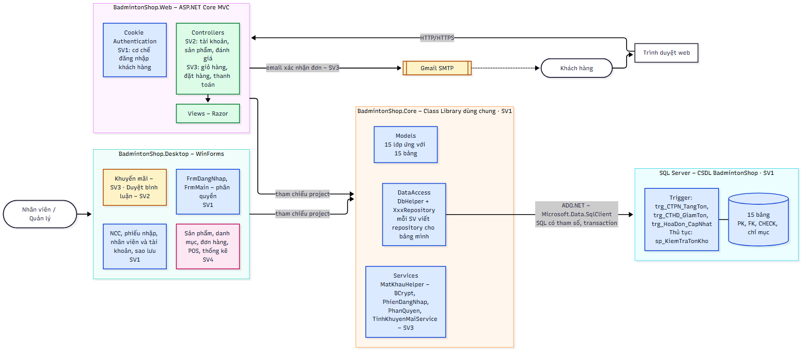
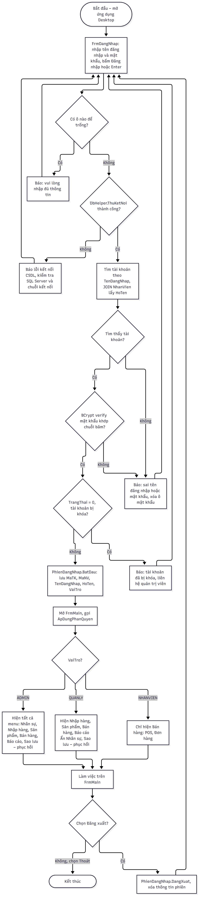
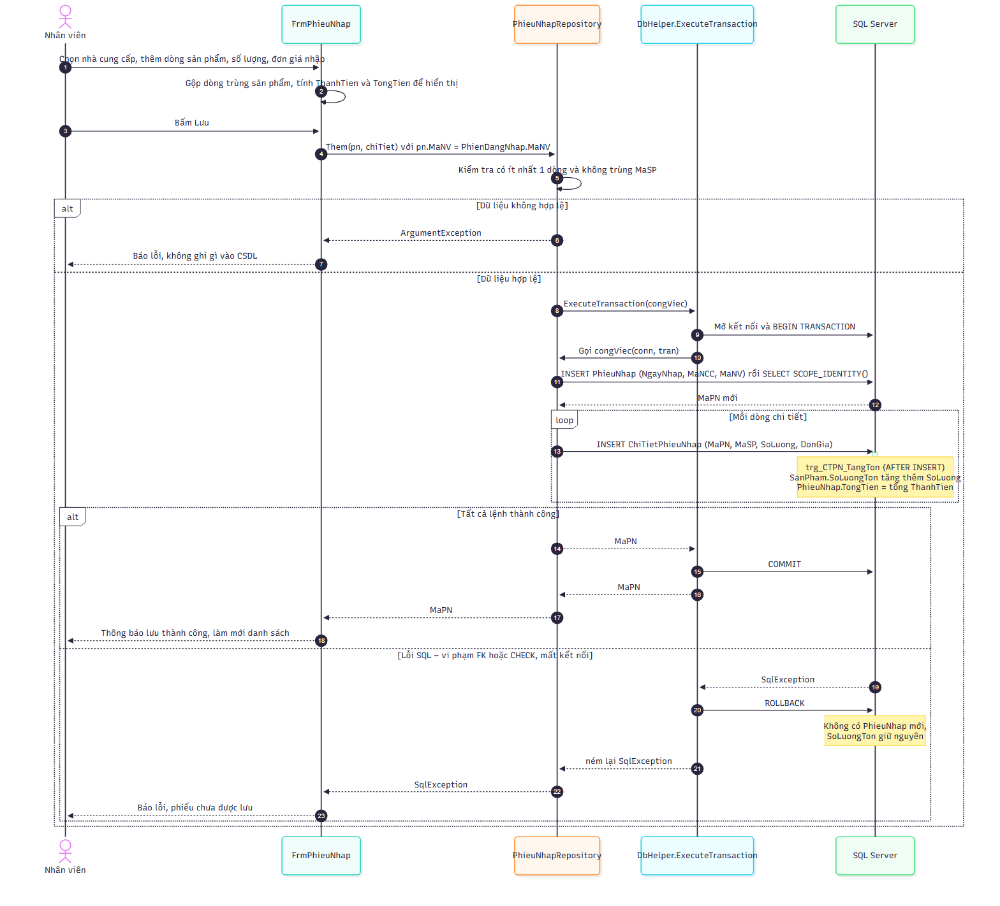
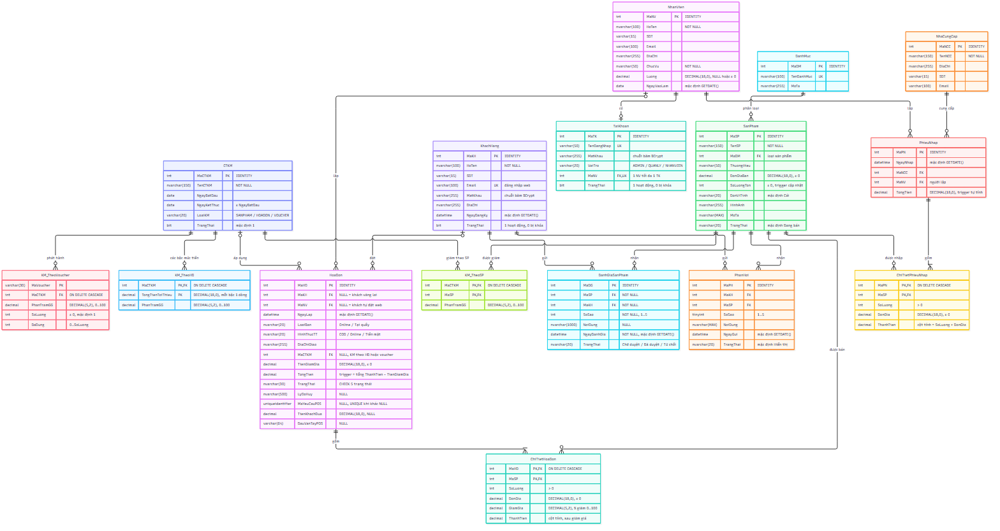

# KIẾN TRÚC HỆ THỐNG

> Người viết: SV1. Bản Word để ghép báo cáo: [`chuong-kien-truc.docx`](chuong-kien-truc.docx), được sinh từ file này bằng `node tools/XuatBaoCao/xuat-docx.js`.
> Quy ước trong lược đồ quan hệ: khóa chính <ins>gạch chân</ins>, khóa ngoại _in nghiêng_.

## 1. Tổng quan kiến trúc

Hệ thống bán đồ thể thao cầu lông BadmintonShop gồm hai ứng dụng phục vụ hai nhóm người dùng khác nhau:

- **Ứng dụng web BadmintonShop.Web** (ASP.NET Core MVC, .NET 8) dành cho khách hàng: xem và tìm kiếm sản phẩm, đăng ký và đăng nhập, giỏ hàng, đặt hàng, thanh toán, đánh giá sản phẩm.
- **Ứng dụng desktop BadmintonShop.Desktop** (Windows Forms, .NET 8) dành cho nhân viên và quản lý cửa hàng: quản lý sản phẩm, nhập hàng, xử lý đơn hàng, bán tại quầy (POS), khuyến mãi, nhân sự, thống kê và sao lưu dữ liệu.

Hai ứng dụng không truy cập cơ sở dữ liệu trực tiếp mà cùng tham chiếu một **thư viện lớp dùng chung BadmintonShop.Core**. Thư viện này chứa các lớp thực thể, lớp truy xuất dữ liệu và các dịch vụ nghiệp vụ, và là nơi duy nhất làm việc với **một cơ sở dữ liệu SQL Server**. Nhờ vậy, một đơn hàng đặt trên web sẽ hiện ngay trên màn hình quản lý đơn của desktop, và tồn kho luôn là một con số thống nhất cho cả hai phía.

## 2. Các thành phần của hệ thống

| Thành phần | Công nghệ | Trách nhiệm chính | Phụ trách |
|---|---|---|---|
| BadmintonShop.Web | ASP.NET Core MVC, Razor, Cookie Authentication | Giao diện cho khách hàng; nhận yêu cầu HTTP, gọi Core, trả về trang HTML | SV2, SV3 (cơ chế đăng nhập: SV1) |
| BadmintonShop.Desktop | Windows Forms | Giao diện cho nhân viên; đăng nhập và phân quyền theo vai trò | SV1, SV4 (khuyến mãi: SV3; duyệt bình luận: SV2) |
| BadmintonShop.Core | Class Library .NET 8, ADO.NET (Microsoft.Data.SqlClient), BCrypt.Net-Next | Models, DataAccess (DbHelper và các Repository), Services (mật khẩu, phiên đăng nhập, phân quyền, khuyến mãi) | SV1 (mỗi thành viên viết Repository cho bảng mình) |
| CSDL BadmintonShop | SQL Server 2022 (máy phát triển có thể dùng LocalDB) | 15 bảng với khóa chính, khóa ngoại, CHECK, chỉ mục; trigger cập nhật tồn kho và tổng tiền | SV1 |
| Dịch vụ email | Gmail SMTP | Gửi email xác nhận đơn hàng cho khách | SV3 |

### 2.1. Thư viện dùng chung BadmintonShop.Core

Thư viện được chia thành ba thư mục, ứng với ba trách nhiệm:

- **Models**: 15 lớp thực thể, mỗi lớp ứng với một bảng, tên thuộc tính trùng tên cột (ví dụ `SanPham`, `HoaDon`, `PhieuNhap`). Các lớp này chỉ chứa dữ liệu, không chứa logic.
- **DataAccess**: lớp tĩnh `DbHelper` gói việc mở kết nối, chạy câu lệnh có tham số (`ExecuteQuery`, `ExecuteNonQuery`, `ExecuteScalar`) và chạy nhiều câu lệnh trong một giao tác (`ExecuteTransaction`). Mỗi bảng có một lớp `XxxRepository` (ví dụ `NhaCungCapRepository`, `PhieuNhapRepository`) cung cấp các hàm đọc/ghi như `LayTatCa`, `LayTheoMa`, `Them`, `Sua`, `Xoa`.
- **Services**: các xử lý nghiệp vụ không gắn với một bảng cụ thể, gồm `MatKhauHelper` (băm và kiểm tra mật khẩu bằng BCrypt), `PhienDangNhap` (lưu người đang đăng nhập trên desktop), `PhanQuyen` (bảng quyền theo vai trò), `KiemTraDuLieu` (kiểm tra số điện thoại, email) và `TinhKhuyenMaiService` (tính giảm giá).

Chuỗi kết nối không viết cứng trong mã: ứng dụng đọc biến môi trường `ConnectionStrings__BadmintonShop` nếu có, nếu không thì đọc từ `appsettings.json` (web) hoặc `App.config` (desktop), rồi gán cho `DbHelper.ConnectionString` một lần khi khởi động. Mỗi máy tự đặt chuỗi kết nối của mình mà không phải sửa file trong kho mã.

## 3. Mô hình phân lớp

Mỗi ứng dụng được tổ chức theo mô hình nhiều lớp. Lớp trên chỉ gọi lớp ngay dưới nó:

| Lớp | Web | Desktop | Nhiệm vụ |
|---|---|---|---|
| Giao diện | Views (Razor) + Controllers | Các Form (`FrmPhieuNhap`, `FrmNhanVien`…) | Hiển thị, nhận dữ liệu nhập, kiểm tra định dạng, báo lỗi cho người dùng |
| Nghiệp vụ | Core/Services | Core/Services | Quy tắc nghiệp vụ dùng chung: mật khẩu, phân quyền, khuyến mãi |
| Truy xuất dữ liệu | Core/DataAccess | Core/DataAccess | Câu lệnh SQL có tham số, giao tác, chuyển dòng dữ liệu thành đối tượng Model |
| Dữ liệu | SQL Server | SQL Server | Lưu trữ; ràng buộc toàn vẹn; trigger cập nhật tồn kho và tổng tiền |

Quy ước bắt buộc của nhóm: **không viết câu lệnh SQL trong Controller hay Form**. Mọi truy cập dữ liệu đi qua Repository trong Core. Khi duyệt Pull Request, nhóm trưởng kiểm tra quy ước này trước khi gộp mã.

## 4. Lý do tách thư viện dùng chung

- **Viết một lần, hai ứng dụng cùng dùng.** Ví dụ `SanPhamRepository.LayTheoMa` được cả trang chi tiết sản phẩm trên web lẫn màn hình POS trên desktop gọi. Sửa câu truy vấn ở một chỗ thì cả hai ứng dụng cùng được sửa.
- **Tránh lệch logic giữa hai ứng dụng.** Việc băm mật khẩu, tính khuyến mãi, lưu hóa đơn trong giao tác chỉ có một bản cài đặt. Không xảy ra tình trạng web tính giảm giá một kiểu còn desktop tính một kiểu.
- **Dễ phân công và làm song song.** Mỗi thành viên viết Repository cho các bảng mình phụ trách. Giao diện web và desktop được phát triển độc lập trên cùng một nền đã chốt từ tuần đầu.
- **Dễ kiểm thử.** Thư viện Core không phụ thuộc giao diện nên có thể kiểm thử bằng một chương trình console nhỏ chạy trên CSDL thật, không cần mở form hay trình duyệt.
- **Ràng buộc quan trọng đặt ở CSDL.** Khóa ngoại, CHECK và trigger tồn kho nằm trong SQL Server, nên dù dữ liệu đến từ ứng dụng nào cũng không thể bán quá tồn kho hay làm sai tổng tiền.

## 5. Một số luồng xử lý tiêu biểu

### 5.1. Đăng nhập và phân quyền trên desktop

Khi mở ứng dụng desktop, `FrmDangNhap` kiểm tra kết nối CSDL trước (`DbHelper.ThuKetNoi`) để báo lỗi rõ ràng nếu máy chủ chưa chạy. Sau đó `TaiKhoanRepository.DangNhap` tìm tài khoản theo tên đăng nhập, so mật khẩu bằng BCrypt và chặn tài khoản đã bị khóa. Đăng nhập thành công thì thông tin người dùng được lưu vào `PhienDangNhap`. `FrmMain` dựa vào vai trò để ẩn hoặc hiện từng nhóm menu theo bảng dưới đây. Khi người dùng đăng xuất, phiên bị xóa và ứng dụng quay về màn hình đăng nhập.

| Chức năng | ADMIN | QUANLY | NHANVIEN |
|---|:-:|:-:|:-:|
| Nhân viên và tài khoản | ✔ | | |
| Nhà cung cấp, phiếu nhập | ✔ | ✔ | |
| Sản phẩm, danh mục, khuyến mãi | ✔ | ✔ | |
| Đơn hàng, bán tại quầy (POS) | ✔ | ✔ | ✔ |
| Thống kê – báo cáo, duyệt bình luận | ✔ | ✔ | |
| Sao lưu – phục hồi CSDL | ✔ | | |

Trên web, khách hàng đăng nhập bằng email và mật khẩu. Hệ thống dùng **Cookie Authentication** của ASP.NET Core: sau khi đăng nhập, cookie chứa các claim `MaKH`, họ tên và email, có hạn 7 ngày và tự gia hạn khi khách còn hoạt động. Các trang cần đăng nhập (giỏ hàng, đặt hàng, hồ sơ) được đánh dấu `[Authorize]`. Ở mỗi yêu cầu, hệ thống kiểm tra lại trạng thái tài khoản, nên khách bị khóa giữa chừng sẽ bị đăng xuất ngay ở yêu cầu kế tiếp.

### 5.2. Lập phiếu nhập và cập nhật tồn kho

Nhân viên chọn nhà cung cấp và thêm các dòng sản phẩm trên `FrmPhieuNhap`; thành tiền và tổng tiền được tính ngay trên form. Khi lưu, `PhieuNhapRepository.Them` ghi phiếu nhập rồi ghi từng dòng chi tiết **trong cùng một giao tác**. Mỗi lần thêm chi tiết, trigger `trg_CTPN_TangTon` tự cộng số lượng vào tồn kho của sản phẩm và tính lại tổng tiền của phiếu. Nếu bất kỳ dòng nào lỗi, toàn bộ giao tác bị hoàn tác: không có phiếu "lưu một nửa" và tồn kho giữ nguyên.

Luồng bán hàng làm theo cách tương tự nhưng theo chiều ngược lại. Trigger `trg_CTHD_GiamTon` trừ tồn kho khi thêm chi tiết hóa đơn và báo lỗi nếu không đủ hàng. Trigger `trg_HoaDon_CapNhat` trả hàng về kho khi đơn chuyển sang trạng thái "Đã hủy". Thủ tục `sp_KiemTraTonKho` cho phép kiểm tra tồn trước khi đặt hàng.

## 6. Bảo mật và toàn vẹn dữ liệu

- **Mật khẩu không lưu dạng thô.** Mật khẩu nhân viên và khách hàng được băm bằng BCrypt (work factor 11) trước khi lưu. Hệ thống yêu cầu mật khẩu mạnh: tối thiểu 8 ký tự, có chữ hoa, chữ thường và chữ số. Khi quản trị viên đặt lại mật khẩu, hệ thống sinh ngẫu nhiên một mật khẩu mới và chỉ hiển thị một lần.
- **Chống SQL Injection.** Mọi câu lệnh đều dùng tham số (`SqlParameter`), không ghép chuỗi dữ liệu người dùng vào câu SQL.
- **Phân quyền theo vai trò.** Có 3 vai trò ADMIN, QUANLY, NHANVIEN. Quản trị viên không thể tự khóa hoặc tự hạ quyền của chính mình, để hệ thống luôn còn người quản trị.
- **Giao tác.** Các nghiệp vụ ghi nhiều bảng (phiếu nhập và chi tiết, hóa đơn và chi tiết) chạy trong một giao tác.
- **Ràng buộc ở CSDL.** Khóa ngoại chặn xóa dữ liệu đang được tham chiếu, ví dụ không xóa được nhà cung cấp đã có phiếu nhập. CHECK chặn số lượng âm và trạng thái đơn không hợp lệ. Cột thành tiền là cột tính toán nên không thể ghi sai.
- **Sao lưu – phục hồi.** Quản trị viên sao lưu CSDL ra file `.bak` và phục hồi khi cần ngay từ ứng dụng desktop.

## 7. Thiết kế cơ sở dữ liệu

### 7.1. Sơ đồ thực thể – liên kết (ERD)

CSDL gồm 15 bảng, chia thành 5 nhóm: nhân sự và tài khoản; danh mục, sản phẩm, nhà cung cấp, khách hàng; nhập hàng; khuyến mãi; bán hàng và phản hồi. Khóa chính đơn đều là số nguyên tự tăng (`INT IDENTITY`). Hai bảng chi tiết dùng khóa chính ghép gồm mã phiếu (hoặc mã hóa đơn) và mã sản phẩm, nên một sản phẩm chỉ xuất hiện một lần trong mỗi phiếu.

### 7.2. Lược đồ quan hệ

Quy ước: khóa chính <ins>gạch chân</ins>, khóa ngoại _in nghiêng_; cột vừa là khóa chính vừa là khóa ngoại thì <ins>_gạch chân và in nghiêng_</ins>.

1. NhanVien(<ins>MaNV</ins>, HoTen, SDT, Email, DiaChi, ChucVu, Luong, NgayVaoLam)
2. TaiKhoan(<ins>MaTK</ins>, TenDangNhap, MatKhau, VaiTro, _MaNV_, TrangThai)
3. DanhMuc(<ins>MaDM</ins>, TenDanhMuc, MoTa)
4. NhaCungCap(<ins>MaNCC</ins>, TenNCC, DiaChi, SDT, Email)
5. SanPham(<ins>MaSP</ins>, TenSP, _MaDM_, ThuongHieu, DonGiaBan, SoLuongTon, DonViTinh, HinhAnh, MoTa, TrangThai)
6. KhachHang(<ins>MaKH</ins>, HoTen, SDT, Email, MatKhau, DiaChi, NgayDangKy, TrangThai)
7. PhieuNhap(<ins>MaPN</ins>, NgayNhap, _MaNCC_, _MaNV_, TongTien)
8. ChiTietPhieuNhap(<ins>_MaPN_</ins>, <ins>_MaSP_</ins>, SoLuong, DonGia, ThanhTien)
9. CTKM(<ins>MaCTKM</ins>, TenCTKM, NgayBatDau, NgayKetThuc, LoaiKM, TrangThai)
10. KM_TheoSP(<ins>_MaCTKM_</ins>, <ins>_MaSP_</ins>, PhanTramGG)
11. KM_TheoHD(<ins>_MaCTKM_</ins>, <ins>TongTienToiThieu</ins>, PhanTramGG)
12. KM_TheoVoucher(<ins>MaVoucher</ins>, _MaCTKM_, PhanTramGG, SoLuong, DaDung)
13. HoaDon(<ins>MaHD</ins>, _MaKH_, _MaNV_, NgayLap, LoaiBan, HinhThucTT, DiaChiGiao, _MaCTKM_, TienGiamGia, TongTien, TrangThai)
14. ChiTietHoaDon(<ins>_MaHD_</ins>, <ins>_MaSP_</ins>, SoLuong, DonGia, GiamGia, ThanhTien)
15. PhanHoi(<ins>MaPH</ins>, _MaKH_, _MaSP_, SoSao, NoiDung, NgayGui, TrangThai)

### 7.3. Các ràng buộc khóa ngoại

| Bảng con | Khóa ngoại | Tham chiếu | Cho phép NULL | Khi xóa bản ghi cha |
|---|---|---|:-:|---|
| TaiKhoan | MaNV (duy nhất) | NhanVien | Không | Chặn |
| SanPham | MaDM | DanhMuc | Không | Chặn |
| PhieuNhap | MaNCC | NhaCungCap | Không | Chặn |
| PhieuNhap | MaNV | NhanVien | Không | Chặn |
| ChiTietPhieuNhap | MaPN | PhieuNhap | Không | Xóa theo |
| ChiTietPhieuNhap | MaSP | SanPham | Không | Chặn |
| KM_TheoSP | MaCTKM | CTKM | Không | Xóa theo |
| KM_TheoSP | MaSP | SanPham | Không | Chặn |
| KM_TheoHD | MaCTKM | CTKM | Không | Xóa theo |
| KM_TheoVoucher | MaCTKM | CTKM | Không | Xóa theo |
| HoaDon | MaKH | KhachHang | Có (khách vãng lai tại quầy) | Chặn |
| HoaDon | MaNV | NhanVien | Có (khách tự đặt trên web) | Chặn |
| HoaDon | MaCTKM | CTKM | Có (không áp khuyến mãi hóa đơn) | Chặn |
| ChiTietHoaDon | MaHD | HoaDon | Không | Xóa theo |
| ChiTietHoaDon | MaSP | SanPham | Không | Chặn |
| PhanHoi | MaKH | KhachHang | Không | Chặn |
| PhanHoi | MaSP | SanPham | Không | Chặn |

Bảng mô tả chi tiết từng cột (kiểu dữ liệu, ràng buộc, ý nghĩa) của cả 15 bảng được trình bày ở phần Mô tả cơ sở dữ liệu.
