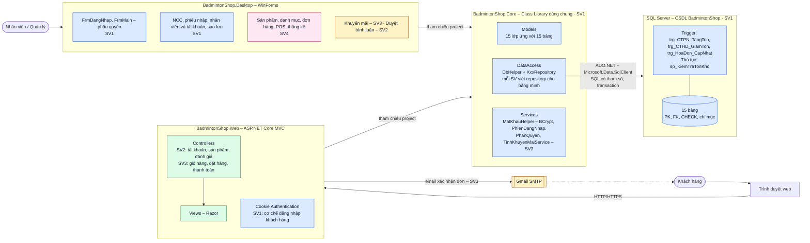

# Sơ đồ kiến trúc hệ thống

Hệ thống gồm hai ứng dụng: **BadmintonShop.Web** (ASP.NET Core MVC) cho khách hàng mua hàng qua trình duyệt và **BadmintonShop.Desktop** (WinForms) cho nhân viên/quản lý vận hành cửa hàng.
Cả hai không tự viết SQL mà cùng tham chiếu thư viện **BadmintonShop.Core** (Models, DataAccess/Repository, Services), thư viện này truy cập **một CSDL SQL Server duy nhất** bằng ADO.NET.
Tồn kho và tổng tiền do **trigger** trong CSDL cập nhật, nên dù đơn đến từ web hay từ POS thì số liệu vẫn đúng.
Web gửi email xác nhận đơn hàng qua **Gmail SMTP**.

**Chú thích màu:** xanh dương = SV1 · xanh lá = SV2/SV3 (Web) · vàng = SV3 · hồng = SV4.

## Vì sao tách thư viện dùng chung BadmintonShop.Core?

- **Viết SQL một lần, hai ứng dụng cùng dùng.** Ví dụ `SanPhamRepository.LayTheoMa` được cả trang chi tiết sản phẩm trên web lẫn màn hình POS trên desktop gọi; sửa câu truy vấn ở một chỗ thì cả hai cùng được sửa.
- **Logic nghiệp vụ không lệch nhau.** Băm/kiểm mật khẩu (`MatKhauHelper`), tính khuyến mãi (`TinhKhuyenMaiService`), lưu hóa đơn trong transaction… chỉ có một bản cài đặt, tránh tình trạng web tính một kiểu, desktop tính một kiểu.
- **Tách lớp rõ ràng, dễ phân công và dễ kiểm thử.** Controller/Form chỉ lo giao diện, không chứa SQL; mỗi thành viên viết `XxxRepository` cho bảng mình phụ trách và có thể kiểm thử Core độc lập với giao diện.
- **Ràng buộc quan trọng đặt ở CSDL** (khóa, CHECK, trigger tồn kho), nên dù dữ liệu đến từ ứng dụng nào cũng không thể bán quá tồn hay làm sai tổng tiền.
