# Sơ đồ thực thể – liên kết (ERD)

Sơ đồ dưới đây vẽ theo `database/01_CreateDatabase.sql`, bổ sung bảng đánh giá từ `database/07_SV2_DanhGiaSanPham.sql` và các cột mở rộng của `HoaDon` trong `database/BadmintonShop.sql`: đủ 16 bảng, đúng tên cột và kiểu dữ liệu, đánh dấu khóa chính (PK), khóa ngoại (FK), cột duy nhất (UK).
Các khóa chính đơn đều là `INT IDENTITY(1,1)` (tự tăng); `ThanhTien` ở hai bảng chi tiết là **cột tính** (`PERSISTED`).
Bội số quan hệ đọc theo ký hiệu Mermaid: `||--o{` một – nhiều (0..n), `||--|{` một – nhiều (1..n), `||--o|` một – không hoặc một, `|o--o{` FK cho phép NULL (0..1 – nhiều).

```mermaid
erDiagram
    NhanVien {
        int MaNV PK "IDENTITY"
        nvarchar(100) HoTen "NOT NULL"
        varchar(15) SDT
        varchar(100) Email
        nvarchar(255) DiaChi
        nvarchar(50) ChucVu "NOT NULL"
        decimal Luong "DECIMAL(18,0), NULL hoặc ≥ 0"
        date NgayVaoLam "mặc định GETDATE()"
    }
    TaiKhoan {
        int MaTK PK "IDENTITY"
        varchar(50) TenDangNhap UK
        varchar(255) MatKhau "chuỗi băm BCrypt"
        varchar(20) VaiTro "ADMIN / QUANLY / NHANVIEN"
        int MaNV FK, UK "1 NV tối đa 1 TK"
        bit TrangThai "1 hoạt động, 0 bị khóa"
    }
    NhaCungCap {
        int MaNCC PK "IDENTITY"
        nvarchar(150) TenNCC "NOT NULL"
        nvarchar(255) DiaChi
        varchar(15) SDT
        varchar(100) Email
    }
    DanhMuc {
        int MaDM PK "IDENTITY"
        nvarchar(100) TenDanhMuc UK
        nvarchar(255) MoTa
    }
    SanPham {
        int MaSP PK "IDENTITY"
        nvarchar(150) TenSP "NOT NULL"
        int MaDM FK "loại sản phẩm"
        nvarchar(50) ThuongHieu
        decimal DonGiaBan "DECIMAL(18,0), ≥ 0"
        int SoLuongTon "≥ 0, trigger cập nhật"
        nvarchar(20) DonViTinh "mặc định Cái"
        nvarchar(255) HinhAnh
        nvarchar(MAX) MoTa
        nvarchar(20) TrangThai "mặc định Đang bán"
    }
    KhachHang {
        int MaKH PK "IDENTITY"
        nvarchar(100) HoTen "NOT NULL"
        varchar(15) SDT
        varchar(100) Email UK "đăng nhập web"
        varchar(255) MatKhau "chuỗi băm BCrypt"
        nvarchar(255) DiaChi
        datetime NgayDangKy "mặc định GETDATE()"
        bit TrangThai "1 hoạt động, 0 bị khóa"
    }
    PhieuNhap {
        int MaPN PK "IDENTITY"
        datetime NgayNhap "mặc định GETDATE()"
        int MaNCC FK
        int MaNV FK "người lập"
        decimal TongTien "DECIMAL(18,0), trigger tự tính"
    }
    ChiTietPhieuNhap {
        int MaPN PK, FK "ON DELETE CASCADE"
        int MaSP PK, FK
        int SoLuong "> 0"
        decimal DonGia "DECIMAL(18,0), ≥ 0"
        decimal ThanhTien "cột tính = SoLuong × DonGia"
    }
    CTKM {
        int MaCTKM PK "IDENTITY"
        nvarchar(150) TenCTKM "NOT NULL"
        date NgayBatDau
        date NgayKetThuc "≥ NgayBatDau"
        varchar(20) LoaiKM "SANPHAM / HOADON / VOUCHER"
        bit TrangThai "mặc định 1"
    }
    KM_TheoSP {
        int MaCTKM PK, FK "ON DELETE CASCADE"
        int MaSP PK, FK
        decimal PhanTramGG "DECIMAL(5,2), 0..100"
    }
    KM_TheoHD {
        int MaCTKM PK, FK "ON DELETE CASCADE"
        decimal TongTienToiThieu PK "DECIMAL(18,0), mỗi bậc 1 dòng"
        decimal PhanTramGG "DECIMAL(5,2), 0..100"
    }
    KM_TheoVoucher {
        varchar(30) MaVoucher PK
        int MaCTKM FK "ON DELETE CASCADE"
        decimal PhanTramGG "DECIMAL(5,2), 0..100"
        int SoLuong "≥ 0, mặc định 1"
        int DaDung "0..SoLuong"
    }
    HoaDon {
        int MaHD PK "IDENTITY"
        int MaKH FK "NULL = khách vãng lai"
        int MaNV FK "NULL = khách tự đặt web"
        datetime NgayLap "mặc định GETDATE()"
        nvarchar(20) LoaiBan "Online / Tại quầy"
        nvarchar(20) HinhThucTT "COD / Online / Tiền mặt"
        nvarchar(255) DiaChiGiao
        int MaCTKM FK "NULL, KM theo HĐ hoặc voucher"
        decimal TienGiamGia "DECIMAL(18,0), ≥ 0"
        decimal TongTien "trigger = tổng ThanhTien − TienGiamGia"
        nvarchar(30) TrangThai "CHECK 5 trạng thái"
        nvarchar(500) LyDoHuy "NULL"
        uniqueidentifier MaYeuCauPOS "NULL, UNIQUE khi khác NULL"
        decimal TienKhachDua "DECIMAL(18,0), NULL"
        varchar(64) DauVanTayPOS "NULL"
    }
    ChiTietHoaDon {
        int MaHD PK, FK "ON DELETE CASCADE"
        int MaSP PK, FK
        int SoLuong "> 0"
        decimal DonGia "DECIMAL(18,0), ≥ 0"
        decimal GiamGia "DECIMAL(5,2), % giảm 0..100"
        decimal ThanhTien "cột tính, sau giảm giá"
    }
    PhanHoi {
        int MaPH PK "IDENTITY"
        int MaKH FK
        int MaSP FK
        tinyint SoSao "1..5"
        nvarchar(MAX) NoiDung
        datetime NgayGui "mặc định GETDATE()"
        nvarchar(20) TrangThai "mặc định Hiển thị"
    }

    DanhGiaSanPham {
        int MaDG PK "IDENTITY"
        int MaSP FK "NOT NULL"
        int MaKH FK "NOT NULL"
        int SoSao "NOT NULL, 1..5"
        nvarchar(1000) NoiDung "NULL"
        datetime NgayDanhGia "NOT NULL, mặc định GETDATE()"
        nvarchar(20) TrangThai "Chờ duyệt / Đã duyệt / Từ chối"
    }

    SanPham    ||--o{ DanhGiaSanPham  : "nhận"
    KhachHang  ||--o{ DanhGiaSanPham  : "gửi"
    NhanVien   ||--o| TaiKhoan         : "có"
    NhanVien   ||--o{ PhieuNhap        : "lập"
    NhaCungCap ||--o{ PhieuNhap        : "cung cấp"
    PhieuNhap  ||--|{ ChiTietPhieuNhap : "gồm"
    SanPham    ||--o{ ChiTietPhieuNhap : "được nhập"
    DanhMuc    ||--o{ SanPham          : "phân loại"
    KhachHang  |o--o{ HoaDon           : "đặt"
    NhanVien   |o--o{ HoaDon           : "lập"
    CTKM       |o--o{ HoaDon           : "áp dụng"
    HoaDon     ||--|{ ChiTietHoaDon    : "gồm"
    SanPham    ||--o{ ChiTietHoaDon    : "được bán"
    KhachHang  ||--o{ PhanHoi          : "gửi"
    SanPham    ||--o{ PhanHoi          : "nhận"
    CTKM       ||--o{ KM_TheoSP        : "giảm theo SP"
    SanPham    ||--o{ KM_TheoSP        : "được giảm"
    CTKM       ||--o{ KM_TheoHD        : "các bậc mức tiền"
    CTKM       ||--o{ KM_TheoVoucher   : "phát hành"
```

**Ghi chú về bội số**

- `NhanVien ||--o| TaiKhoan`: `TaiKhoan.MaNV` vừa là FK vừa `UNIQUE` và `NOT NULL` → mỗi tài khoản thuộc đúng 1 nhân viên, mỗi nhân viên có 0 hoặc 1 tài khoản.
- `HoaDon.MaKH`, `HoaDon.MaNV`, `HoaDon.MaCTKM` cho phép NULL → phía bảng cha là `|o` (0..1).
- `PhieuNhap ||--|{ ChiTietPhieuNhap` và `HoaDon ||--|{ ChiTietHoaDon` là quy tắc nghiệp vụ "mỗi phiếu/hóa đơn có ít nhất 1 dòng" – được kiểm trong code (`PhieuNhapRepository.Them`), CSDL bản thân không chặn phiếu rỗng.
- Các bảng `KM_TheoSP`, `KM_TheoHD`, `KM_TheoVoucher` là bảng con của `CTKM`, xóa CTKM thì dòng con bị xóa theo (`ON DELETE CASCADE`).

## So sánh "ERD vẽ tay" với CSDL thực tế

ERD vẽ tay là bản vẽ lại từ giấy (`ERD Shop Cầu Lông.md`, kiểu `string` cho mọi khóa). `docs/ERD.md` hiện đã được cập nhật thành **bản chốt khớp script**, nên bảng dưới so sánh bản vẽ tay với script `01_CreateDatabase.sql`.

| Bảng / mục | ERD vẽ tay | CSDL thực tế (script) | Ghi chú |
|---|---|---|---|
| Tất cả khóa chính | `string` | `INT IDENTITY(1,1)` | tự tăng, join nhanh, code đơn giản |
| Tên bảng KM | `KM_THEO_SP`, `KM_THEO_HD`, `KM_THEO_VOUCHER` | `KM_TheoSP`, `KM_TheoHD`, `KM_TheoVoucher` | chỉ đổi cách viết |
| TaiKhoan | 5 cột, `MaNV` chỉ là FK | thêm `TrangThai` (khóa TK); `TenDangNhap` UNIQUE; `MaNV` UNIQUE + NOT NULL; `VaiTro` CHECK 3 giá trị | khóa tài khoản, 1 NV – 1 TK |
| DanhMuc | `MaDM`, `TenDanhMuc` | thêm `MoTa`; `TenDanhMuc` UNIQUE | hiển thị trên web |
| SanPham | `DonGia` | đổi thành `DonGiaBan`; thêm `ThuongHieu`, `DonViTinh`, `MoTa`; `SoLuongTon` ≥ 0 | SV2 lọc theo thương hiệu, trang chi tiết |
| KhachHang | `NgayDangKy` kiểu date, `TrangThai` string | `NgayDangKy` DATETIME; `TrangThai` BIT; `Email` UNIQUE | đăng nhập web bằng email |
| ChiTietPhieuNhap | không có thành tiền | thêm `ThanhTien` là cột tính | |
| PhieuNhap / HoaDon / PhanHoi | ngày kiểu `date` | `NgayNhap`, `NgayLap`, `NgayGui` kiểu DATETIME | lưu cả giờ |
| HoaDon | `MaKH`, `MaNV` bắt buộc; có `TienGiamGia`, `MaCTKM` | `MaKH`, `MaNV` cho phép NULL; thêm `LoaiBan`, `HinhThucTT`, `DiaChiGiao`; `TrangThai` CHECK 5 giá trị | đơn online và POS dùng chung 1 bảng |
| ChiTietHoaDon | `ThanhTien` thường | thêm `GiamGia` (%); `ThanhTien` là cột tính | tránh lệch số liệu |
| PhanHoi | không có sao | thêm `SoSao` (1–5), `TrangThai` | đánh giá sao, duyệt bình luận |
| CTKM | `TrangThai` string, không có loại | thêm `LoaiKM` (SANPHAM / HOADON / VOUCHER); `TrangThai` BIT; CHECK `NgayKetThuc ≥ NgayBatDau` | lọc theo loại khuyến mãi |
| KM_TheoHD | 1 CTKM – 0..1 dòng; PK chỉ `MaCTKM` | 1 CTKM – nhiều bậc; PK `(MaCTKM, TongTienToiThieu)` | ví dụ ≥ 1 triệu giảm 5 %, ≥ 3 triệu giảm 10 % |
| KM_TheoVoucher | chỉ `PhanTramGG` | thêm `SoLuong`, `DaDung` (CHECK `DaDung ≤ SoLuong`) | giới hạn lượt dùng voucher |
| Phần trăm giảm | `float` | `DECIMAL(5,2)`, CHECK 0..100 | tránh sai số dấu phẩy động |
| Quan hệ NhanVien/KhachHang – HoaDon | `||--o{` | `|o--o{` | do FK cho phép NULL |
| Quan hệ CTKM – KM_TheoHD | `||--o|` | `||--o{` | nhiều bậc mức tiền |
