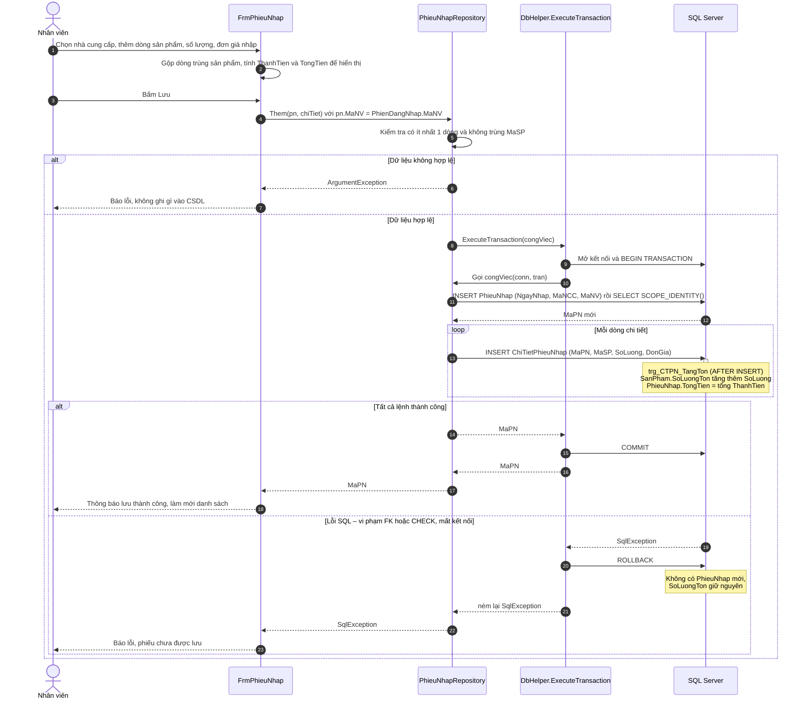

# Sơ đồ tuần tự – Lập phiếu nhập hàng (Desktop)

Nhân viên lập phiếu nhập trên `FrmPhieuNhap`; form tự tính thành tiền/tổng tiền để xem trước, rồi gọi `PhieuNhapRepository.Them`.
Repository ghi `PhieuNhap` và từng dòng `ChiTietPhieuNhap` trong **một transaction** thông qua `DbHelper.ExecuteTransaction`.
Code **không tự cộng tồn kho**: mỗi lần INSERT chi tiết, trigger `trg_CTPN_TangTon` tăng `SanPham.SoLuongTon` và tính lại `PhieuNhap.TongTien`.
Có lỗi ở bất kỳ bước nào thì toàn bộ bị rollback – không có phiếu "nửa vời", tồn kho giữ nguyên.

> Ghi chú: `FrmPhieuNhap` là form dự kiến của tuần 3 (ROADMAP 3.1); `PhieuNhapRepository.Them` và `DbHelper.ExecuteTransaction` đã có trong Core.
