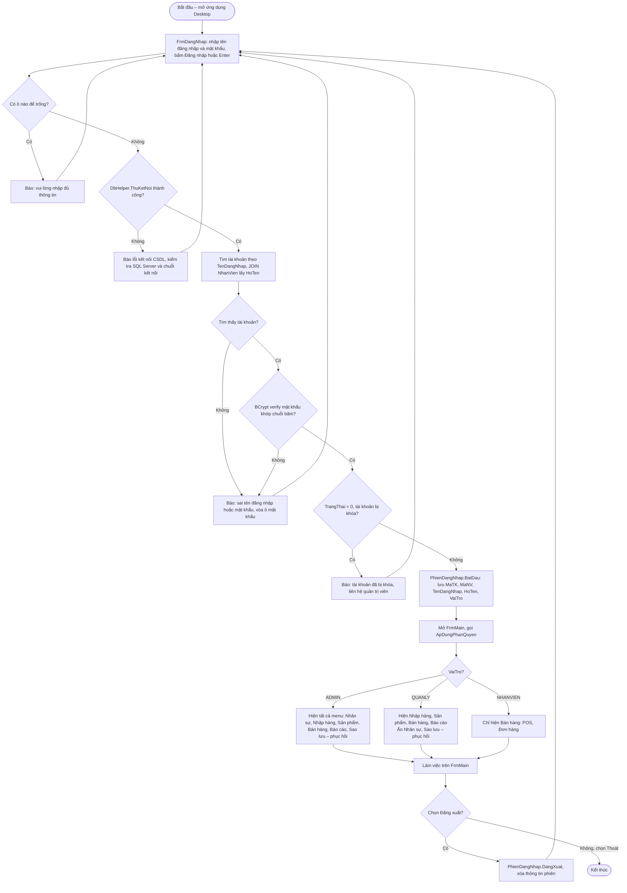

# Sơ đồ hoạt động – Đăng nhập Desktop

Nhân viên nhập tên đăng nhập và mật khẩu trên `FrmDangNhap`. Form kiểm tra ô trống, thử kết nối CSDL (`DbHelper.ThuKetNoi`), rồi gọi `TaiKhoanRepository.DangNhap`.
Mật khẩu được so bằng **BCrypt** với chuỗi băm trong CSDL; mật khẩu được kiểm **trước** trạng thái khóa để người nhập sai không dò được tài khoản nào đang bị khóa.
Đăng nhập thành công thì thông tin được lưu vào `PhienDangNhap`, mở `FrmMain` và `ApDungPhanQuyen()` ẩn/hiện menu theo vai trò (bảng quyền nằm trong `PhanQuyen.cs`).

**Bảng phân quyền áp dụng** (`Core/Services/PhanQuyen.cs`)

| Nhóm chức năng (menu) | ADMIN | QUANLY | NHANVIEN |
|---|:-:|:-:|:-:|
| Nhân viên & tài khoản | ✔ | | |
| Nhà cung cấp, phiếu nhập | ✔ | ✔ | |
| Sản phẩm, danh mục, khuyến mãi | ✔ | ✔ | |
| Đơn hàng, POS | ✔ | ✔ | ✔ |
| Thống kê – báo cáo, duyệt bình luận | ✔ | ✔ | |
| Sao lưu – phục hồi CSDL | ✔ | | |
