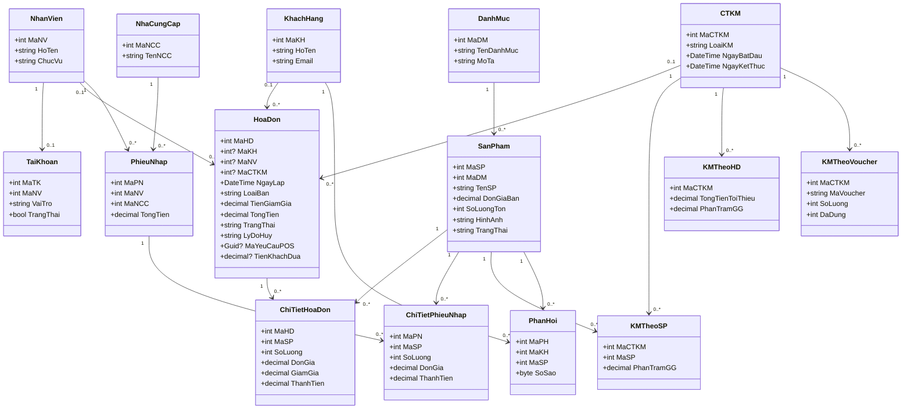
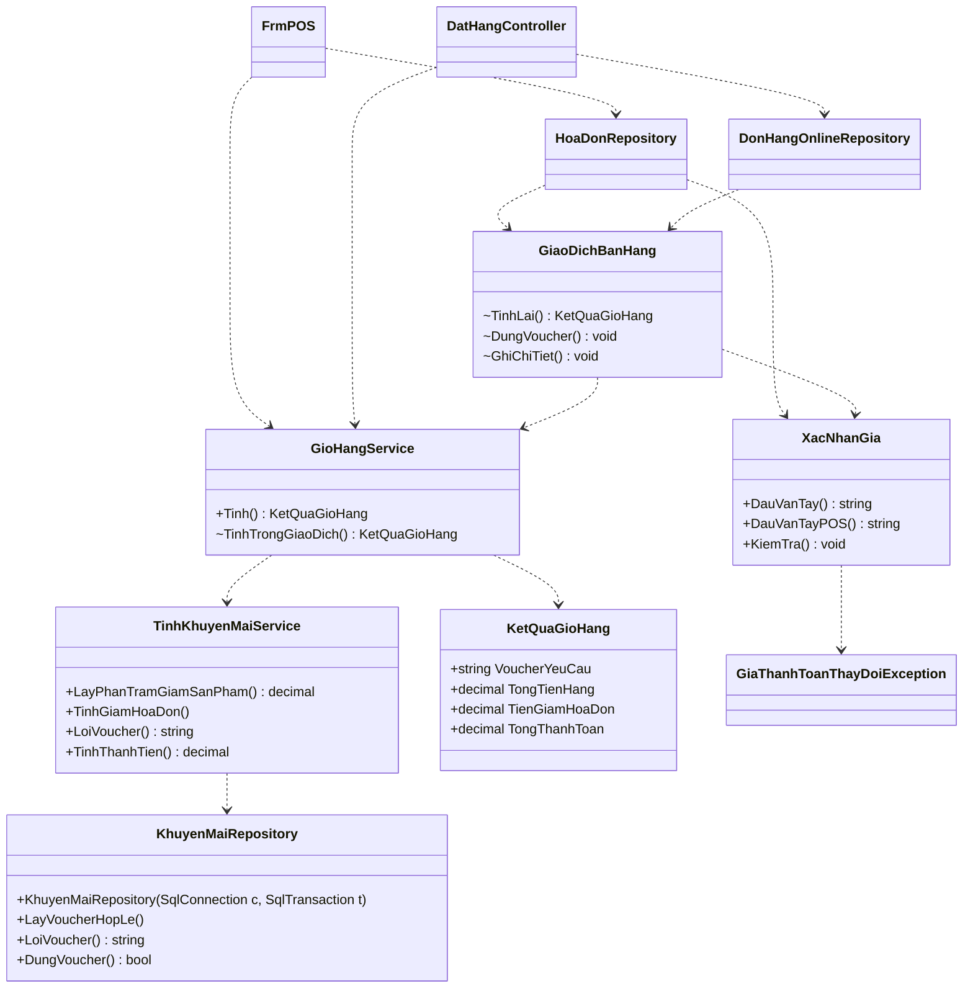

# Sơ đồ lớp Core và nghiệp vụ — SV4

Phản ánh mã nguồn nhánh `feature/sv4-final-integration` ngày 26/10/2026 (chưa commit, nền develop `920a576`). Ký hiệu: liên kết thực thể theo FK; dependency là lời gọi trong mã. Thuộc tính trình bày phần chính, không thay thế model đầy đủ.

## Các thực thể Core

Các model là POCO 1–1 với bảng, **không có navigation property/ORM**; các mũi tên trên là FK nghiệp vụ. ChiTietHoaDon.ThanhTien và ChiTietPhieuNhap.ThanhTien chỉ đọc về từ cột tính; HoaDon.TongTien và PhieuNhap.TongTien do trigger tính. CSDL cho phép hóa đơn chưa có chi tiết ở cấp lược đồ; thao tác ghi phải bảo đảm không để header rỗng sau lỗi.

## Repository, dịch vụ và giao diện

```mermaid
classDiagram
    class DbHelper {
        +string ConnectionString
        +TaoKetNoi() SqlConnection
        +ExecuteQuery() DataTable
        +ExecuteNonQuery() int
        +ExecuteScalar() object
        +ExecuteTransaction()
    }
    class DanhMucRepository {
        +LayTatCa() List~DanhMuc~
        +LayTheoMa(int maDM) DanhMuc
        +Luu(DanhMuc dm) int
        +Xoa(int maDM) void
    }
    class SanPhamRepository {
        +LayTatCa() List~SanPham~
        +LayTheoMa(int maSP) SanPham
        +LayDanhSachHienThi() DataTable
        +Luu(SanPham sp) int
        +NgungBan(int maSP) void
    }
    class HoaDonRepository {
        +LayDanhSachHienThi() DataTable
        +LayTheoMa(int ma) HoaDon
        +LayChiTietHienThi(int ma) DataTable
        +ChuyenTrangThai() void
        +ThanhToanPOS() int
    }
    class BaoCaoRepository {
        +LayDuLieu() DataTable
    }
    class BaoCaoService {
        +PhanBo() Dictionary
        +Tao() KetQuaBaoCao
    }
    class KetQuaBaoCao {
        +DateTime TuNgay
        +DateTime DenNgay
        +string LoaiBan
        +decimal TongDoanhThu
        +IReadOnlyDictionary Bang
    }
    class QuyTacBanHang {
        +int NguongSapHet
        +DuocChuyen() bool
        +BatBuoc() string
        +KiemTraTien() void
    }
    class KhoAnhSanPham {
        +string ThuMucGoc
        +DuongDanDayDu() string
    }
    class PhienDangNhap {
        +int MaNV
        +BatDau() void
        +DangXuat() void
        +CoQuyen() bool
    }
    class PhanQuyen {
        +CoQuyen() bool
    }
    class QuyenForm {
        +KiemTraKhiMo() bool
        +DuQuyen() bool
    }
    class Sv4Ui {
        +Chay() void
    }
    class FrmDanhMuc
    class FrmSanPham
    class FrmSanPhamSua
    class FrmDonHang
    class FrmPOS
    class FrmThongKe
    class DongPOS {
        +int MaSP
        +int SoLuong
        +decimal DonGia
        +decimal ThanhTien
    }
    class AnhSanPham {
        +Doc() Bitmap
        +Luu() string
    }
    class XuatTaiLieu {
        +Excel() void
        +BaoCaoPdf() void
        +HoaDonPdf() void
    }
    class BieuDoCot
    DanhMucRepository ..> DbHelper
    SanPhamRepository ..> DbHelper
    HoaDonRepository ..> DbHelper
    BaoCaoRepository ..> DbHelper
    DanhMucRepository ..> QuyTacBanHang
    SanPhamRepository ..> QuyTacBanHang
    SanPhamRepository ..> KhoAnhSanPham
    HoaDonRepository ..> QuyTacBanHang
    BaoCaoService ..> QuyTacBanHang
    BaoCaoService ..> KetQuaBaoCao
    PhienDangNhap ..> PhanQuyen
    QuyenForm ..> PhienDangNhap
    Sv4Ui ..> QuyenForm
    FrmDanhMuc ..> DanhMucRepository
    FrmSanPham ..> SanPhamRepository
    FrmSanPham ..> FrmSanPhamSua
    FrmSanPhamSua ..> SanPhamRepository
    FrmSanPhamSua ..> DanhMucRepository
    FrmSanPhamSua ..> AnhSanPham
    AnhSanPham ..> KhoAnhSanPham
    FrmDonHang ..> HoaDonRepository
    FrmDonHang ..> XuatTaiLieu
    FrmPOS ..> SanPhamRepository
    FrmPOS ..> HoaDonRepository
    FrmPOS ..> PhienDangNhap
    FrmPOS ..> DongPOS
    FrmPOS ..> XuatTaiLieu
    FrmThongKe ..> BaoCaoRepository
    FrmThongKe ..> BaoCaoService
    FrmThongKe ..> BieuDoCot
    FrmThongKe ..> XuatTaiLieu
    XuatTaiLieu ..> KetQuaBaoCao
```

Tất cả form SV4 gọi QuyenForm ở OnLoad và dùng Sv4Ui khi thực hiện thao tác CSDL; lược bỏ các cạnh lặp để dễ đọc. Các lớp NhaCungCapRepository, NhanVienRepository, TaiKhoanRepository, KhachHangRepository, PhieuNhapRepository, SaoLuuRepository (SV1) cũng truy cập DbHelper và model tương ứng; không bị thay thế bởi SV4.

Dịch vụ Core hiện có khác: MatKhauHelper, KiemTraDuLieu, LoiCsdl, VaiTro, ChucNang, KetQuaDangNhap. `TinhKhuyenMaiService` và `GioHangService` đã tính khuyến mãi thật dùng chung Web/POS; không còn service khung. Cột SQL `HoaDon.DauVanTayPOS` do repository ghi/đọc trực tiếp, chưa thêm property vào POCO HoaDon. `XuatTaiLieu`, `AnhSanPham`, `QuyenForm`, `BieuDoCot` nằm ở Desktop do phụ thuộc WinForms/GDI, không đưa vào Core đa nền tảng.

## Luồng thanh toán cuối cùng

GiaoDichBanHang internal chia sẻ điều kiện ghi, không thay ranh giới quyền: POS dùng MaNV/QuyenForm; web dùng Authorize/MaKH chủ đơn. KhuyenMaiRepository gắn connection/transaction để không đọc giá qua kết nối khác khi thanh toán. Trigger SV1 là nơi duy nhất sửa tồn và TongTien; không biểu diễn trigger như class C#.
